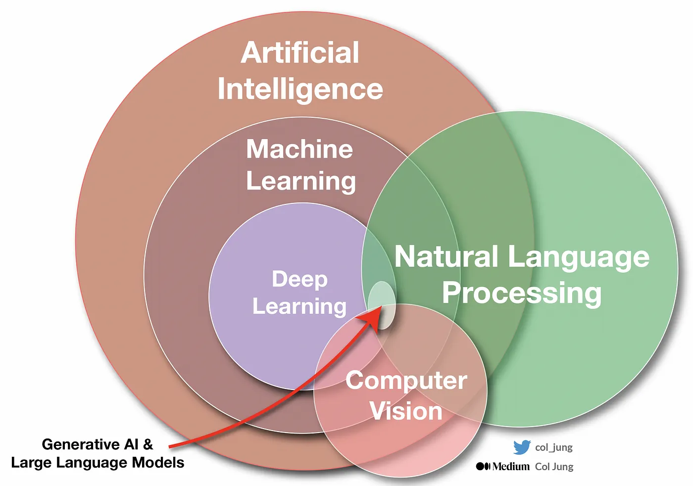

# 0.1 Konsep Dasar LLM

Dokumen ini menjelaskan fondasi dasar dari LLM (Large Language Model) dan mengapa ia memiliki keterbatasan yang krusial untuk dipahami sebelum masuk ke RAG.

---

## Apa yang Akan Anda Pelajari

- Apa itu LLM dan posisinya dalam hierarki kecerdasan buatan
- Cara kerja LLM secara sederhana
- Tiga kelemahan fatal LLM yang memotivasi lahirnya RAG

## 1. Apa itu LLM?

### Hierarki Kecerdasan Buatan (AI)
1.  **Artificial Intelligence (AI):** Lingkaran terluar. Teknik simulasi kecerdasan manusia, mulai dari logika sederhana hingga sistem adaptif.
2.  **Machine Learning (ML):** Bagian dari AI. Sistem yang **belajar pola dari data**, bukan diprogram dengan aturan eksplisit.
3.  **Deep Learning (DL):** Bagian dari ML. Menggunakan *Neural Networks* berlapis untuk memproses data kompleks (gambar, suara, teks) secara otomatis.
4.  **Generative AI & LLM:** Bagian spesifik dari DL. Fokus utamanya adalah memahami dan **menghasilkan (generate)** konten baru (seperti teks manusia).

**LLM (Large Language Model)** seperti GPT-4, Gemini, atau Claude pada dasarnya adalah "mesin prediksi teks" yang telah membaca hampir seluruh internet.

### Cara Kerja Sederhana
Bayangkan sebuah auto-complete di HP yang sangat cerdas. Jika diberi kalimat *"Ibukota Indonesia adalah..."*, ia memprediksi kata selanjutnya *"Jakarta"* berdasarkan pola statistik yang ia pelajari dari miliaran kalimat.
Namun, LLM modern tidak hanya memprediksi kata, tapi memiliki kemampuan **Reasoning (Penalaran)**, **Coding**, dan **Pemahaman Konteks** yang mendalam.

---

## 2. Kelemahan Fatal LLM

Meskipun pintar, LLM memiliki tiga kelemahan utama jika dipakai langsung di perusahaan:

1.  **Hallucination (Berhalusinasi):** Jika ia tidak tahu jawabannya, ia seringkali **mengarang bebas** dengan nada yang sangat meyakinkan. Ini berbahaya untuk data faktual.
2.  **Cutoff Knowledge:** Pengetahuannya berhenti di waktu terakhir ia dilatih. Ia tidak tahu berita hari ini atau harga saham detik ini.
3.  **No Private Context:** Gemini/GPT **tidak tahu** data internal perusahaan, SOP, laporan keuangan, ataupun dokumen rahasia lainnya.

Kelemahan inilah yang mendasari lahirnya teknik **RAG (Retrieval-Augmented Generation)**, yang akan dibahas di modul selanjutnya.

---

## Navigasi

| ← Sebelumnya | Selanjutnya → |
|:---|---:|
| [Daftar Isi](../README.md) | [0.2 Konsep Dasar RAG](0.2-konsep-dasar-rag.md) |
