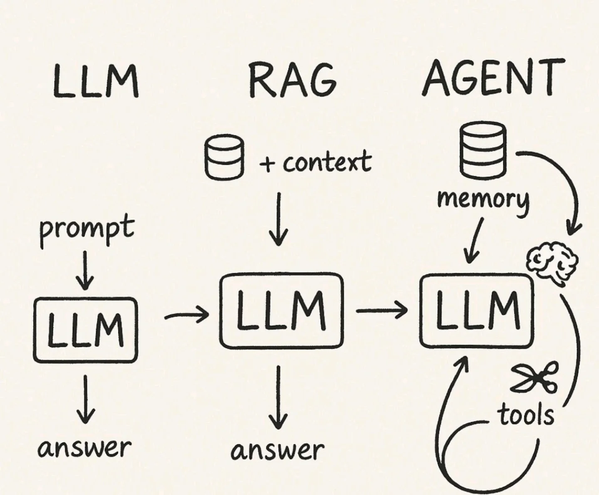
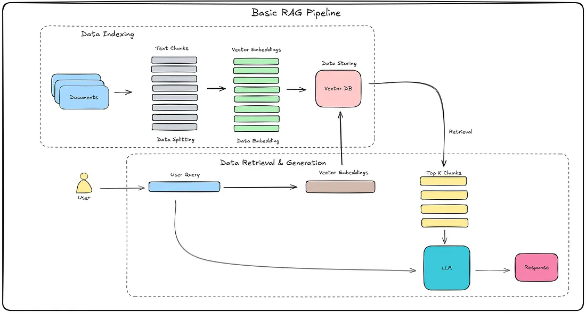
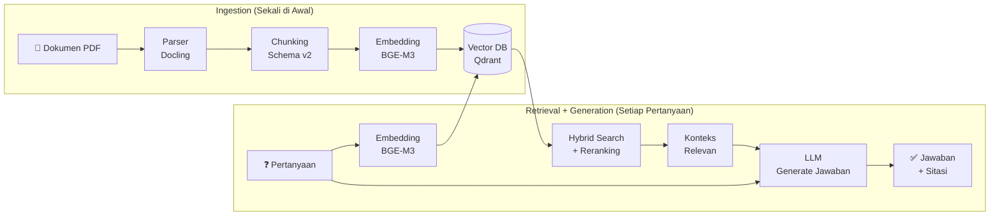

# 0.2 Konsep Dasar RAG & Workflow

Dokumen ini menjelaskan apa itu RAG dan bagaimana alur kerjanya secara konseptual.

---

## Apa yang Akan Anda Pelajari

- Apa itu RAG dan masalah apa yang dipecahkannya
- Tiga pilar utama: Ingestion, Retrieval, Generation
- Bagaimana data mengalir dari dokumen mentah hingga jawaban akhir

## 1. Apa itu RAG?

**RAG (Retrieval-Augmented Generation)** adalah metode arsitektur yang menggabungkan kemampuan bahasa LLM dengan **kebenaran data eksternal**.

### Masalah yang Diselesaikan
LLM seperti Gemini/GPT memiliki kelemahan:
1.  **Halusinasi:** Mengarang jawaban jika tidak tahu.
2.  **Buta Data Privat:** Tidak tahu dokumen internal perusahaan.

### Solusi RAG
Alih-alih menyuruh LLM menjawab dari ingatan lamanya, kita menyuruh sistem untuk:
1.  **Mencari (Retrieve)** dokumen terpercaya dari database kita.
2.  **Menyerahkan (Augment)** dokumen tersebut ke LLM sebagai "contekan".
3.  **Menjawab (Generate)** pertanyaan berdasarkan dokumen tersebut.

---

## 2. Arsitektur RAG: Tiga Pilar Utama

### Secara Sederhana: 2 Alur Berbeda
Bayangkan sistem ini memiliki **2 pekerjaan** yang terpisah, seperti di perpustakaan:

1.  **Menyimpan Data (Ingestion):** *Pekerjaan Pustakawan.*
    *   Tugas: Menata buku baru di rak agar rapi dan siap dicari.
    *   Waktu: Dilakukan **di awal**, sebelum ada yang bertanya.

2.  **Menyajikan Data (Retrieval & Generation):** *Pekerjaan Resepsionis.*
    *   Tugas: Mencari buku yang relevan saat ada pengunjung bertanya, lalu membacakannya.
    *   **Posisi Augment:** Terjadi di sini. Ini adalah momen saat Resepsionis **membuka buku** dan menunjukkannya ke pengunjung (LLM) sebagai referensi jawaban.
    *   Waktu: Dilakukan **saat itu juga**, ketika user bertanya.

### Alur Data End-to-End (Diagram)

---
Secara teknis, kedua alur tersebut diterjemahkan menjadi tiga tahap vital:

### Tahap 1: Ingestion (Memasukkan Data)
Ini adalah proses "belajar". Dokumen mentah diproses agar bisa dicari oleh mesin.
1.  **Parsing:** Mengubah PDF/Word menjadi teks bersih yang terstruktur.
2.  **Chunking:** Memecah dokumen panjang menjadi potongan-potongan kecil (paragraf) agar lebih mudah dikelola.
3.  **Embedding:** Mengubah teks potongan menjadi deretan angka (vektor) agar mesin bisa memahami maknanya.
4.  **Indexing:** Menyimpan vektor tersebut ke dalam database khusus.

### Tahap 2: Retrieval (Mencari Data)
Ini adalah proses saat pengguna bertanya.
1.  **Search:** Sistem mencari potongan dokumen yang paling relevan dengan pertanyaan user. Pencarian bisa berdasarkan kata kunci persis (*Keyword Search*) atau kesamaan makna (*Semantic Search*).
2.  **Ranking:** Hasil pencarian dinilai ulang untuk memastikan hanya dokumen terbaik yang diambil.

### Tahap 3: Generation (Menjawab)
Ini adalah proses akhir.
1.  **Synthesis (Augment):** Sistem menggabungkan pertanyaan user + dokumen yang ditemukan tadi menjadi satu instruksi lengkap.
2.  **Answering (Generate):** LLM membaca instruksi tersebut dan merangkai jawaban yang natural untuk pengguna.

---

Setelah memahami konsep alur ini, pertanyaan selanjutnya adalah: **"Alat apa saja yang kita pakai untuk melakukan tugas-tugas di atas?"**

Silakan lanjut ke folder **01-Komponen-Teknis** untuk membedah alat-alat (tools) secara spesifik.

---

## Navigasi

| ← Sebelumnya | Selanjutnya → |
|:---|---:|
| [0.1 Konsep Dasar LLM](0.1-konsep-dasar-llm.md) | [0.3 Glosarium](0.3-glosarium.md) |
