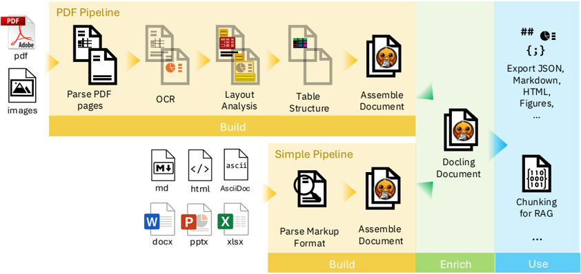
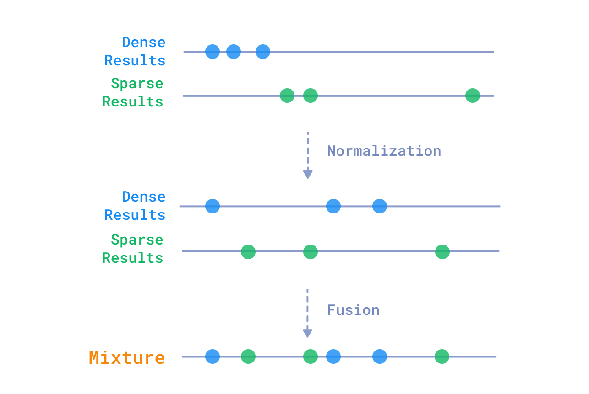
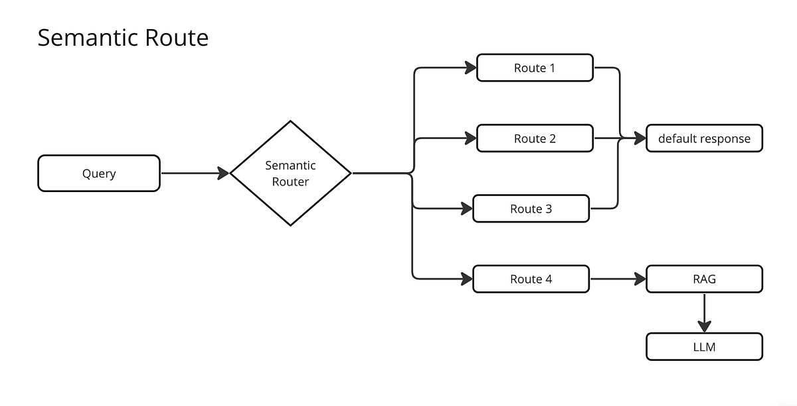
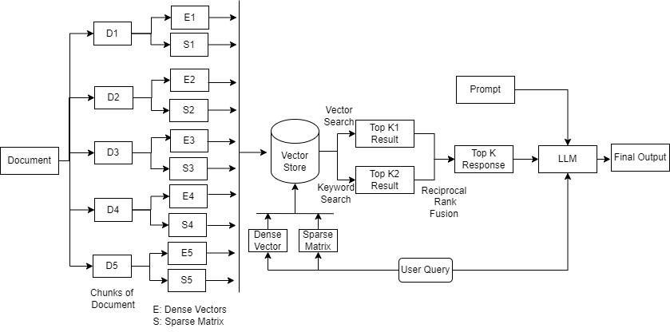

# 0.3 Komponen Teknis RAG

Setelah memahami konsep alur kerja RAG di modul **0.2**, di sini kita akan membedah **alat-alat spesifik (Tools)** yang digunakan untuk menjalankan setiap tahap tersebut.

---

## Daftar Isi

- [1. Alat Ingestion (Memasukkan Ke Mesin)](#1-alat-ingestion-memasukkan-ke-mesin)
    - [A. Parser: Docling (vs PyPDF)](#a-parser-docling-vs-pypdf)
    - [B. Chunking Strategy: Schema v2](#b-chunking-strategy-schema-v2)
    - [C. Enrichment: Vision AI & Contextual Retrieval](#c-enrichment-vision-ai--contextual-retrieval)
    - [D. Embedding: BAAI/bge-m3](#d-embedding-baaibge-m3)
    - [E. Database: Qdrant](#e-database-qdrant)
- [2. Alat Retrieval (Pencarian Cerdas)](#2-alat-retrieval-pencarian-cerdas)
    - [A. Pre-Retrieval: Intelligent Query Router](#a-pre-retrieval-intelligent-query-router)
    - [B. Orchestrator: LlamaIndex & Fusion](#b-orchestrator-llamaindex--fusion)
    - [C. Reranker: BAAI/bge-reranker-base](#c-reranker-baaibge-reranker-base)
- [3. Alat Generation (Otak Penjawab)](#3-alat-generation-otak-penjawab)
    - [A. Multi-Agent Pipeline](#a-multi-agent-pipeline)
    - [B. Citation Validation & Repair](#b-citation-validation--repair)

---

## 1. Alat Ingestion (Memasukkan Ke Mesin)

### A. Parser: Docling (vs PyPDF)
**Fungsi:** Mengubah PDF visual menjadi data logis (Markdown).

**Mengapa Docling?**
-   **Old Way (PyPDF/PyMuPDF):** Hanya mengekstrak teks berdasarkan koordinat. Sering gagal mengenali struktur visual seperti layout 2 kolom, tabel kompleks, atau caption gambar.
-   **New Way (Docling):** Menggunakan **Vision-Language Model (VLM)** kecil yang "melihat" halaman dokumen layaknya mata manusia.
    -   **Table Understanding:** Mampu mengenali baris dan kolom tabel dengan akurat, mengonversinya menjadi Format Markdown Table yang rapi.
    -   **Layout Analysis:** Membedakan antara Judul Bab, Sub-bab, Paragraf, Header, dan Footer.
    -   **OCR Capabilities:** Bisa membaca teks dari gambar atau scan dokumen yang tidak memiliki layer teks (searchable text).



### B. Chunking Strategy: Schema v2
**Fungsi:** Memecah dokumen panjang menjadi potongan-potongan kecil (chunks) agar muat di context window LLM.

Sistem menggunakan **Schema v2** yang jauh lebih canggih dari fixed-size splitting:

| Tipe Chunk | Penjelasan |
| :--- | :--- |
| **text** | Chunk teks biasa dari paragraf, heading, dan konten umum |
| **figure** | Chunk khusus untuk gambar/chart, dilengkapi deskripsi dari Vision AI |
| **table_parent** | Chunk tabel utuh (atomic, tidak dipecah per baris) agar konteks tabel tidak hilang |
| **table_anchor** | Chunk ringkas untuk retrieval recall — membantu tabel ditemukan saat pencarian |

**Mengapa Schema v2?**
-   **Fixed Size (Buruk):** Memotong kalimat secara brutal di tengah jalan (misal: "Ibu pergi ke pa..." | "...sar"). Konteks hilang. Tabel terpotong di tengah baris.
-   **Schema v2 (Baik):** Memecah berdasarkan semantik dan jenis konten.
    -   **Semantic Coherence:** Satu chunk berisi satu topik utuh.
    -   **Table Preservation:** Tabel disimpan utuh sebagai `table_parent`, tidak pernah dipotong per baris.
    -   **Retrieval Recall:** `table_anchor` dibuat khusus agar tabel besar tetap bisa ditemukan lewat pencarian.

**Konfigurasi Default:**
-   Chunk Size: `1024 token`
-   Chunk Overlap: `200 token`
-   Max Table Anchors per Tabel: `6`

### C. Enrichment: Vision AI & Contextual Retrieval
**Fungsi:** Memperkaya chunks dengan informasi tambahan menggunakan AI.

#### Vision AI untuk Chart & Gambar
Gambar/chart dalam PDF dideskripsikan oleh **Vision AI** agar bisa dicari lewat teks.
-   **Sebelum:** Gambar grafik hanya berupa placeholder kosong, tidak bisa ditemukan saat search.
-   **Sesudah:** AI mendeskripsikan: *"Bar chart showing revenue growth from 2020-2023, with 15% increase in Q4 2023."*

**Pilihan Model Vision AI:**

| Model | Tipe | Kelebihan | Kekurangan |
| :--- | :--- | :--- | :--- |
| **Gemini Flash** | Cloud API | Cepat, akurat, context window besar | Butuh internet, data dikirim ke cloud |
| **Qwen 2.5 VL** | Local/Cloud | Privasi total, support multi-bahasa | Butuh GPU lokal |
| **Ollama (LLaVA/Moondream)** | Local | Ringan, mudah dijalankan via Ollama CLI | Akurasi lebih rendah dibanding cloud |

> **Catatan:** Model Vision AI bersifat **switchable** — bisa diganti melalui konfigurasi tanpa ubah kode.

#### Table Visual Interpretation
Untuk tabel SOP yang mengandung flow diagram (panah, simbol keputusan), sistem dapat menggunakan **Vision AI** untuk menginterpretasi semantik visual yang tidak bisa ditangkap oleh parsing teks biasa.

#### Contextual Retrieval
Menambahkan ringkasan **Metadata** atau "konteks global" di setiap chunk.

**Masalah "Lost in the Middle":**
Chunk yang hanya berbunyi *"Laba bersih naik 5% yoy"* sangat ambigu. Laba siapa? Tahun berapa? Di dokumen mana?

**Solusi:**
Menggunakan LLM untuk membuat ringkasan singkat dari dokumen induk, lalu menempelkannya ke setiap chunk.
-   **Sebelum:** _"Laba bersih naik 5% yoy"_
-   **Sesudah:** _"[Konteks: Laporan Keuangan Q3 2024 PT Mencari Cinta Sejati, Bab II: Kinerja Finansial] Laba bersih naik 5% yoy"_

<!-- TODO: Tambahkan ilustrasi chunking schema v2 -->

**Pilihan Model untuk Enrichment:**

| Model | Tipe | Kelebihan | Kekurangan |
| :--- | :--- | :--- | :--- |
| **Gemini Flash-Lite** | Cloud API | **Sangat Cepat & Murah.** Context window besar, cocok untuk batch processing. | Butuh koneksi internet. |
| **Qwen 2.5 (1.5B/7B)** | Local/Cloud | **Performa Terbaik di Kelasnya.** Support Bahasa Indonesia bagus. | Butuh GPU jika lokal (Ollama). |
| **Llama 3.2 (3B)** | Local | **Efisien.** Model kecil yang cukup pintar untuk summarization. | Bahasa Indonesia kurang tajam. |

> **Catatan:** Model enrichment juga **switchable** — dapat diganti sesuai kebutuhan privasi dan performa.

### D. Embedding: BAAI/bge-m3
**Fungsi:** Mengubah kalimat manusia menjadi deretan angka (Vektor) agar bisa dihitung kemiripannya.

**Mengapa BAAI/bge-m3?**
Model ini adalah State-of-the-Art (SOTA) untuk model open-source multilingual. Keunggulannya ("M3"):
1.  **Multi-Lingual:** Sangat fasih dalam Bahasa Indonesia, tidak seperti model OpenAI lama yang bias ke Bahasa Inggris.
2.  **Multi-Function:** Mendukung 3 metode retrieval sekaligus:
    -   **Dense Retrieval (1024d):** Memahami makna semantik ("mobil" mirip "kendaraan").
    -   **Sparse Retrieval (Lexical):** Memahami kata kunci presisi ("Error 404" vs "Error 500").
    -   **Multi-Vector (ColBERT):** Memahami interaksi detail antar kata (MaxSim).
3.  **Large Context:** Mampu memproses input hingga **8192 token**, cukup untuk satu bab penuh dokumen.

### E. Database: Qdrant
**Fungsi:** Gudang penyimpanan vektor (Vector Store) yang efisien dan skalabel.

**Mengapa Qdrant?**
-   **Hybrid Search Native:** Satu-satunya vector DB open-source yang sangat optimal menggabungkan skor Dense (Vector) dan Sparse (Keyword/BM25) dalam satu query.
-   **High Performance:** Ditulis dengan bahasa **Rust**, sangat hemat memori (RAM) namun performanya tinggi. Cocok untuk dijalankan di laptop (via Docker) maupun server produksi.
-   **gRPC Support:** Mendukung komunikasi via gRPC untuk operasi yang lebih cepat (digunakan oleh Gateway .NET).
-   **Named Vectors:** Mendukung penyimpanan multiple vectors (dense + sparse) dalam satu collection dengan nama terpisah.
-   **Filtering:** Mendukung filter metadata yang kompleks (misal: "Cari tentang 'gaji' TAPI hanya di dokumen 'SOP HRD'").



---

## 2. Alat Retrieval (Pencarian Cerdas)

### A. Pre-Retrieval: Intelligent Query Router
**Fungsi:** "Receptionist" cerdas yang memilah niat (intent) pengguna sebelum masuk ke sistem RAG yang berat.

**Cara Kerja (LLM Classification):**
Setiap input user dianalisis oleh LLM untuk diklasifikasikan ke dalam 4 kategori:

1.  **SEARCH:** User mencari fakta spesifik. (e.g., "Apa sanksi merokok?") -> **Lanjut ke RAG.**
2.  **SUMMARIZATION:** User meminta ringkasan. (e.g., "Ringkas bab 1.") -> **Lanjut ke RAG dengan Query "Bab 1".**
3.  **CHIT_CHAT:** Obrolan santai/sapaan. (e.g., "Halo", "Siapa kamu?") -> **Langsung dijawab LLM (Tanpa RAG) agar cepat & hemat.**
4.  **AMBIGUOUS:** Pertanyaan tidak jelas (e.g., "Jelaskan itu."). -> **Sistem akan bertanya balik (Clarification Question).**

Router juga memanfaatkan **riwayat percakapan** untuk menangani follow-up questions (e.g., "Tahun berapa?" merujuk ke topik sebelumnya).

**Output Router (JSON):**
```json
{
  "intention": "SEARCH",
  "rewritten_query": "sanksi pelanggaran merokok di lingkungan kampus",
  "reasoning": "User menanyakan tentang aturan spesifik.",
  "clarification_question": null
}
```



### B. Orchestrator: LlamaIndex & Fusion
**Fungsi:** Mengatur strategi pencarian agar tidak ada dokumen relevan yang terlewat.

**Strategi: Parallel Retrieval & Fusion**
Alih-alih hanya mencari sekali, sistem melakukan **Multiple Queries** secara paralel:
1.  **Query Asli:** "sanksi rokok" (Menangkap kata kunci persis).
2.  **Query Rewritten:** "sanksi hukuman pelanggaran merokok kebijakan tata tertib" (Menangkap makna/konteks).

Query rewrite menggunakan aturan **rule-based** (bukan LLM) sehingga sangat cepat, gratis, dan deterministik.

Kedua hasil pencarian ini digabungkan menggunakan algoritma **Reciprocal Rank Fusion (RRF)**.
-   Dokumen yang muncul di KEDUA pencarian akan mendapat skor sangat tinggi.
-   Ini meminimalisir risiko salah satu metode gagal menemukan dokumen.



### C. Reranker: BAAI/bge-reranker-base
**Fungsi:** "Juri Penilai" tahap kedua (Second Stage Retrieval).

**Cara Kerja (Two-Stage Retrieval):**
1.  **Stage 1 (Retrieval):** Qdrant mengambil 25 dokumen teratas secara cepat (approximate). Mungkin ada beberapa yang kurang relevan.
2.  **Stage 2 (Reranking):** BAAI/bge-reranker membaca ulang 25 dokumen tersebut satu per satu bersama dengan pertanyaan user.
    -   Ia menggunakan arsitektur **Cross-Encoder** yang jauh lebih teliti daripada embedding biasa.
    -   Ia memberikan skor relevansi (0-1) dan mengurutkan ulang.
    -   **Hasil:** 5 dokumen terbaik (Elite) yang benar-benar relevan dikirim ke LLM. Ini drastis mengurangi halusinasi.


---

## 3. Alat Generation (Otak Penjawab)

### A. Multi-Agent Pipeline
**Fungsi:** Mengatur proses penjawaban melalui beberapa "agen" AI yang masing-masing memiliki spesialisasi.

Sistem menggunakan **3 agen LLM** yang diorkestrasikan secara otomatis:

| Agen | Temperature | Tugas |
| :--- | :--- | :--- |
| **query-router** | 0.1 (Presisi) | Klasifikasi intent pengguna |
| **chit-chat** | 0.7 (Kreatif) | Menjawab sapaan dan obrolan santai |
| **grounded-answer** | 0.1 (Presisi) | Menjawab pertanyaan berdasarkan sumber dengan sitasi |

**Pipeline Features:**
-   **Retry otomatis** (max 3x) dengan backoff jika API gagal
-   **Rate limiting** (120 permits/menit) untuk mencegah throttling
-   **Timeout** (90 detik) per request

**Pilihan Model LLM:**

| Model | Tipe | Kelebihan | Kekurangan |
| :--- | :--- | :--- | :--- |
| **Gemini 2.5 Flash** | Cloud API | **Best All-Rounder.** Context window raksasa (1 Juta Token), sangat cepat, murah, nalar tinggi. | Bergantung pada koneksi internet & kuota API. |
| **OpenAI GPT-4o-mini** | Cloud API | **Standar Industri.** Sangat stabil, instruksi diikuti dengan presisi tinggi. | Context window lebih kecil (128k), sedikit lebih mahal. |
| **Qwen 2.5 (14B/32B)** | Local (Ollama) | **Privasi Total.** Data tidak keluar dari server. Performa mendekati GPT-4 class. | Butuh VRAM GPU besar (16GB++). |
| **DeepSeek R1** | Local/Cloud | **High Reasoning.** Sangat jago logika dan coding. | Kadang terlalu verbose. |

> **Catatan:** Semua agen bisa dikonfigurasi untuk menggunakan provider dan model yang berbeda. Sistem dirancang **provider-agnostic** — bisa beralih antara Gemini, OpenAI, Ollama, atau provider lain via konfigurasi.

### B. Citation Validation & Repair
**Fungsi:** Memastikan setiap jawaban memiliki sitasi yang valid dan akurat.

**Cara Kerja:**
1.  **Validation:** Setelah LLM menghasilkan jawaban, sistem memeriksa apakah semua sitasi `[S1]`, `[S2]`, dll. merujuk ke sumber yang benar-benar ada.
2.  **Repair:** Jika sitasi invalid, sistem otomatis meminta LLM untuk **memperbaiki jawabannya** (regenerate) dengan instruksi yang lebih ketat.
3.  **Fallback:** Jika setelah repair sitasi masih invalid, sistem memberikan pesan bahwa informasi tidak cukup.

**Manfaat:**
-   Mencegah LLM "mengarang" nomor sumber yang tidak ada.
-   Memastikan setiap klaim faktual bisa diverifikasi oleh pengguna.
-   Automatic quality assurance tanpa campur tangan manusia.
