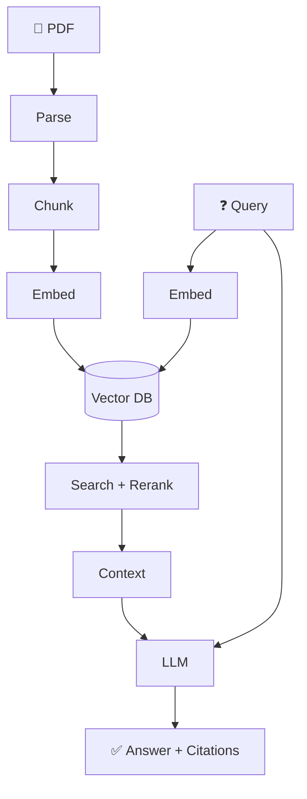

# 00 — Overview

**RAG System** is a document-based Q&A system that combines document retrieval with AI text generation. Instead of answering from "memory", the LLM is given relevant documents as factual context to produce accurate, cited answers.

---

## The Problem

LLMs like GPT-4 and Gemini have three critical weaknesses:

| # | Weakness | Impact |
|---|----------|--------|
| 1 | **Knowledge Cut-off** | Cannot access information after training date |
| 2 | **Hallucination** | Generates confident but fabricated answers |
| 3 | **No Private Context** | Cannot access internal company documents |

## The Solution: RAG

RAG adds a "reference layer" — before answering, the system searches relevant documents and provides them to the LLM as context. The LLM only needs to summarize, not recall.



---

## Architecture at a Glance

```
┌──────────────────────────────────────────────────────────────┐
│                      RAG System                               │
│                                                               │
│   Streamlit UI (:8501)                                        │
│         │                                                     │
│         ▼                                                     │
│   ┌─────────────────────────────────────────────────────┐     │
│   │          Gateway (.NET) :8080                        │     │
│   │  ┌──────────┐ ┌──────────┐ ┌──────────────────┐    │     │
│   │  │  Query    │ │ Chit-Chat│ │ Grounded Answer  │    │     │
│   │  │  Router   │ │  Agent   │ │ + Citation Valid. │    │     │
│   │  └──────────┘ └──────────┘ └──────────────────┘    │     │
│   └────────────────────┬────────────────────────────────┘     │
│                        │ HTTP                                  │
│   ┌────────────────────▼────────────────────────────────┐     │
│   │          Worker (Python) :8000                        │     │
│   │  ┌──────────┐ ┌──────────┐ ┌──────────┐            │     │
│   │  │ Docling   │ │ BGE-M3   │ │ Reranker │            │     │
│   │  │ Parser    │ │ Embedding│ │ CrossEnc.│            │     │
│   │  └──────────┘ └──────────┘ └──────────┘            │     │
│   └────────────────────┬────────────────────────────────┘     │
│                        │ REST + gRPC                           │
│   ┌────────────────────▼────────────────────────────────┐     │
│   │          Qdrant (Vector DB) :6333/:6334              │     │
│   └─────────────────────────────────────────────────────┘     │
└──────────────────────────────────────────────────────────────┘
```

---

## Design Objectives

| # | Objective | What It Means |
|---|-----------|---------------|
| 1 | **Accuracy over speed** | Citation validation + reranking ensures grounded answers |
| 2 | **Hybrid search** | Dense (semantic) + Sparse (keyword) search eliminates keyword mismatch |
| 3 | **Provider-agnostic** | Swap Gemini → OpenAI → Ollama without code changes |
| 4 | **Schema-aware chunking** | Tables, figures, and text are chunked differently |
| 5 | **Self-correcting** | Citation audit loop auto-repairs hallucinated references |
| 6 | **Enterprise-ready** | Retry, timeout, rate limiting, structured logging |

---

## Document Index

| # | Document | Topic |
|---|----------|-------|
| 00 | Overview (this page) | Introduction, architecture, glossary |
| 01 | [Ingestion Pipeline](01-ingestion-pipeline.md) | Parser, chunking, enrichment, embedding, vector storage |
| 02 | [Retrieval Pipeline](02-retrieval-pipeline.md) | Query routing, hybrid search, fusion, reranking |
| 03 | [Generation Pipeline](03-generation-pipeline.md) | Multi-agent orchestration, citation validation |
| 04 | [Application](04-application.md) | Project structure, setup, code tour |
| 05 | [Data Flow](05-data-flow.md) | End-to-end ingestion and chat flows |
| 06 | [Configuration Reference](06-configuration.md) | All settings in one page |
| 07 | [Observability](07-observability.md) | Structured logging and debugging |
| 08 | [Reliability](08-reliability.md) | Retry, timeout, rate limiting |
| 09 | [Troubleshooting](09-troubleshooting.md) | Symptom → diagnosis → solution |
| 10 | [Example: Hello RAG](10-example-hello-rag.md) | Smallest working flow from zero |
| 11 | [Example: Ingestion](11-example-ingestion.md) | Detailed ingestion walkthrough |
| 12 | [Example: Query](12-example-query.md) | Detailed query walkthrough |
| 13 | [Example: Customization](13-example-customization.md) | Swap models, tune retrieval |

---

## Glossary

Key terms used throughout the documentation:

| Term | Definition |
|------|-----------|
| **LLM** | Large Language Model — AI that generates text (GPT-4, Gemini, Claude) |
| **RAG** | Retrieval-Augmented Generation — combining search with LLM generation |
| **Embedding** | Converting text into numerical vectors for similarity search |
| **Vector DB** | Database specialized for storing and searching vectors (Qdrant) |
| **Chunk** | A 1024-token document fragment — the unit of search |
| **Dense Search** | Search based on semantic meaning similarity |
| **Sparse Search** | Search based on keyword matching (BM25) |
| **Hybrid Search** | Combining Dense + Sparse for better accuracy |
| **RRF** | Reciprocal Rank Fusion — algorithm for merging multiple search results |
| **Reranking** | Re-scoring search results using a Cross-Encoder for higher precision |
| **Cross-Encoder** | Model that reads query + document together to judge relevance |
| **Citation** | Source markers `[S1]`, `[S2]` in RAG answers |
| **Hallucination** | When an LLM fabricates information not present in sources |
| **SSE** | Server-Sent Events — streaming answers token by token |
| **Token** | Smallest unit processed by an LLM (≈ ¾ English word) |
| **Context Window** | Maximum text an LLM can process in a single call |

---

## Tech Stack

| Component | Technology | Role |
|-----------|-----------|------|
| Gateway | .NET (ASP.NET Core) | Chat orchestration, query routing, citation validation |
| Worker | Python (FastAPI) | PDF parsing, embedding, hybrid search, reranking |
| Vector DB | Qdrant | Vector storage + native hybrid search |
| UI | Streamlit | Upload PDF, chat, manage documents |
| Embedding | BAAI/bge-m3 | Dense (1024d) + Sparse vectors |
| Reranker | BAAI/bge-reranker-base | Cross-encoder second-stage ranking |
| LLM | Gemini 2.5 Flash (default) | All agent tasks |
