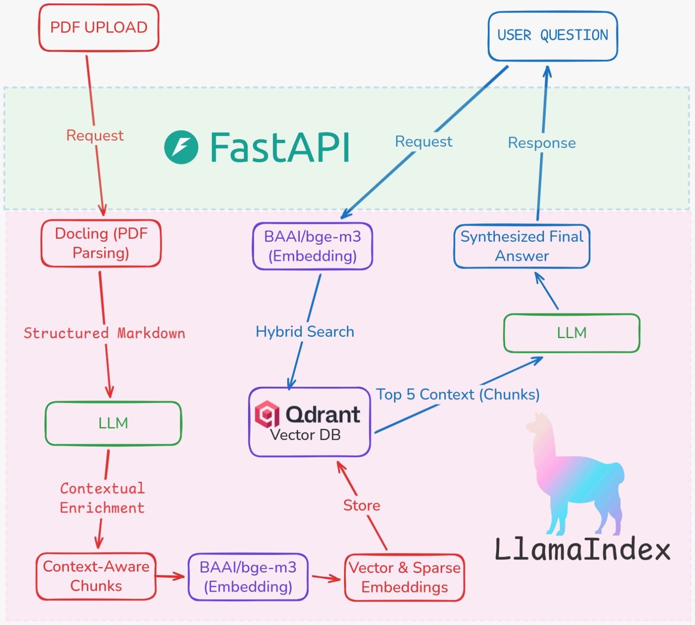
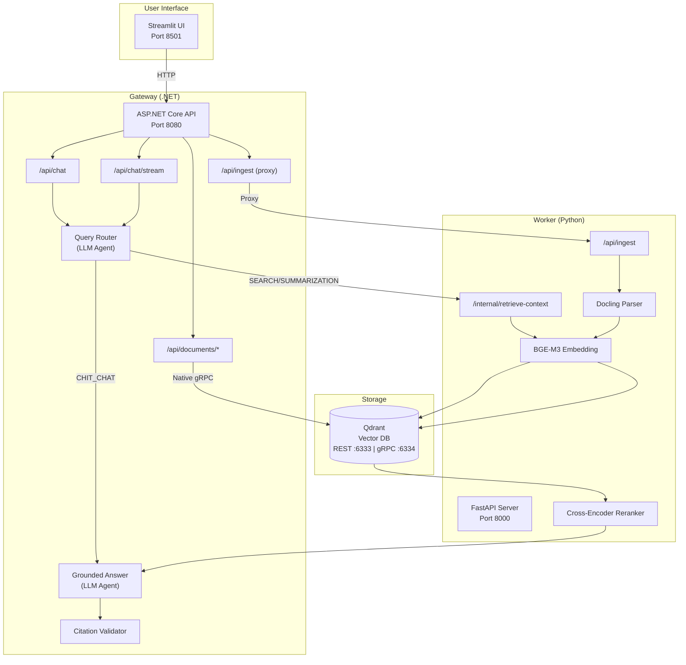
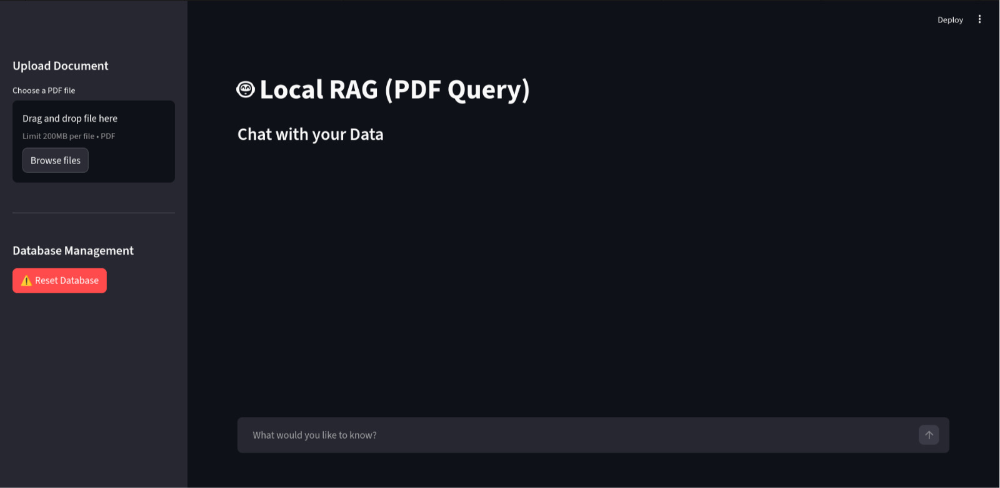

# 1.1 Gambaran Umum Aplikasi RAG

Dokumen ini menjelaskan gambaran umum aplikasi Enterprise RAG System, termasuk apa yang dilakukan aplikasi ini secara end-to-end dan arsitektur tingkat tingginya.

---

## Daftar Isi
- [1.1 Gambaran Umum Aplikasi RAG](#11-gambaran-umum-aplikasi-rag)
  - [Daftar Isi](#daftar-isi)
- [1. Apa yang Dilakukan Aplikasi?](#1-apa-yang-dilakukan-aplikasi)
- [2. Arsitektur 2-Service](#2-arsitektur-2-service)
- [3. Komponen Utama](#3-komponen-utama)
- [4. Separation of Concerns](#4-separation-of-concerns)
- [5. Tampilan Antarmuka](#5-tampilan-antarmuka)

---

## 1. Apa yang Dilakukan Aplikasi?

Aplikasi **Local RAG** adalah sistem tanya-jawab berbasis dokumen yang memungkinkan pengguna untuk:

1.  **Upload PDF:** Mengunggah satu atau beberapa dokumen PDF melalui antarmuka web.
2.  **Ingest (Proses & Simpan):** Sistem membaca konten PDF (termasuk tabel dan gambar), memecahnya menjadi chunks cerdas (Schema v2), mengubahnya menjadi vektor, dan menyimpannya di Qdrant.
3.  **Retrieval (Pencarian):** Ketika pengguna bertanya, sistem mencari potongan dokumen yang paling relevan menggunakan pencarian hybrid (Dense + Sparse) dan me-rerank hasilnya.
4.  **Answer (Jawab):** LLM membaca potongan yang ditemukan dan merangkai jawaban yang akurat beserta sitasi sumber yang tervalidasi.
5.  **Document Management:** Kelola dokumen yang sudah di-ingest (list, detail, hapus per dokumen, reset semua).

Secara sederhana: **Upload → Ingest → Query → Answer dengan Sumber Tervalidasi**.

---

## 2. Arsitektur 2-Service

Sistem terdiri dari **dua service utama** yang bekerja sama, ditambah Qdrant sebagai database vektor:

### Request Flow

1.  **User bertanya** via Streamlit atau `POST /api/chat`
2.  **Gateway merouting query** menggunakan **Query Router Agent** (LLM):
    -   `SEARCH` → minta konteks dari Worker → generate jawaban grounded dengan sitasi
    -   `SUMMARIZATION` → sama, lebih fokus ke ringkasan
    -   `CHIT_CHAT` → jawab langsung tanpa retrieval
    -   `AMBIGUOUS` → tanya klarifikasi ke user
3.  **Worker mencari konteks** via hybrid search (dense + sparse), rerank dengan cross-encoder, dan mengembalikan chunks berlabel sumber
4.  **Gateway generate jawaban** dengan validasi sitasi — memastikan setiap klaim didukung sumber `[S1]`, `[S2]`, dst.

---

## 3. Komponen Utama

| Komponen | Teknologi | Port | Fungsi |
|----------|-----------|------|--------|
| **Frontend** | Streamlit | 8501 | Antarmuka web untuk upload PDF, chat, dan kelola dokumen |
| **Gateway** | ASP.NET Core (.NET) | 8080 | Public API, chat orchestration, query routing, document management, citation validation |
| **Worker** | FastAPI (Python) | 8000 | PDF ingestion, embedding, hybrid retrieval, reranking |
| **Vector DB** | Qdrant (Docker) | 6333/6334 | Penyimpanan vektor dense + sparse, hybrid search |
| **PDF Parser** | Docling | - | Mengekstrak teks dari PDF menjadi Markdown (termasuk OCR) |
| **Embedding** | BAAI/bge-m3 | - | Mengubah teks menjadi vektor Dense (1024d) + Sparse |
| **Reranker** | BAAI/bge-reranker-base | - | Cross-encoder untuk re-ranking hasil pencarian |
| **LLM** | Switchable (Gemini/OpenAI/Ollama/dll) | - | Routing, penjawaban, dan enrichment |

---

## 4. Separation of Concerns

Pemisahan ke 2 service bukan kebetulan — ada alasan arsitektural yang jelas:

| Aspek | Gateway (.NET) | Worker (Python) |
|-------|----------------|-----------------|
| **Bahasa** | C# / .NET | Python |
| **Fokus** | Orchestration & Business Logic | ML Pipeline & Data Processing |
| **Tugas Utama** | Routing query, generate jawaban, validasi sitasi, kelola dokumen | Parsing PDF, embedding, hybrid search, reranking |
| **Komunikasi ke Qdrant** | Native gRPC (dokumen CRUD) | REST API (ingestion & search) |
| **LLM Usage** | Multi-agent (router, chit-chat, grounded-answer) | Enrichment saat ingestion |
| **Scalability** | Bisa di-scale independen | GPU-bound, di-scale berdasarkan beban ML |

**Komunikasi Internal:**
Gateway dan Worker berkomunikasi via HTTP dengan autentikasi `X-Internal-Api-Key` header. Endpoint internal Worker (`/internal/retrieve-context`) hanya bisa diakses oleh Gateway.

---

## 5. Tampilan Antarmuka

Aplikasi menyediakan antarmuka berbasis web Streamlit yang fungsional:

**Antarmuka Streamlit.** Di sidebar kiri terdapat fitur upload PDF dan tombol reset database. Di area utama adalah chat interface untuk bertanya tentang dokumen yang sudah diupload.

### Fitur Utama Antarmuka:
1.  **Sidebar - Upload Document:** Area untuk mengunggah satu atau beberapa file PDF dan tombol "Ingest Document" untuk memproses.
2.  **Sidebar - Document Management:** Daftar dokumen yang sudah di-ingest dengan opsi hapus per dokumen.
3.  **Sidebar - Database Management:** Tombol reset untuk menghapus semua data di koleksi Qdrant.
4.  **Chat Area:** Input untuk mengetik pertanyaan dan area menampilkan jawaban beserta sumber referensi.
5.  **Streaming Response:** Jawaban ditampilkan secara real-time token per token (SSE).
6.  **Sources Expandable:** Setiap jawaban dilengkapi sumber yang bisa di-expand untuk melihat potongan teks asli.