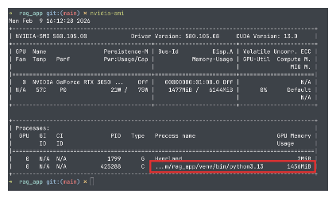
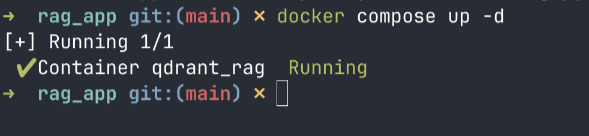

# 1.2 Cara Menjalankan Aplikasi

Dokumen ini menjelaskan langkah-langkah untuk menjalankan aplikasi RAG, baik menggunakan Docker maupun secara lokal.

---

## Daftar Isi
- [1. Prasyarat](#1-prasyarat)
- [2. Menjalankan dengan Docker Compose](#2-menjalankan-dengan-docker-compose)
- [3. Menjalankan Secara Lokal](#3-menjalankan-secara-lokal)
- [4. Troubleshooting Umum](#4-troubleshooting-umum)

---

## 1. Prasyarat

Sebelum menjalankan aplikasi, pastikan sistem Anda memenuhi persyaratan berikut:

### A. Software yang Diperlukan

| Software | Versi Minimum | Keterangan |
|----------|---------------|------------|
| **Python** | 3.10+ (direkomendasikan 3.13) | Runtime utama aplikasi |
| **Docker & Docker Compose** | Terbaru | Untuk menjalankan Qdrant |
| **Ollama** | Terbaru | Untuk menjalankan LLM lokal (Opsional) |
| **CUDA Toolkit** | 12.x (opsional) | Jika menggunakan GPU NVIDIA untuk LLM Lokal |

### B. Model Lokal (Opsional)

Jika Anda berencana menggunakan **Local LLM** (tanpa internet/biaya API), unduh model berikut. **Jika menggunakan Cloud API (Gemini/OpenAI), lewati langkah ini.**

```bash
# Unduh model LLM (gemma3:4b direkomendasikan untuk VRAM 6GB)
ollama pull gemma3:4b

# Pastikan Ollama berjalan
ollama serve
```

### C. Catatan GPU

**Rekomendasi:** Penggunaan **Cloud API (seperti Gemini)** sangat disarankan untuk performa terbaik dan kebutuhan hardware yang minim.

Jika menggunakan Local LLM, aplikasi ini dioptimalkan untuk GPU NVIDIA dengan minimal VRAM 4GB. Jika menggunakan Cloud API, kebutuhan VRAM hanya sekitar **1.5GB** (hanya untuk embedding).

Berikut penggunaan memori tipikal:



**nvidia-smi output.** Embedding model BGE-M3 menggunakan sekitar 1.4GB VRAM. Sisa VRAM digunakan untuk Ollama saat inferensi.

---

## 2. Menjalankan dengan Docker Compose

Docker Compose digunakan untuk menjalankan **Qdrant** (Vector Database). File konfigurasi terdapat di `rag_app/docker-compose.yml`.

### Langkah-langkah:

**1. Navigasi ke direktori aplikasi:**
```bash
cd rag_app
```

**2. Jalankan Qdrant dengan Docker Compose:**
```bash
docker-compose up -d
```



**Docker Compose berhasil.** Qdrant berjalan di `localhost:6333` dengan data disimpan di volume `qdrant_storage`.

**3. Verifikasi Qdrant berjalan:**
```bash
# Cek status container
docker ps | grep qdrant

# Atau akses dashboard Qdrant di browser
# http://localhost:6333/dashboard
```

### Konfigurasi docker-compose.yml:
```yaml
services:
  qdrant:
    image: qdrant/qdrant:latest
    container_name: qdrant_rag
    ports:
      - "6333:6333"
    volumes:
      - qdrant_storage:/qdrant/storage
    restart: always

volumes:
  qdrant_storage:
```

---

## 3. Menjalankan Secara Lokal

Setelah Qdrant berjalan, Anda perlu menjalankan dua komponen Python:
1. **FastAPI Backend** - Server API di port 8000
2. **Streamlit Frontend** - Antarmuka web di port 8501

### A. Setup Awal (Sekali Saja)

**1. Buat Virtual Environment:**
```bash
python3 -m venv venv
source venv/bin/activate  # Linux/Mac
# atau: venv\Scripts\activate  # Windows
```

**2. Install Dependencies:**
```bash
pip install -r requirements.txt
```

**Catatan:** File `requirements.txt` berisi:
- `fastapi`, `uvicorn`, `python-multipart` - Backend API
- `llama-index`, `llama-index-*` - Orchestrator dan integrasi
- `qdrant-client` - Koneksi ke Qdrant
- `docling` - Parser PDF
- `streamlit`, `requests` - Frontend
- `FlagEmbedding`, `fastembed` - Embedding model

### B. Jalankan Aplikasi

**Terminal 1 - Backend API:**
```bash
# Cara 1: Langsung dengan Python
python3 main.py

# Cara 2: Dengan uvicorn (untuk development)
uvicorn main:app --host 0.0.0.0 --port 8000 --reload
```

Output yang diharapkan:
```
INFO:     Loading Shared BGE-M3 Model (GPU): BAAI/bge-m3
INFO:     Loading LLM Provider: ollama with Model: gemma3:4b
INFO:     LlamaIndex Settings initialized.
INFO:     Uvicorn running on http://0.0.0.0:8000
```

**Terminal 2 - Frontend Streamlit:**
```bash
streamlit run streamlit_app.py
```

Output yang diharapkan:
```
  You can now view your Streamlit app in your browser.

  Local URL: http://localhost:8501
  Network URL: http://192.168.x.x:8501
```

### C. Konfigurasi Environment

Salin file `.env.example` menjadi `.env` dan sesuaikan:
```bash
cp .env.example .env
```

Konfigurasi penting yang bisa diubah.

**Opsi 1: Menggunakan Cloud API (DIREKOMENDASIKAN)**
Lebih cepat, lebih pintar, dan ringan di komputer.
```bash
# Ganti provider ke gemini (atau openai/anthropic)
LLM_PROVIDER="gemini"
LLM_MODEL="models/gemini-2.0-flash"

# Masukkan API Key Anda
GOOGLE_API_KEY="AIzaSyTr..."
```

**Opsi 2: Menggunakan Local LLM (Ollama)**
Gratis, privasi total, tapi butuh GPU kuat.
```bash
# LLM Provider (ollama, openai, anthropic, gemini)
LLM_PROVIDER="ollama"
LLM_MODEL="gemma3:4b"
```

**Konfigurasi Lainnya:**
```bash
# Hybrid Search Balance (0.0=keyword, 1.0=semantic)
HYBRID_ALPHA=0.3

# Chunking
CHUNK_SIZE=512
CHUNK_OVERLAP=128
```

---

## 4. Troubleshooting Umum

### A. "Connection refused" ke Qdrant

**Gejala:**
```
qdrant_client.http.exceptions.UnexpectedResponse: Connection refused
```

**Solusi:**
1. Pastikan Docker berjalan: `docker ps`
2. Restart Qdrant: `docker-compose restart qdrant`
3. Cek port tidak terpakai: `lsof -i :6333`

### B. "CUDA out of memory"

**Gejala:**
```
torch.cuda.OutOfMemoryError: CUDA out of memory
```

**Solusi:**
1. Gunakan model lebih kecil di `.env`: `LLM_MODEL="gemma3:1b"`
2. Pastikan hanya satu instance embedding model berjalan
3. Kurangi `CHUNK_SIZE` dan `UPSERT_BATCH_SIZE`

### C. Model BGE-M3 Tidak Terload

**Gejala:**
```
OSError: BAAI/bge-m3 not found
```

**Solusi:**
Model akan otomatis diunduh saat pertama kali dijalankan. Pastikan:
1. Koneksi internet aktif
2. Ada ruang disk cukup (~2GB untuk model)
3. Jika offline, unduh manual ke cache HuggingFace

### D. Ollama "Connection Error"

**Gejala:**
```
httpx.ConnectError: [Errno 111] Connection refused
```

**Solusi:**
1. Pastikan Ollama service berjalan: `ollama serve`
2. Cek model sudah diunduh: `ollama list`
3. Verifikasi URL di `.env`: `OLLAMA_BASE_URL="http://localhost:11434"`