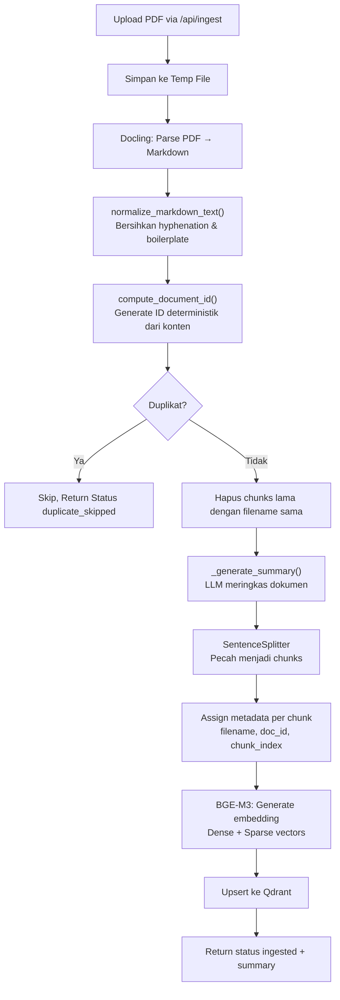
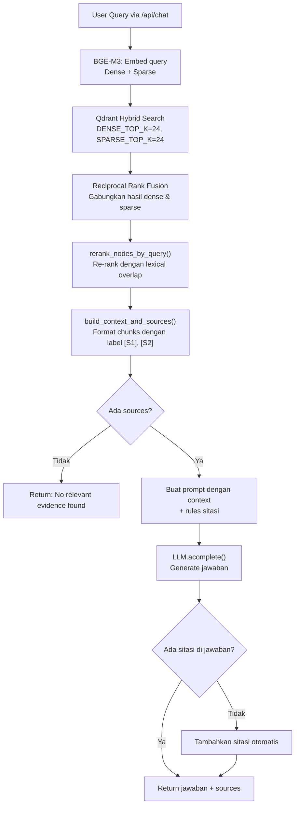

# 1.3 Alur Ingestion dan Chat

Dokumen ini menjelaskan alur lengkap dari upload PDF hingga mendapatkan jawaban, termasuk apa yang terjadi di balik layar pada setiap tahap.

---

## Daftar Isi
- [1. Alur Upload & Ingestion](#1-alur-upload--ingestion)
- [2. Alur Chat & Retrieval](#2-alur-chat--retrieval)
- [3. Kenapa Bisa Salah?](#3-kenapa-bisa-salah)

---

## 1. Alur Upload & Ingestion

### A. Langkah di UI: Upload File

Pengguna memilih file PDF di sidebar Streamlit dan menekan tombol "Ingest Document".


**Upload File.** Pengguna memilih dokumen PDF dari komputer lokal melalui file uploader Streamlit.

### B. Proses Ingestion Berjalan

Setelah tombol ditekan, spinner muncul menandakan proses sedang berjalan. Ini adalah tahap terlama karena melibatkan parsing PDF, chunking, embedding, dan penyimpanan ke database.


**Ingesting File.** Proses ini bisa memakan waktu beberapa menit tergantung ukuran PDF dan spesifikasi hardware.

### C. Ingestion Selesai

Setelah selesai, sistem menampilkan status sukses beserta ringkasan dokumen yang dihasilkan secara otomatis oleh LLM.


**Ingest Complete.** Output menampilkan filename, status, jumlah chunks yang dibuat, global summary, dan doc_id yang unik untuk dokumen tersebut.

### D. Detail Teknis: Apa yang Terjadi di Kode?

Berikut adalah alur detail proses ingestion yang terjadi di `app/services/ingestion_service.py`:



**Pemetaan Kode:**

| Langkah | File | Fungsi/Class |
|---------|------|--------------|
| Upload handling | `app/api/endpoints.py` | `ingest_document()` |
| PDF parsing | `app/services/ingestion_service.py` | `process_pdf()` dengan Docling |
| Text cleanup | `app/services/rag_quality.py` | `normalize_markdown_text()` |
| Document ID | `app/services/rag_quality.py` | `compute_document_id()` |
| Chunking | `app/services/ingestion_service.py` | LlamaIndex `SentenceSplitter` |
| Embedding | `app/core/llm_setup.py` | `get_embedding_model()`, `get_sparse_embedding_functions()` |
| Storage | `app/services/ingestion_service.py` | `QdrantVectorStore` + `VectorStoreIndex` |

---

## 2. Alur Chat & Retrieval

### A. User Bertanya

Setelah dokumen di-ingest, pengguna bisa bertanya melalui chat input di area utama.

### B. Jawaban Relevan

Jika pertanyaan relevan dengan konten dokumen, sistem akan memberikan jawaban yang akurat beserta sitasi sumber.


**Jawaban Relevan.** LLM memberikan jawaban berdasarkan chunks yang ditemukan. Sitasi seperti `[S1]`, `[S2]` menunjukkan sumber mana yang digunakan. User bisa expand untuk melihat teks asli.

### C. Pertanyaan Tidak Relevan

Jika pertanyaan di luar topik dokumen, sistem akan menunjukkan kebingungan atau memberikan jawaban yang tidak tepat.


**Pertanyaan Tidak Relevan.** Ketika user bertanya tentang topik yang tidak ada di dokumen, sistem tetap mencoba menjawab dari chunks yang ada, yang bisa menghasilkan jawaban tidak tepat.

### D. Detail Teknis: Apa yang Terjadi di Kode?

Berikut adalah alur detail proses chat yang terjadi di `app/api/endpoints.py`:



**Pemetaan Kode:**

| Langkah | File | Fungsi/Class |
|---------|------|--------------|
| Chat endpoint | `app/api/endpoints.py` | `chat()` |
| Hybrid retrieval | `app/api/endpoints.py` | `VectorStoreIndex.as_retriever()` |
| RRF fusion | `app/api/endpoints.py` | `reciprocal_rank_fusion()` |
| Re-ranking | `app/services/rag_quality.py` | `rerank_nodes_by_query()` |
| Context building | `app/services/rag_quality.py` | `build_context_and_sources()` |
| LLM completion | `app/core/llm_setup.py` | `get_llm().acomplete()` |

---

## 3. Kenapa Bisa Salah?

Ada beberapa alasan mengapa sistem RAG bisa memberikan jawaban yang tidak tepat:

### A. Penyebab Umum

| Masalah | Penyebab | Solusi |
|---------|----------|--------|
| **Jawaban tidak relevan** | Chunks yang di-retrieve tidak mengandung informasi yang dibutuhkan | Coba perbaiki `HYBRID_ALPHA` atau perkecil `CHUNK_SIZE` |
| **Hallucination** | LLM mengarang meskipun tidak ada evidence | Sistem sudah memitigasi dengan prompt yang ketat + sitasi wajib |
| **Jawaban terlalu umum** | Chunks yang ditemukan terlalu luas | Gunakan pertanyaan yang lebih spesifik |
| **Missing context** | Informasi terpecah di beberapa chunks | Tingkatkan `CHUNK_OVERLAP` |

### B. Mekanisme Quality Control di Kode

Aplikasi ini memiliki beberapa mekanisme untuk menjaga kualitas jawaban, yang diimplementasikan di `app/services/rag_quality.py`:

1.  **`normalize_markdown_text()`:** Membersihkan artifact PDF seperti:
    - Hyphenation (`obser-\nvation` → `observation`)
    - Page markers (`Page 1 of 10` dihapus)
    - Boilerplate berulang (header/footer)

2.  **`rerank_nodes_by_query()`:** Re-ranking dengan lexical overlap:
    ```python
    # Blend rank signal dengan lexical overlap
    fused_score = (1 - lexical_weight) * rank_signal + lexical_weight * lexical
    ```
    Ini memastikan chunks yang mengandung kata-kata dari query diprioritaskan.

3.  **Citation Enforcement:** Di `endpoints.py`, jika LLM tidak menyertakan sitasi:
    ```python
    if sources and not _CITATION_PATTERN.search(answer):
        citation_tail = " ".join(f"[{source['id']}]" for source in sources[:2])
        answer = f"{answer}\n\nCitations: {citation_tail}"
    ```

4.  **Grounding Prompt:** Prompt sistem mewajibkan LLM hanya menjawab dari konteks:
    ```
    Rules:
    1) If evidence is insufficient, say you don't have enough information.
    2) Cite every factual claim with source IDs like [S1] [S2].
    3) Do not cite sources that are not in the provided context.
    ```

### C. Parameter yang Bisa Diatur

Di file `.env`, Anda bisa mengatur parameter retrieval:

```bash
# Keseimbangan hybrid search
# 0.0 = murni keyword, 1.0 = murni semantic
HYBRID_ALPHA=0.3  # Default: favor keyword matching

# Jumlah kandidat untuk tiap metode
DENSE_TOP_K=24
SPARSE_TOP_K=24

# Hasil akhir setelah re-ranking
RERANK_TOP_K=8
MAX_SOURCES=5
```

**Tips:** Jika pertanyaan Anda mengandung istilah teknis atau nama spesifik, gunakan `HYBRID_ALPHA` yang lebih rendah (0.2-0.3) untuk memprioritaskan keyword matching.
