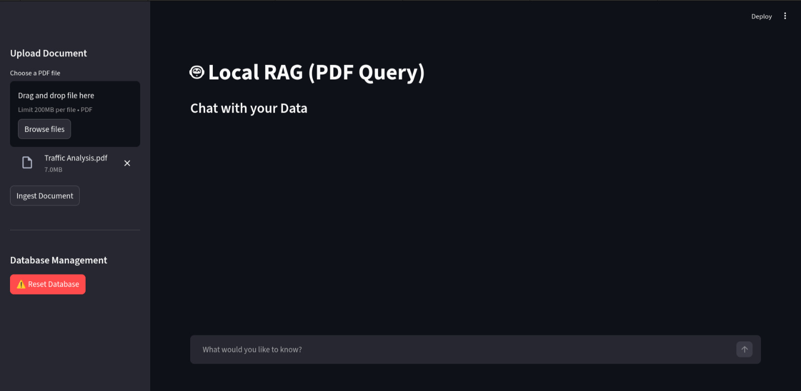
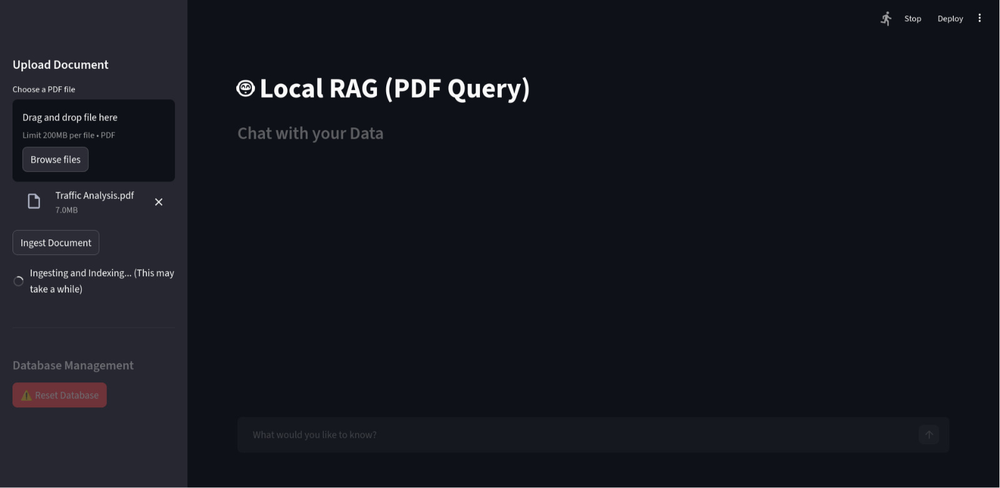
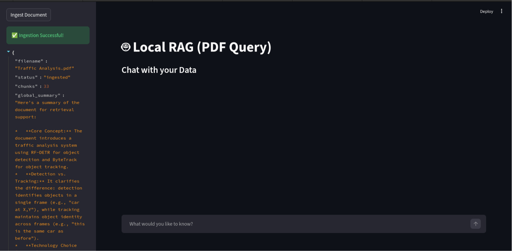
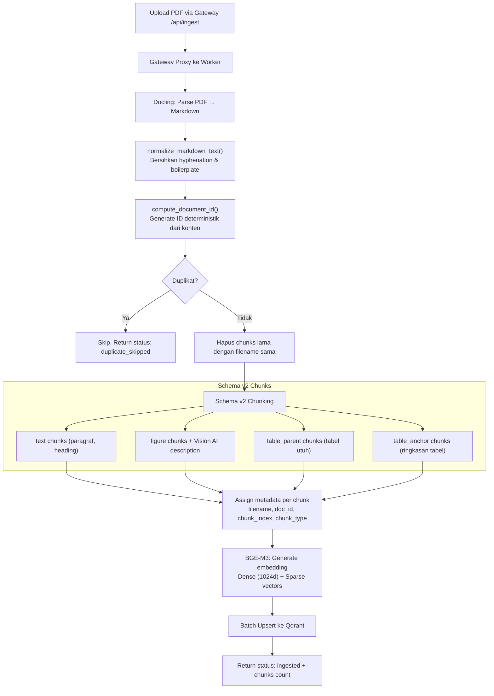
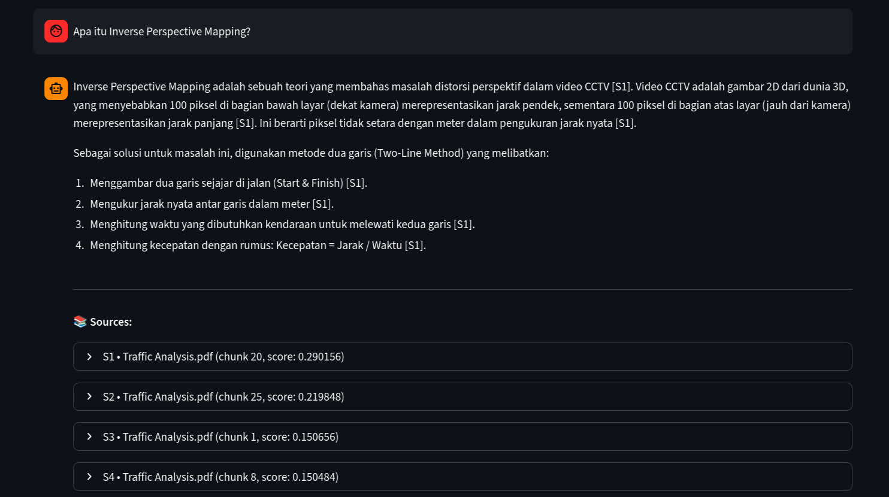
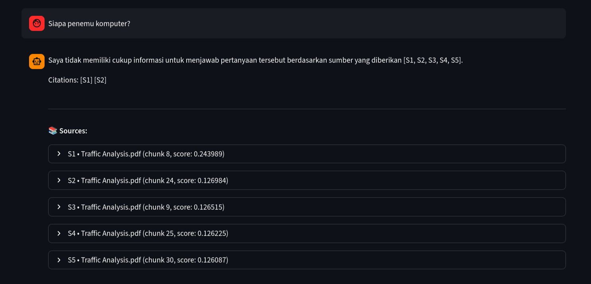
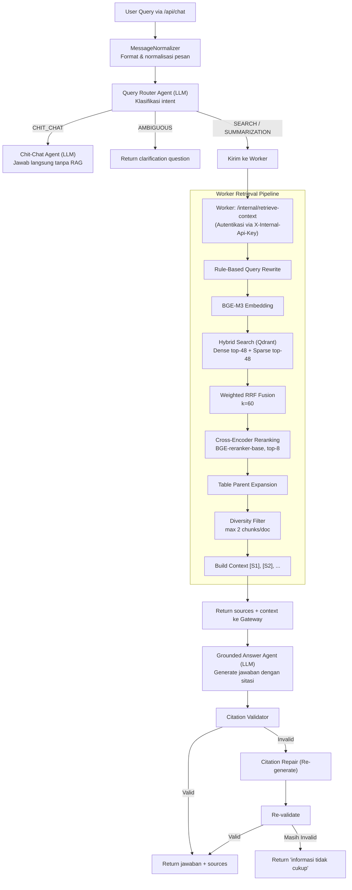

# 1.3 Alur Ingestion dan Chat

Dokumen ini menjelaskan alur lengkap dari upload PDF hingga mendapatkan jawaban, termasuk interaksi antara **Gateway (.NET)** dan **Worker (Python)** di balik layar.

---

## Daftar Isi
- [1. Alur Upload & Ingestion](#1-alur-upload--ingestion)
- [2. Alur Chat & Retrieval](#2-alur-chat--retrieval)
- [3. Streaming (SSE)](#3-streaming-sse)
- [4. Kenapa Bisa Salah?](#4-kenapa-bisa-salah)

---

## 1. Alur Upload & Ingestion

### A. Langkah di UI: Upload File

Pengguna memilih satu atau beberapa file PDF di sidebar Streamlit dan menekan tombol "Ingest Document".



**Upload File.** Pengguna memilih dokumen PDF dari komputer lokal melalui file uploader Streamlit.

### B. Proses Ingestion Berjalan

Setelah tombol ditekan, spinner muncul menandakan proses sedang berjalan. Ini adalah tahap terlama karena melibatkan parsing PDF, chunking, embedding, dan penyimpanan ke database.



**Ingesting File.** Proses ini bisa memakan waktu beberapa menit tergantung ukuran PDF dan spesifikasi hardware.

### C. Ingestion Selesai

Setelah selesai, sistem menampilkan status sukses beserta ringkasan dokumen yang dihasilkan secara otomatis oleh LLM.



**Ingest Complete.** Output menampilkan filename, status, jumlah chunks yang dibuat, global summary, dan doc_id yang unik untuk dokumen tersebut.

### D. Detail Teknis: Proses Ingestion di Worker



### E. Pemetaan Kode (Worker)

| Langkah | Lokasi File | Modul |
|---------|-------------|-------|
| Ingestion endpoint | `worker/app/api/endpoints.py` | `ingest_document()` |
| Ingestion orchestration | `worker/app/features/ingestion/application/` | Use case |
| PDF parsing (Docling) | `worker/app/features/ingestion/infrastructure/` | Parser |
| Text cleanup | `worker/app/features/common/` | `normalize_markdown_text()` |
| Schema v2 chunking | `worker/app/features/ingestion/infrastructure/` | Chunking |
| Vision AI (chart/figure) | `worker/app/features/ingestion/infrastructure/` | Picture description |
| Table visual interpretation | `worker/app/features/ingestion/infrastructure/` | Table interpreter |
| Embedding | `worker/app/shared/runtime/` | BGE-M3 singleton |
| Upsert ke Qdrant | `worker/app/features/ingestion/infrastructure/` | Qdrant upsert |

---

## 2. Alur Chat & Retrieval

### A. Pre-Processing: Router & Rewrite
Sebelum masuk ke pencarian, pertanyaan user diproses oleh **Intelligent Router**:
1.  **Router Check:** Apakah ini pertanyaan (Search), sapaan (Chit-Chat), atau minta ringkasan?
2.  **Rewriting:** Jika perlu Search, query akan diperbaiki. Misal: "sanksi rokok" -> "sanksi pelanggaran merokok bagi mahasiswa".

### B. Jawaban Relevan
Jika pertanyaan relevan dengan konten dokumen, sistem akan memberikan jawaban yang akurat beserta sitasi sumber.



**Jawaban Relevan.** LLM memberikan jawaban berdasarkan chunks yang ditemukan. Sitasi seperti `[S1]`, `[S2]` menunjukkan sumber mana yang digunakan. User bisa expand untuk melihat teks asli.

### C. Pertanyaan Tidak Relevan / Ambigu
-   **Chit-Chat:** Dijawab langsung oleh LLM tanpa RAG ("Halo, ada yang bisa saya bantu?").
-   **Ambiguous:** Sistem akan bertanya balik ("Mohon perjelas, sanksi apa yang Anda maksud?").



### D. Detail Teknis: Apa yang Terjadi di Kode?

Berikut adalah alur detail proses chat yang terjadi di **Gateway** (`ChatController.cs`) dan **Worker** (`retrieve-context`):



### C. Pemetaan Kode

**Gateway (.NET):**

| Langkah | File | Class/Method |
|---------|------|-------------|
| Chat endpoint | `gateway/Controllers/ChatController.cs` | `Chat()`, `ChatStream()` |
| Message normalization | `gateway/Services/MessageNormalizer.cs` | `Normalize()` |
| Router prompt | `gateway/Services/PromptTemplates.cs` | `BuildRouterUserPrompt()` |
| Route parsing | `gateway/Services/RouteDecisionParser.cs` | `Parse()` |
| Worker communication | `gateway/Services/PythonWorkerClient.cs` | `RetrieveContextAsync()` |
| Answer prompt | `gateway/Services/PromptTemplates.cs` | `BuildGroundedAnswerPrompt()` |
| Citation validation | `gateway/Services/CitationValidator.cs` | `CitationsAreValid()` |
| Citation repair | `gateway/Services/PromptTemplates.cs` | `BuildCitationRepairPrompt()` |
| Document management | `gateway/Services/QdrantDocumentService.cs` | Native gRPC operations |

**Worker (Python):**

| Langkah | File | Modul |
|---------|------|-------|
| Retrieve endpoint | `worker/app/api/endpoints.py` | `retrieve_context_internal()` |
| Retrieval orchestration | `worker/app/features/retrieval/application/` | Use case |
| Query rewrite | `worker/app/features/retrieval/infrastructure/` | Rule-based rewriter |
| Hybrid search | `worker/app/features/retrieval/infrastructure/` | Qdrant hybrid search |
| RRF fusion | `worker/app/features/retrieval/infrastructure/` | Weighted RRF |
| Cross-encoder reranking | `worker/app/features/retrieval/infrastructure/` | BGE-reranker |
| Context assembly | `worker/app/features/retrieval/infrastructure/` | Source labeling |

---

## 3. Streaming (SSE)

Selain endpoint non-streaming (`/api/chat`), sistem juga mendukung **Server-Sent Events (SSE)** melalui `/api/chat/stream` untuk pengalaman yang lebih responsif.

### Alur SSE Events

| Event Type | Kapan Dikirim | Isi |
|------------|---------------|-----|
| `sources` | Setelah retrieval selesai, sebelum jawaban | Metadata sumber (filename, chunk_id, text) |
| `delta` | Saat LLM menghasilkan token | Potongan teks jawaban |
| `warning` | Jika sitasi invalid terdeteksi | Peringatan validasi |
| `done` | Akhir stream | Signal selesai + finish_reason |

### Contoh SSE Output

```
data: {"type":"sources","sources":[{"id":"S1","filename":"doc.pdf","text":"..."}]}

data: {"type":"delta","text":"Berdasarkan dokumen"}

data: {"type":"delta","text":", sanksi yang berlaku"}

data: {"type":"delta","text":" adalah... [S1]"}

data: {"type":"done","finish_reason":"stop"}
```

---

## 4. Kenapa Bisa Salah?

### A. Penyebab Umum

| Masalah | Penyebab | Solusi |
|---------|----------|--------|
| **Jawaban tidak relevan** | Chunks tidak ditemukan atau Router salah klasifikasi | Cek `HYBRID_ALPHA` atau review query rewrite rules |
| **Hallucination** | LLM mengarang meskipun tidak ada evidence | Sistem memitigasi dengan Citation Validation + Repair |
| **Jawaban terlalu umum** | Cross-encoder gagal memfilter dokumen spesifik | Tingkatkan `RERANK_MIN_SCORE` |
| **Missing context** | Informasi terpecah di beberapa chunks | Tingkatkan `CHUNK_OVERLAP`, aktifkan table parent expansion |
| **Sitasi invalid** | LLM mengarang nomor sumber | Citation Repair otomatis men-regenerate jawaban |
| **Timeout** | Worker terlalu lama memproses | Sesuaikan `WorkerTimeoutSeconds` di Gateway config |

### B. Mekanisme Quality Control

Sistem memiliki **beberapa lapisan** quality control:

1.  **Text Normalization:** Membersihkan artifact PDF (hyphenation, page markers, boilerplate).
2.  **Duplicate Detection:** Content hash mencegah dokumen identik di-ingest ulang.
3.  **Diversity Filter:** Membatasi max 2 chunks per dokumen agar konteks beragam.
4.  **Citation Validation:** Memastikan setiap `[Sx]` merujuk ke sumber yang ada.
5.  **Citation Repair:** Auto-regenerate jawaban jika sitasi invalid.
6.  **Grounding Prompt:** Instruksi ketat mewajibkan LLM hanya menjawab dari konteks:
    ```
    Rules:
    1) If evidence is insufficient, say you don't have enough information.
    2) Cite every factual claim with source IDs like [S1] [S2].
    3) Do not cite sources that are not in the provided context.
    4) ANSWER IN BAHASA INDONESIA.
    ```

### C. Parameter yang Bisa Diatur

**Worker** (`worker/app/core/config.py` — sebagian besar hardcoded):

| Parameter | Default | Penjelasan |
|-----------|---------|------------|
| `HYBRID_ALPHA` | 0.3 | Balance keyword vs semantic (0=keyword, 1=semantic) |
| `DENSE_TOP_K` / `SPARSE_TOP_K` | 48 | Kandidat per metode pencarian |
| `RERANK_TOP_K` | 8 | Jumlah chunks setelah re-ranking |
| `RERANK_MIN_SCORE` | 0.001 | Minimum score threshold |
| `MAX_SOURCES` | 5 | Maksimal sumber di response |
| `MAX_SOURCES_PER_DOC` | 2 | Max chunks per dokumen (diversity) |

**Gateway** (`gateway/appsettings.json`):

| Parameter | Default | Penjelasan |
|-----------|---------|------------|
| `Gateway:MaxSources` | 5 | Max sumber yang diminta dari Worker |
| `Gateway:WorkerTimeoutSeconds` | 600 | Timeout untuk panggilan ke Worker |
| `Gateway:RouterModel` | gemini-2.5-flash | Model LLM untuk routing |
| `Gateway:GroundedAnswerModel` | gemini-2.5-flash | Model LLM untuk jawaban |
