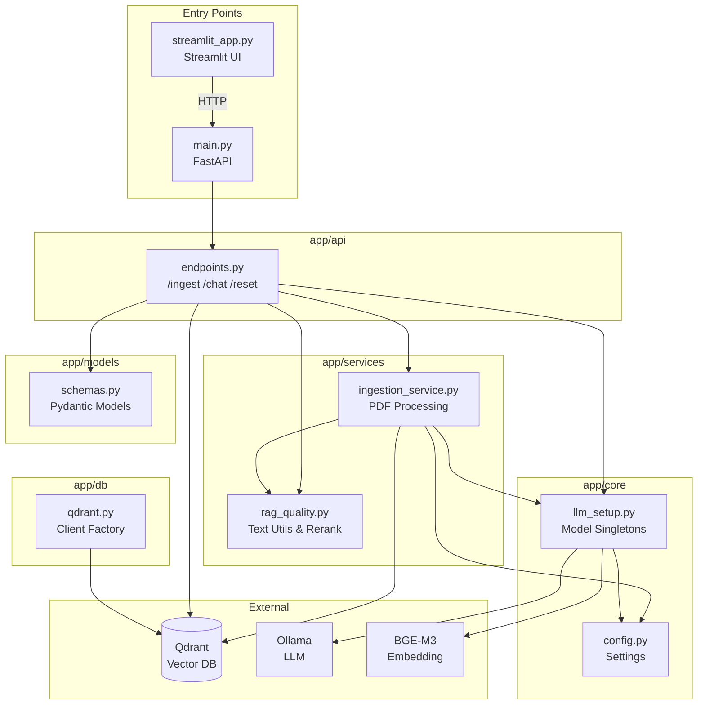

# 1.4 Tur Kode dan Arsitektur

Dokumen ini adalah panduan eksplorasi kode aplikasi RAG, menjelaskan struktur direktori, tanggung jawab setiap modul, dan bagaimana komponen-komponen saling terhubung.

---

## Daftar Isi
- [1.4 Tur Kode dan Arsitektur](#14-tur-kode-dan-arsitektur)
  - [Daftar Isi](#daftar-isi)
  - [1. Struktur Direktori](#1-struktur-direktori)
  - [2. Entry Points](#2-entry-points)
    - [A. main.py - FastAPI Server](#a-mainpy---fastapi-server)
    - [B. streamlit\_app.py - Web UI](#b-streamlit_apppy---web-ui)
  - [3. Modul app/api](#3-modul-appapi)
    - [endpoints.py](#endpointspy)
  - [4. Modul app/core](#4-modul-appcore)
    - [A. config.py - Application Settings](#a-configpy---application-settings)
    - [B. llm\_setup.py - Model Singletons](#b-llm_setuppy---model-singletons)
  - [5. Modul app/db](#5-modul-appdb)
    - [qdrant.py](#qdrantpy)
  - [6. Modul app/services](#6-modul-appservices)
    - [A. ingestion\_service.py](#a-ingestion_servicepy)
    - [B. rag\_quality.py](#b-rag_qualitypy)
  - [7. Modul app/models](#7-modul-appmodels)
    - [schemas.py](#schemaspy)
  - [8. Diagram Arsitektur Lengkap](#8-diagram-arsitektur-lengkap)

---

## 1. Struktur Direktori

```
rag_app/
├── main.py                  # Entry point FastAPI
├── streamlit_app.py         # Entry point Streamlit UI
├── docker-compose.yml       # Konfigurasi Qdrant container
├── requirements.txt         # Dependencies Python
├── .env.example             # Template environment variables
├── evaluate_rag.py          # Script evaluasi kualitas RAG
├── test_rag.py              # Script smoke test
├── tests/
│   └── test_rag_quality.py  # Unit tests untuk rag_quality.py
└── app/
    ├── api/
    │   └── endpoints.py     # REST API routes (/ingest, /chat, /reset)
    ├── core/
    │   ├── config.py        # Settings dari environment
    │   └── llm_setup.py     # Singleton LLM & Embedding initialization
    ├── db/
    │   └── qdrant.py        # Qdrant client factory
    ├── models/
    │   └── schemas.py       # Pydantic models untuk request/response
    └── services/
        ├── ingestion_service.py  # Logika ingestion PDF
        └── rag_quality.py        # Utility untuk text processing & reranking
```

---

## 2. Entry Points

### A. main.py - FastAPI Server

```python
# main.py (ringkasan)
from fastapi import FastAPI
from app.api.endpoints import router
from app.core.llm_setup import init_settings

app = FastAPI(title="Local RAG API")

@app.on_event("startup")
def on_startup():
    init_settings()  # Load embedding & LLM saat startup

app.include_router(router, prefix="/api")
```

**Tanggung Jawab:**
- Inisialisasi FastAPI application
- Memanggil `init_settings()` untuk load model singleton
- Mount semua routes di bawah prefix `/api`

**Cara Jalankan:**
```bash
python3 main.py
# atau
uvicorn main:app --host 0.0.0.0 --port 8000 --reload
```

### B. streamlit_app.py - Web UI

```python
# streamlit_app.py (ringkasan)
import streamlit as st
import requests

API_URL = "http://localhost:8000/api"

# Sidebar: Upload & Reset
uploaded_file = st.file_uploader("Choose a PDF file", type=["pdf"])
if st.button("Ingest Document"):
    response = requests.post(f"{API_URL}/ingest", files=files)

# Main: Chat Interface
if prompt := st.chat_input("What would you like to know?"):
    response = requests.post(f"{API_URL}/chat", json={"messages": prompt})
```

**Tanggung Jawab:**
- Menyediakan antarmuka upload PDF
- Menampilkan chat interface
- Berkomunikasi dengan FastAPI backend via HTTP

**Cara Jalankan:**
```bash
streamlit run streamlit_app.py
```

---

## 3. Modul app/api

### endpoints.py

File ini berisi semua REST API endpoints.

**Endpoints Tersedia:**

| Method | Path | Fungsi |
|--------|------|--------|
| `POST` | `/api/ingest` | Upload dan proses PDF |
| `POST` | `/api/chat` | Tanya jawab dengan dokumen |
| `DELETE` | `/api/reset` | Hapus seluruh koleksi Qdrant |

**Fungsi Penting:**

```python
# Reciprocal Rank Fusion untuk hybrid search
def reciprocal_rank_fusion(
    dense_result: VectorStoreQueryResult,
    sparse_result: VectorStoreQueryResult,
    alpha: float = 0.5,
    top_k: int = 10,
) -> VectorStoreQueryResult:
    """Menggabungkan hasil dense dan sparse search dengan RRF."""
    k = 60  # RRF constant
    # ... fuse by rank position, not raw scores
```

```python
# Chat endpoint - orchestrates retrieval + generation
@router.post("/chat", response_model=ChatResponse)
async def chat(request: ChatRequest):
    # 1. Setup hybrid vector store
    # 2. Retrieve dengan mode hybrid
    # 3. Rerank dengan lexical overlap
    # 4. Build context dengan source labels
    # 5. Generate answer via LLM
    # 6. Enforce citations jika tidak ada
```

---

## 4. Modul app/core

### A. config.py - Application Settings

Menggunakan `pydantic-settings` untuk load konfigurasi dari environment.

```python
# config.py (ringkasan)
from pydantic_settings import BaseSettings

class Settings(BaseSettings):
    # Qdrant
    QDRANT_HOST: str = "localhost"
    QDRANT_PORT: int = 6333
    COLLECTION_NAME: str = "pdf_rag"

    # Models
    EMBEDDING_MODEL: str = "BAAI/bge-m3"
    
    # Chunking
    CHUNK_SIZE: int = 768
    CHUNK_OVERLAP: int = 200
    
    # Retrieval
    HYBRID_ALPHA: float = 0.3
    DENSE_TOP_K: int = 24
    SPARSE_TOP_K: int = 24
    RERANK_TOP_K: int = 8
    
    # LLM
    LLM_PROVIDER: str = "ollama"
    LLM_MODEL: str = "gemma3:4b"
    
    class Config:
        env_file = ".env"

settings = Settings()
```

**Parameter Kritis:**

| Parameter | Default | Penjelasan |
|-----------|---------|------------|
| `HYBRID_ALPHA` | 0.3 | Balance keyword vs semantic (0=keyword, 1=semantic) |
| `CHUNK_SIZE` | 768 | Token per chunk |
| `RERANK_TOP_K` | 8 | Jumlah chunks setelah re-ranking |
| `MAX_SOURCES` | 5 | Maksimal sumber di response |

### B. llm_setup.py - Model Singletons

File ini mengelola inisialisasi model dengan **Singleton Pattern** untuk hemat VRAM.

```python
# llm_setup.py (ringkasan)

# Global singletons
_bgem3_model = None
_embedding_model = None
_llm = None

def get_bgem3_model():
    """Singleton untuk BGE-M3 (FlagEmbedding)."""
    global _bgem3_model
    if _bgem3_model is None:
        from FlagEmbedding import BGEM3FlagModel
        _bgem3_model = BGEM3FlagModel(
            settings.EMBEDDING_MODEL,
            use_fp16=True  # Hemat VRAM
        )
    return _bgem3_model
```

**Class Penting:**

```python
class BGEM3LlamaWrapper(BaseEmbedding):
    """Wrapper untuk mengintegrasikan BGE-M3 dengan LlamaIndex."""
    
    def _get_query_embedding(self, query: str) -> List[float]:
        output = self._model.encode(query, return_dense=True, ...)
        return output['dense_vecs'].tolist()
```

**Fungsi Factory LLM:**

```python
def _create_llm(provider: str, model_name: str):
    """Factory function untuk berbagai LLM provider."""
    if provider == "ollama":
        return Ollama(model=model_name, ...)
    elif provider == "openai":
        return OpenAI(model=model_name, api_key=...)
    elif provider == "gemini":
        return Gemini(model=model_name, api_key=...)
    # ... anthropic, dll
```

---

## 5. Modul app/db

### qdrant.py

File minimalis untuk factory Qdrant client.

```python
# qdrant.py
from qdrant_client import AsyncQdrantClient
from .config import settings

def get_qdrant_client() -> AsyncQdrantClient:
    return AsyncQdrantClient(
        host=settings.QDRANT_HOST,
        port=settings.QDRANT_PORT
    )
```

**Catatan:** Dalam praktiknya, koneksi Qdrant lebih sering dibuat langsung di `endpoints.py` dan `ingestion_service.py` karena kebutuhan sync/async yang berbeda.

---

## 6. Modul app/services

### A. ingestion_service.py

Menghandle seluruh proses ingestion PDF.

```python
class IngestionService:
    def __init__(self):
        self.qdrant_client = QdrantClient(...)
        self.llm = get_fast_llm()
        self.embed_model = get_embedding_model()
        self.sparse_doc_fn, self.sparse_query_fn = get_sparse_embedding_functions()
    
    async def process_pdf(self, file: UploadFile):
        # 1. Save to temp file
        # 2. Parse with Docling
        # 3. Normalize text
        # 4. Check for duplicates
        # 5. Generate summary
        # 6. Chunk with SentenceSplitter
        # 7. Add metadata to each node
        # 8. Upsert to Qdrant
```

**Fitur Khusus:**

1.  **Duplicate Detection:** Menggunakan content hash untuk skip dokumen yang identik
2.  **Filename Replacement:** Jika filename sama tapi konten beda, hapus yang lama
3.  **Rate Limit Retry:** Menggunakan `tenacity` untuk retry saat API limit tercapai

### B. rag_quality.py

Utility functions untuk kualitas RAG.

**Fungsi Text Processing:**

```python
def normalize_markdown_text(text: str) -> str:
    """Bersihkan artifact PDF."""
    # Remove soft hyphens
    # Join hyphenated words
    # Drop page markers & boilerplate
    # Normalize whitespace
```

**Fungsi ID Generation:**

```python
def compute_document_id(filename: str, normalized_text: str) -> str:
    """Content-addressed document ID."""
    digest = hashlib.sha256(normalized_text.encode()).hexdigest()
    return f"doc_{digest[:20]}"

def compute_chunk_id(doc_id: str, chunk_index: int) -> str:
    return f"{doc_id}:chunk:{chunk_index:05d}"

def compute_point_uuid(chunk_id: str) -> str:
    """Deterministic UUID untuk Qdrant point ID."""
    return str(uuid.uuid5(uuid.NAMESPACE_URL, chunk_id))
```

**Fungsi Reranking:**

```python
def rerank_nodes_by_query(
    query: str,
    candidates: Sequence[NodeWithScore],
    top_k: int,
    lexical_weight: float = 0.35,
) -> List[NodeWithScore]:
    """Re-rank dengan blend of rank signal + lexical overlap."""
```

---

## 7. Modul app/models

### schemas.py

Pydantic models untuk validasi request/response.

```python
class ChatRequest(BaseModel):
    messages: str  # Single query string

class SourceInfo(BaseModel):
    """Struktur sumber yang ditampilkan di UI."""
    id: str           # S1, S2, ...
    filename: str
    doc_id: str
    chunk_id: str
    chunk_index: int | str
    score: Optional[float]
    text: str         # Konten chunk
    node_id: str      # Qdrant point ID

class ChatResponse(BaseModel):
    response: str
    sources: List[SourceInfo]

class IngestionResponse(BaseModel):
    filename: str
    status: str       # "ingested" | "duplicate_skipped"
    chunks: int
    global_summary: str
    doc_id: Optional[str]
    replaced_points: int
```

---

## 8. Diagram Arsitektur Lengkap



**Alur Data:**
1. **Request masuk** via Streamlit → FastAPI
2. **Endpoints** mengorkestrasikan services
3. **Services** menggunakan core utilities (config, llm_setup)
4. **Rag_quality** menyediakan text processing dan reranking
5. **Schemas** memvalidasi input/output
6. **External** systems: Qdrant, Ollama, BGE-M3
