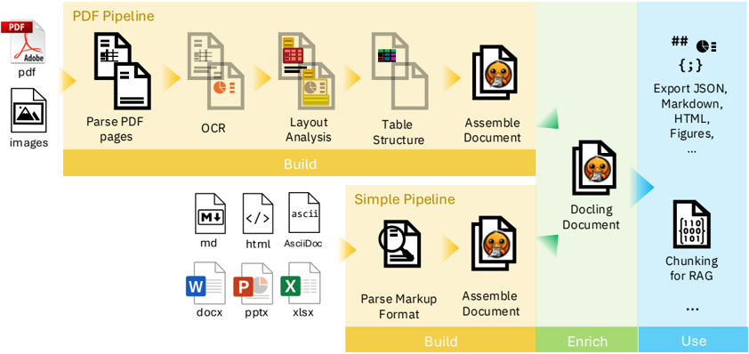
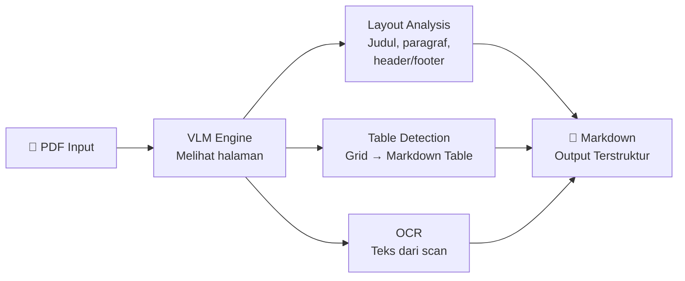

# 1.1.1 Parser: Docling (vs PyPDF)

Dokumen ini membedah perangkat pertama dalam lini Ingestion, yaitu sistem Parser PDF.

---

## Apa yang Akan Anda Pelajari

- Apa itu Parser dan mengapa PDF tidak bisa langsung dibaca mesin
- Keunggulan Docling dibanding parser tradisional (PyPDF)
- Bagaimana Docling memproses tabel, layout, dan OCR

---

## Konsep Dasar: Apa itu Parser?
Sebagai analogi, manusia bisa dengan mudah membedakan mana judul bab, mana paragraf, mana tabel, dan mana keterangan gambar pada sebuah buku hanya dari melihat *layout*-nya. Namun, bagi komputer, dokumen PDF pada dasarnya hanyalah kumpulan huruf dan garis yang berserakan di koordinat X dan Y tertentu tanpa makna terstruktur. 

**Parser** adalah alat (atau pustaka perangkat lunak) yang bertugas membaca dokumen mentah (seperti PDF atau Word) dan mengubahnya menjadi format teks yang terstruktur, seperti Markdown. Teks terstruktur ini penting agar tahap selanjutnya (memotong teks dan mencari makna) bisa berjalan akurat.

## Fungsi dalam RAG
Mengubah PDF visual menjadi data logis (Markdown).

## Mengapa Menggunakan Docling?

Sistem perusahaan kita telah meninggalkan parser klasik seperti PyPDF/PyMuPDF dan beralih ke rilis canggih dari IBM, yaitu **Docling**.

-   **Era Lama (Traditional OCR - PyPDF/PyMuPDF):** Alat lama ini hanya mengekstrak teks secara harfiah berdasarkan kotak koordinat. Mereka seringkali kehilangan orientasi saat dihadapkan pada struktur visual yang kompleks. Jika dokumen memiliki dua kolom, tabel dengan baris atau kolom yang *merged*, atau jika bagian bawah halaman terdapat *footer* bernomor saklek, alat ini gagal menangkap konteksnya dan membuat output teksnya meloncat-loncat berantakan.
-   **Era Baru (Docling - VLM Driven):** Docling tidak sekadar "mengekstraksi teks" secara buta. Docling dilengkapi dengan mesin **Vision-Language Model (VLM)**. Artinya, sistem secara cerdas "melihat" satu halaman penuh selayaknya mata manusia sebelum mulai menulis ulang strukturnya.
    -   **Table Understanding:** Tabel sering menjadi hambatan utama dalam RAG karena formatnya mudah pecah. Docling secara mengejutkan mampu mendeteksi *grid* abstrak dan mengonversinya menjadi Format Markdown Table yang rapi sempurna, sehingga relasi antar baris dan kolom tidak lenyap.
    -   **Layout Analysis:** Secara otomatis mendeteksi mana kalimat yang merupakan "Judul Utama", "Sub-bab", "Paragraf Biasa", dan yang paling kritikal, mampu membedakan (lalu membuang) "Header dan Footer" agar nomor halaman PDF tidak tercampur masuk ke dalam *knowledge base* pencarian yang akan merusak konteks tata bahasa asli.
    -   **OCR Capabilities Terpadu:** Bekerja mulus membaca teks hasil ketikan maupun teks yang terkunci menjadi *"flattened images"* seperti dokumen-dokumen *scan*, tanpa perlu menambah alat pihak ketiga lainnya, sekaligus melestarikan hierarki *heading* yang asli.

*(Ilustrasi abstraksi visual Docling dalam mendekode letak logis dokumen.)*

### Alur Parsing Docling

---

## Navigasi

| ← Sebelumnya | Selanjutnya → |
|:---|---:|
| [0.3 Glosarium](../../00-Introduction/0.3-glosarium.md) | [1.1.2 Chunking Schema v2](1.1.2-chunking-schema.md) |
