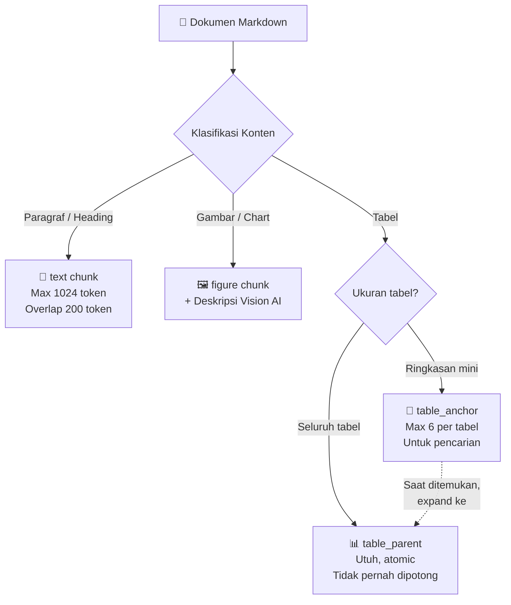

# 1.1.2 Chunking Strategy: Schema v2

Dokumen ini mendalami strategi *Chunking* yang mendasar dan krusial agar pencarian informasi bisa dilakukan tanpa error *"Lost Context"*.

---

## Apa yang Akan Anda Pelajari

- Apa itu Chunking dan mengapa tidak bisa memotong sembarangan
- Keunggulan Schema v2 dibanding fixed-size chunking
- Empat tipe chunk dan fungsi masing-masing

---

## Konsep Dasar: Apa itu Chunking?
Saat seseorang harus menghafal isi seluruh buku ensiklopedia untuk ujian, alih-alih mencoba merekam seluruh buku dari lembar pertama hingga akhir sekaligus ke dalam kepalanya (yang mustahil), mereka pasti akan memecahnya menjadi bagian-bagian kecil: mengingat per bab per bab, per halaman, atau per paragraf utama. 

Model LLM juga memiliki keterbatasan "daya ingat" (yang disebut *Context Window* limit). **Chunking** adalah proses mesin memotong seluruh dokumen PDF atau Word yang sangat amat panjang menjadipotongan-potongan teks kecil (ratusan kata saja) sehingga ketika pencari melakukan *search*, AI dapat mengambil potongan-potongan kecil ini, mencernanya sekaligus tanpa meluap kapasitas memorinya, lalu memberikan jawaban balik yang mendetail.

## Fungsi dalam RAG
Memecah dokumen teks yang masif menjadi potongan-potongan spesifik (*chunks*) untuk menjamin agar konteks utuh bisa dimuat dalam kapasitas LLM (saat digunakan membuat jawaban yang utuh).

## Mengapa Skema Pemotongan Kita Istimewa? (Schema v2)

Sistem dokumentasi dan chat internal tidak lagi memotong dokumen secara membabi-buta (*fixed-size*) seperti aplikasi RAG kelas hobi.

- **Kelemahan "Fixed-Size":** Ini membedah dokumen berdasarkan batasan teknis (misal tiap 1000 karakter, potong!), tidak peduli dia berada di tengah akhir kalimat atau tengah tabel! Kata seperti "Perusaha...[POTONGAN BERAKHIR]...aan meluncurkan..." akan terpisah drastis dan membingungkan LLM pencari fakta di lain saat.
- **Keunggulan "Schema v2" (Semantic Based Chunking):** Memotong kalimat dan struktur berdasarkan *semantik* atau maknanya (memotretnya berdasarkan satu topik utuh per bagian).

Dalam implementasi sistem ini, `Schema v2` mengklasifikasikan struktur *Chunk* menjadi:

### Diagram Tipe Chunk

| Tipe Chunk | Penjelasan | Tujuan Desain (Problem Solving) |
| :--- | :--- | :--- |
| **`text`** | Potongan murni informasi narasi (paragraf utuh beserta judul atas subjeknya). | Menjauhkan "Patahan di Antara Kalimat" dengan fitur *Overlap*. |
| **`figure`** | Potongan spesial untuk aset berupa gambar pendukung (Grafik chart, Alur Visio) | Menggabungkannya dengan deskripsi vision AI. |
| **`table_parent`** | Sebuah anomali spesial yang HARUS ADA: menjaga semua isi Tabel seutuh seratus persennya agar **tidak pernah dipotong per baris** (atomic chunk table). | Tabel berisi regulasi nomor denda tidak boleh hilang koneksinya antara "kolom tingkat denda" di tabel baris terakhir dengan "aturan" di header awal. |
| **`table_anchor`** | Dokumen teks sintetik pendek-pendek berisi daftar baris tabel secara mini (summary tabel). | Karena *table parent* seringkali amat terlalu besar untuk mesin perbandingan matematis "Semantic Search", maka pancingannya adalah *Anchor* yang super ramah dengan radar vektor, dimana setiap jangkar (*anchor*) nantinya akan otomatis membongkar seluruh *Table Parent* bila ia ditemukan relevan. |

**Parameter Standard RAG Enterprise Sistem:**
-   *Maximum Chunk Margin Limit (Kata/Token)*: `1024 token`.
-   *Persepsi Tumpang Tindih (Overlap)*: `200 token` (Bila terpotong, 200 karakter awal teks sambungannya mengulang akhir kalimat yang lampau, untuk lem super kuat penyambungan makna semantik).
-   *Max Anchor Threshold*: Setiap tabel raksasa akan dipecah maksimal menjadi `6` jangkar narasi mikro agar mudah dilacak di vektor galaksi.

---

## Navigasi

| ← Sebelumnya | Selanjutnya → |
|:---|---:|
| [1.1.1 Parser: Docling](1.1.1-parser-docling.md) | [1.1.3 Enrichment: Vision AI](1.1.3-enrichment-vision-ai.md) |
