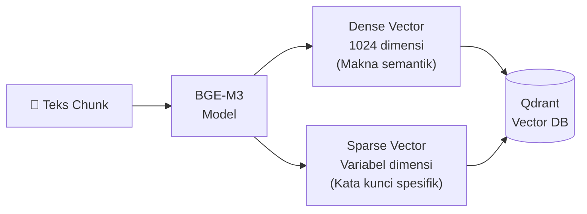

# 1.1.4 Embedding: BAAI/bge-m3

Dokumen ini menjelaskan tulang punggung matematis dari teknologi pencarian AI, yaitu proses *Embedding*.

---

## Konsep Dasar: Apa itu Embedding?

Komputer pada hakikat dasarnya sangat bodoh dalam urusan semantik. Komputer tidak mengerti arti sehelai kata "Kucing" atau "Anjing". Komputer murni cuma mengerti angka 0 dan 1. 

**Embedding** adalah teknologi ajaib ("Penerjemah Bahasa ke Matematika") yang sanggup mengonversi kalimat utuh buatan manusia dan menyulapnya secara algoritmik menjadi **koordinat angka desimal melimpah dalam ruang multi-dimensi** (disebut Vektor). 

Kata-kata atau kalimat yang memiliki rute plot cerita/makna berdekatan (contoh: "Sang Raja Mahkota" dan "Pangeran Keraton") akan dilempar ke arah koordinat ruang vektor angka yang berhimpitan dekat letaknya secara kalkulus. 
Dengan begini, sistem RAG tidak lagi bersembunyi di balik sistem tebak-tebakan "kecocokan kata/typo yang persis sama huruf-hurufnya" (seperti halnya menekan tombol lawas `Ctrl+F` di program Word), melainkan mencari **berdasarkan penciuman kedekatan kemiripan makna**.

## Fungsi dalam Proses RAG
Mengubah deretan teks literasi manusia secara instan menjadi format angka Vektor (ribuan dimensi) supaya bisa dikalkulasi jarak kemiripan maknanya (Cosine Similarity/Dot Product) terhadap teks pertanyaan abstrak dari pengguna.

## Mengapa Memilih Model BAAI/bge-m3?

Model otak penerjemah bahasa yang kita sewa operasikan secara gratis ini lahir dari pabrikan BAAI dan mendapuk gelar State-of-the-Art (SOTA) untuk klan *open-source model* (model tak berbayar yang tak menumpang jalan jaringan internet cloud server). 

Keunggulannya terpetakan dalam nama rilis panggilannya, "M3" (Multilingual, Multi-Function, Multi-Granularity):
1.  **Multi-Lingual Absolut:** Fasih total dan tidak bertele-tele saat membaca dialek narasi Bahasa Indonesia, tak tertinggal sangat paham intonasi kalimat inggris dan jerman. (Beda dengan model murahan dari OpenAI edisi lawas *ada-002* yang sering kikuk kebingungan kala mendapati serapan kosakata Nusantara).
2.  **Multi-Function Terpadu:** Dalam sekali telan proses *loading embedding* kalimat, ia seketika mencetak **tiga senjata jenis koordinat berbeda sekaligus**:
    -   **Kalkulasi Dense Retrieval (Vektor Gemuk 1024-dimensi):** Kemahiran menyerap arti dan relasi semantik ghaib di balik layar ("mobil rongsok kecelakaan" otomatis mirip sekali letaknya dengan "truk ringsek tabrakan beruntun").
    -   **Kalkulasi Sparse Retrieval (Lexical Akurat):** Taktik perang tradisional ala algoritma BM25. Cepat kilat mengejar pencarian persis spesifik kata teknis yang dilarang salah hitung ("Error Kodifikasi Pasal 404 KUHP" VS "Error Pasal 500 Pidana").
    -   **Kalkulasi Multi-Vector (Mekanisme ColBERT Terbaik):** Menyimpan setiap jejak token-token suku kata tunggal dan mengawasi ikatan kuat interaksi (*MaxSim*) antar tiap vocabnya. (Bila diaktifkan, performanya tiada tanding kendati menelan RAM yang teramat haus dan boros).
3.  **Large Context Input:** Kekuatan perutnya sanggup menelan input sekop teks hingga **8192 token** (cukup panjang memampung satu bab penuh skripsi atau dokumen legal komprehensif tanpa takut kepanasan memori *truncated out of limit*).

### Diagram Proses Embedding

---

## Navigasi

| ← Sebelumnya | Selanjutnya → |
|:---|---:|
| [1.1.3 Enrichment: Vision AI](1.1.3-enrichment-vision-ai.md) | [1.1.5 Database: Qdrant](1.1.5-database-qdrant.md) |
