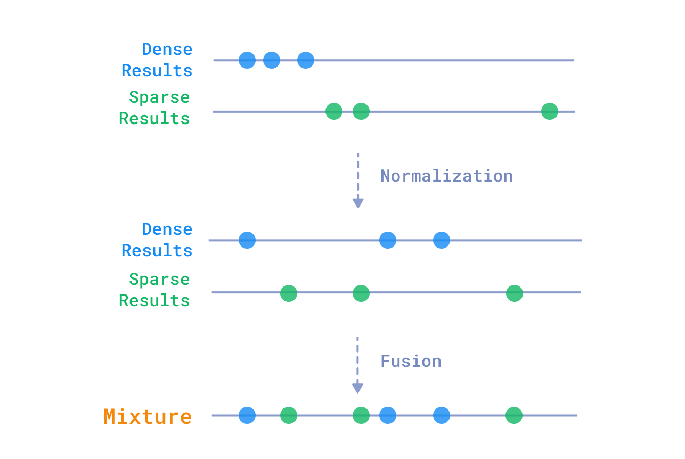

# 1.1.5 Database Penyimpan Vektor: Qdrant

Dokumen ini membedah gudang rak penyimpan terakhir di mana sekumpulan jutaan angka vektor hasil pemrosesan embedding tadi "tidur dan menetap" berevolusi menanti dibangunkan ketika dicari.

---

## Konsep Dasar: Apa itu Vector Database?

*Database* tradisional warisan puluhan tahun peradaban internet (seperti klan SQL: Postgres, MySQL) menyimpan barisan data dalam sel wujud kolom dan baris kotak. Jika ingin mencari secarik informasi di SQL jadul tersebut, pendoa mesin (Programmer) harus melayangkan mantra kata kunci tebakan yang *plek* persis identik hurufnya (misal: menebar saklar `SELECT * WHERE nama_karyawan = 'Budi'`). 

**Vector Database** berdiri di kutub bumi yang berbeda 180 derajat. Gudang moderen ini didesain dan direkayasa secara teknis khusus dari nol hanya demi menata dan menerbangkan rak-rak barisan koordinat angka *ruang dimensional* hasil cetakan **Embedding** (*vektor*). 
Ketika kelak seorang staff manusia mengetik deretan pertanyaan di kotak pencarian web, rentetan pertanyaan *human* tersebut di-embedding (diterjemahkan jadi array angka vektor) seketika itu juga, lalu Database Vektor langsung melepaskan roket pencariannya lewat rumus sakti matematika kalkulus *Cosine Similarity*: Berburu kilat ke triliunan miliaran arah untuk menarik pulang dan meng-ekstrak serumpun dokumen-dokumen mana yang posisinya paling "mepet/berdekatan menempel mesra" ke titik koordinat pertanyaan user tersebut. Kemiripan Makna menang mutlak atas kecocokan huruf.

## Fungsi dalam Fase RAG
Bertugas sebagai pangkalan pelabuhan penyimpan vektor (Vector Store) berkecepatan dewa yang efisien, tidak rakus beban, skalabilitas menjulang ke atas demi mengarsipkan puluhan jutaan lembar potongan kalimat dokumen perusahaan tanpa tersendat jeda loading lambat.

## Mengapa Qdrant Menjadi Pilihan Tunggal?

Sempat menguji kompetitor kondang semacam Pinecone (SaaS mahal tertutup), ChromaDB (enteng tapi loyo bagi produksi massif), atau ekstensi `pgvector` Postgres. Namun tahta pemenang diserahkan telak ke pelukan mesin rakitan Berlin ini: **Qdrant**.

Kekuatan Utamanya Menggebrak Pasar:
-   **Kompilasi Murni Bahasa Rust:** Dibanding para vektor database siluman saingan yang ditulis Python (*lambat pelan*) atau golang. Qdrant sedari lahir ditulis dengan fondasi C-level (Rust Engine). Daya ingat memori RAM yang dilahap sangat pelit super irit dengan *Speed* laju peluru tiada tara. Mudah menumpang mulus jalan di spek mesin laptop developer lokal mungil (via wadah ringan Docker) atau melesat liar berlari bebas di rak peternakan server cloud produksi perusahaan raksasa.
-   **Pionir Juara Bertahan "Hybrid Search" Sejati Secara Nativ:** Banyak database mendaku hebat di algoritma Vector Dense, menyedihkannya mereka payah kala di suruh melakukan penyaringan keyword statis. Qdrant satu-satunya wadah penyimpanan merdeka (open-source) yang arsitekturnya super fasih, lihai mengolaborasikan dua skor alam berbeda (Dense Semantic 1024d) + kekuatan murni laju pelacak angka frekuensi huruf jadul (`keyword` Sparse BM-25) dalam hanya satu hentakan bidikan fungsi `query()`, tiada putaran ronde eksternal terpisah (Fusion di level mesin *core* asli database, tak di aplikasi eksternal python lagi!).
-   **Akses Jalur Tol gRPC Protocol:** Protokol HTTP Rest API dirasa ketinggalan lari kuda pacu. Qdrant membuka segel jalur *Direct Streaming Binary protocol gRPC* berespon sepersekian milidetik yang digunakan intensif tanpa hambatan saat gerbang .NET Gateway kita melontarkan jutaan baris muatan kargo teks padat saat ingest ke python.
-   **Sangat Lentur Mengelola Filtering (Payload Filtering Metada):** Selain sakti di medan vektor, filter klausa pemotong bersyarat pun tetap licin tajam (misal: "Carikan Saya pasal terkait urusan uang 'pesangon', TAPI tolong buang galian dokumen jika asal mula id berkas dari ranah wilayah 'SOP IT Server', FOKUSKAN saja di lingkup departemen 'SOP Regulasi HRD dan Keuangan'").

*(Skema penggabungan Dense dan Sparse search secara internal di mesin Qdrant).*
