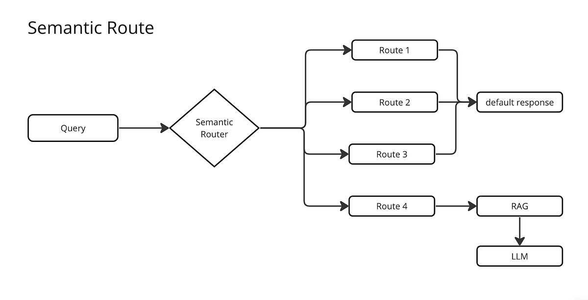

# 1.2.1 Pre-Retrieval: Intelligent Query Router

Dokumen ini masuk memasuki babak baru, yakni arena pencarian/retrieval. Komponen garis depan pertama pertahanan saat pengguna melemparkan frasa pertanyaan adalah Query Router.

---

## Konsep Dasar: Apa itu Resepsionis AI (Query Router)?

Dalam sebuah kantor perusahaan yang super besar, staf pertama yang sigap menjawab panggilan luar dari pesawat telepon adalah seorang Resepsionis (*Router*). 
Jika si penelepon sebatas berbasa-basi menyapa semisal "Selamat malam, apakah jam pelayanan sudah buka?" (*Chit-chat*), sang Resepsionis langsung merespon dengan luwes menjawabnya seraya menyapa ulang. 

Sebaliknya, kalau urgensinya berbalik drastis mendesak dan spesifik: "Segera tolong kirim dan berikan saya salinan file laporan audit finansial divisi operasional kuartal tiga di tahun tutup buku lalu!" (Kasus *Search* berat), mustahil rasanya resepsionis depan menanggapi. Ia pasti akan mentransfer estafet rute panggilan tersebut lurus tembus ke meja staf departemen khusus lemari arsip pelacakan (Dalam hal ini, Sistem Retrieval RAG Server kita). 
Terkadang, kalau celoteh pelanggan di ujung telepon di luar nalar atau membingungkan, Resepsionis ini bahkan dibekali pisau komando otonom untuk *balik bertanya detail kejelasannya* ketimbang ia bingung memprosesnya kemana-mana.

**Intelligent Query Router** adalah sesosok "Resepsionis Berotak LLM" virtual mungil gesit yang tugas mandirinya adalah mencegat/membaca kilat riwayat pesan pertanyaan awal di tiap detik sesi obrolan (*sebelum bahkan jari menyentuh tuas gigi oper gigi pencarian ke mesin Database SQL/Vektor yang rakus energi berat*), sembari cerdik men-stempel mengelompokkan keluhan kalimat sesuai bingkai tabung niat (*intent*) hati penggunanya demi pengkaryaan efisiensi jalur logik.

## Alur Singkat Mekanika Kerja Router (LLM Intent Classification)

Satu langkah detik setelah kueri ditekan dari form antarmuka web, muatannya langsung dicek silang oleh Agen Resepsionis Model Kecil (misal menggunakan Gemini opsi *super kilat suhu dingin*) untuk dilakukan labelisasi ke ranah 4 kuadran pemilahan hakiki:

1.  **Tag Kategori SEARCH (Pencarian Data Hard-Fact):** Mesin radar mencium user sedang lapar mengejar kepingan temuan fakta spesifik unik (contoh: "Apa sanksi bila saya terjerat kasus merokok di lingkungan terpadu?"). -> **Dilempar Transfer langsung masuk ke lorong utama RAG Retrieval Data Qdrant.**
2.  **Tag Kategori SUMMARIZATION (Meringkas):** Mata batin Router melihat perintah mengikat pemadatan dari user. (contoh: "Tolong bacakan intisari padat di bab tata tertib bagian perikatan pegawai."). -> **Dilempar ke RAG dengan mengubah pertanyaan sintetik palsu pencari di-rekayasa ulas menjadi frasa "Bab 1 Tata Tertib".**
3.  **Tag Kategori CHIT_CHAT (Senda-Gurau Harian):** Obrolan ringan basa-basi menyapa belaka/keluar alur (contoh: "Hai RAG, kamu malam ini capek ndak?, siapakah dirimu?"). -> **Rute pemborosan uang komputasi disumbat putus!** Ia takkan disuruh capek bolak-balik membongkar isi Database Qdrant Vector dan di bypass langsung instan ditiupkan saja nafas jawaban balasan ngobrol generik LLM semata sedetik beres! Hemat tenaga.
4.  **Tag Kategori AMBIGUOUS (Absurd/Tidak Jelas Arah Ujungnya):** Lontaran tak bernyawa karena hilangnya rantai arti kalimat dan tak sinkron pada deretan riwayat obrolan usang sebelumnya (e.g., di chat pertama berbunyi pesan singkat *Blank* "Siapa sih itu? Emang iya?" atau cuma singkatan alay membingungkan). -> **Router berkuasa penuh menghentikan proses RAG sedini mungkin, lalu membalikkan telapak menodong pertanyaan (Clarification Question) menyuruh sang manusia pengetik untuk menjelaskan rincian kerancuan pertanyaannya sendiri kembali.**

## Menggali Kedalaman Obrolan (Contextual Tracker Follow-Up)
Keajaiban magis *Router* bukan semata-mata menilah ucapan harafiah baru, akan tetapi sang resepsionis handal juga tak lepas pandang menilik rekam jejak lembaran balok *riwayat percakapan chat sebelumnya* demi meracik benang merah sambungan makna di omongan "Tanya Jawab Follow-up". 
(Bila di log percakapan pertama menanyakan perihal "Skandal Pencatutan Gaji Pegawai Tahun Angsur", lalu pertanyaan chat susulan berikutnya sang empu cuma usil mengetik *"Pihak Terlibat di Tahun berapa pak?"* — Router secara otomatis merevisi gaung query hampa tersebut kembali bermakna ke belakang merujuk "Skandal" usang di depan mata radar algoritma!)

## Wujud Contoh Output JSON Kesimpulan Sang Agen Router:
Di bawah terlampir penampakan logika hasil muntahan file format JSON oleh pikiran *LLM router* sesaat usai menimbang kueri ke depan gerbang API Qdrant-RAG:

```json
{
  "intention": "SEARCH",
  "rewritten_query": "Daftar susunan pedoman sanksi pelanggaran tindakan merokok bagi warga sipil di kawasan pekarangan area kampus binaan regulasi",
  "reasoning": "Ditemukan fakta kuat User mencoba menggali menanyakan soal rincian klausa sanksi kebijakan penegakan aturan merokok di suatu ranah spesifik.",
  "clarification_question": null
}
```


*(Peta skema penentuan rute logika)*
