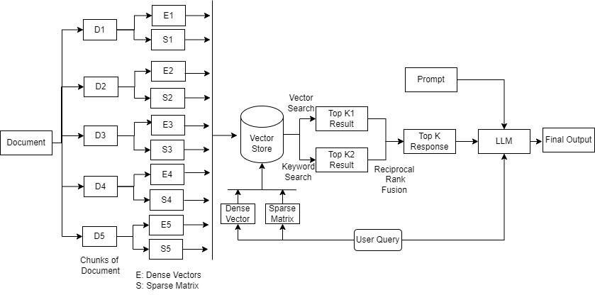
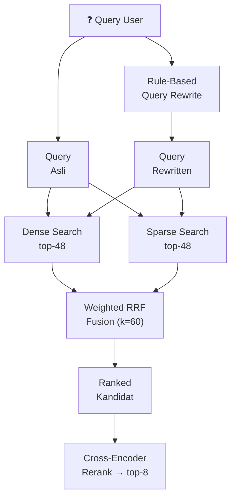

# 1.2.2 Konduktor Utama: Orchestrator & RRF Fusion

Dokumen ini membedah dapur persilangan ragam kueri buatan (Query Expansion) & trik peleburan ranking (RRF), diawasi di bawah ketukan tangan maestro Orkestra.

---

## A. Konsep Dasar: Apa itu Kehebatan Orchestrator dan Kekuatan Lebur Fusion?

-   **Orchestrator Sang Dirigen:** Banyak tutorial RAG abal-abal sekadar mengandalkan satu langkah tembakan konyol senapan primitif: (Telan query user $\rightarrow$ cari ke Vector Data persis $\rightarrow$ muntahkan tebakan ke Chat AI). Skema cetek itu jelas tidak akan pernah dilirik di lingkungan keras setingkat "Production Enterprise" yang minim celah error.
    Sistem RAG level atas tidak sembunyi bekerja pada jangkauan pergerakan satu rentetan langkah linier sempit semata. Ia membutuhkan rantai operasi pabrik berkesinambungan ter-urut rumit (Tulis Ulang kueri palsu A, Ciptakan sub-kueri hantu B, tembak pencarian berantai masif hybrid bersamaan ke dalam pusaran ruang dimensi Vector database, filter *diversity* ragam kloningan teks, saring ranking kembali ke oven *reranker*, barulah dirangkum). 
    Pilar pengontrol **Orchestrator** (dalam *engine* ekosistem Python yang terilhami dan disokong kerangka struktur *LlamaIndex/Langchain Concept*) adalah Sang "maestro dirigen pertunjukan" yang menelateni harmoni komando mengatur lalu-lintas serangkaian simfoni langkah panjang kompleks tesebut dari bilik panggung utama.

-   **Fusion (Ilmu Peleburan Papan Prestasi):** Taruhlah kiasan ibarat Anda berniat berbelanja barang idaman misterius (namun bingung tempat yang kredibel) lalu repot-repot mengetik tombol carinya beriringan di platform lapak Google Engine, Bing, Brave Search, dan lapak marketplace Amazon sekaligus berbarengan di 4 jendela komputer. Trik ini demi meraup temuan kompilasi pencarian yang tak bakal meleset!. 
    Lalu, anda membedah hasilnya: Jika ada satu situs lapak online antah berantah langka yang mencuat muncul nangkring di urutan Halaman Satu nomor jawara paling atas di hasil tarikan "Google", "Bing", DAN sekalian mejeng telak di list pucuk nomor urut "Amazon", Bisa dipastikan tanpa butuh ragu secuil pun kalau lapak website barang itu "Super Sangat Amat Relevan Tepat Sasaran! Mutlak The Best". 
    Nah, algoritma kalkulus mutakhir **Fusion** (sebagai contoh metode tenar *Reciprocal Rank Fusion/RRF*) adalah teknik *pengaduk gado-gado papan urutan prestasi* di mana mesin RAG menelusuri database membabi buta dengan taktik melepas umpan meriam seribu senapan (puluhan varian turunan kata kunci buatan LLM), lantas seluruh ranking hasilnya di-oplos menjadi satu tabel besar "Peleburan" (Fusion). 
    Dokumen kerdil apa pun yang terbukti paling frekuentif ulet muncul nimbrung konsisten di jajaran nomor tinggi dari pelbagai keragaman tebaran senapan sub-pencarian ini, kelak otomatis melambung rankingnya dirombak paksa dinaikkan derajat tahtanya hingga ke peringkat pucuk puncak tak tertandingi di laga akhir (Top Final Selected Context). Menghabisi akar masalah "Keyword Missmatch" telak!

## B. Strategi Gelar Perang: "Parallel Retrieval & RRF Fusion" (Menyergap dari Segala Arah Penjuru)

Guna menolak patuh pada metode sergapan gampangan pencarian dangkal sekali intip tunggal, Sang Orchestrator arsitektur kita mengaktifkan radar agresif menyuntik perintah meriam ganda (**Multiple Queries**) menukik serempak paralel terjun menyergap Database Qdrant:

1.  **Daya Senapan Pertama (Query Original Mentah Asli User):** Menyambar pelatuk memburu persis menembakkan ejaan huruf pertanyaan lugu (misal: "coba cari ihwal sanksi denda ketahuan ngerokok", berfungsi menjebak persentase ketat "Kata Kunci Frasa Tepat/Exact Lexical match" barangkali memang tertulis demikian slang bahasanya).
2.  **Daya Senapan Tambahan Kloning Tiruan Rekayasa (Rewritten Queries):** Menciptakan peluru kamuflase kloning terjemahan formal nan halus semantik merentang luas jangkauan konteks formal (mengubah *slang*/keraguan teks jadi "tatanan sanksi jenis beban hukuman perizinan tentang pasal pelanggaran dilarang tata tertib merokok di lahan pekarangan dinas fasilitas institusi"). Mengail lauk di samudra makna kembaran konteks semantik secara abstrak dalam pusaran koordinat vector dimensi angka Dense Retrieval.

(Rahasia dapur ngebut kita: Peretasan modifikasi pembelahan ekstensi Query sintetik buatan palsu ini tidak lagi dijahit bodoh memakai lambatnya gilingan nalar lama token LLM. Ekstensi disuling instan via cetakan formula tata regulasi leksikal statis yang super ketat tak masuk nalar secepat kedipan atom (Rule-Based Rewritter), menambal penyakit tarif server dompet jebol atau lelet latensi!).

Usai peluru nyasar pencari membredel ruang dimensi, tumpukan balok reruntuhan hasil ranking gado-gado temuan (ratusan potong konteks berjejal adu kuat sikut-sikutan di tribun), ditampung bulat lalu dilebur utuh (Oplosan) dengan tongkat sihir pusaka kalkulus sakti mandraguna: Formulir sakral **Reciprocal Rank Fusion (RRF) berskala *weighted* 60%.**
Sebuah keajaiban pengurang risiko buta. Seburuk-buruknya kegagalan salah satu metode vektor meleset buta dalam penaklukan jejak, kawan tebasan dari pilar pencarian lainnya dipastikan jadi pelindung pelindung baja penjaring anti bocor tangkapan dokumen-dokumen yang tercecer krusial.

*(Sketsa proses fusi faksi-faksi ragam kueri membuai pelukan Rank List terakhir.)*

### Diagram Alur Parallel Retrieval + RRF Fusion

---

## Navigasi

| ← Sebelumnya | Selanjutnya → |
|:---|---:|
| [1.2.1 Query Router](1.2.1-intelligent-query-router.md) | [1.2.3 Cross-Encoder Reranker](1.2.3-reranker-cross-encoder.md) |
