# 01 — Concepts & Visual Guide

This document provides a visual, in-depth exploration of the core concepts behind the RAG system. It includes diagrams, screenshots, and images that complement the technical reference pages.

---

## LLM: The Foundation

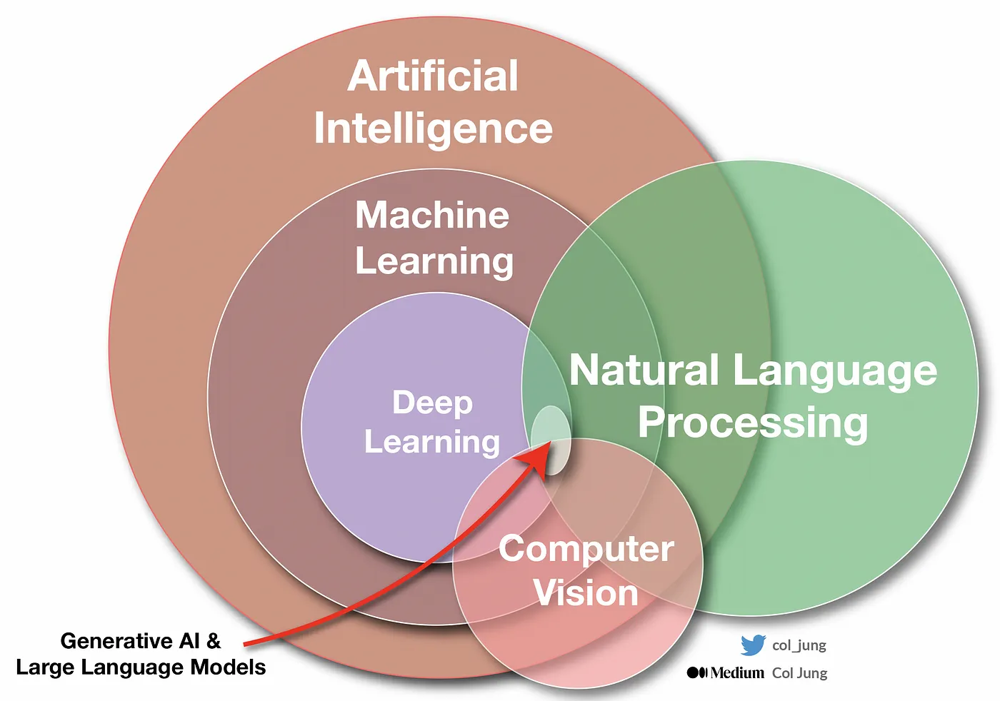

### AI Hierarchy

1. **Artificial Intelligence (AI):** The broadest circle — techniques that simulate human intelligence, from simple logic to adaptive systems.
2. **Machine Learning (ML):** A subset of AI — systems that **learn patterns from data** rather than being explicitly programmed.
3. **Deep Learning (DL):** A subset of ML — uses multi-layered Neural Networks to process complex data (images, audio, text) automatically.
4. **Generative AI & LLM:** A specific area of DL — focused on understanding and **generating** new content (like human-readable text).

**LLM (Large Language Model)** — models like GPT-4, Gemini, or Claude — are essentially "text prediction engines" trained on vast amounts of text from the internet.

### How LLMs Work (Simplified)

Think of a phone's auto-complete, but vastly more intelligent. Given the prompt *"The capital of Indonesia is..."*, it predicts the next token as *"Jakarta"* based on statistical patterns learned from billions of sentences. Modern LLMs go beyond prediction — they have **reasoning**, **coding**, and deep **contextual understanding** capabilities.

### Three Critical Weaknesses of LLMs

Despite their intelligence, LLMs have three fundamental weaknesses when used in enterprise settings:

1. **Hallucination:** When the LLM doesn't know the answer, it often **fabricates** one with extreme confidence. Dangerous for factual data.
2. **Knowledge Cut-off:** Its knowledge stops at its last training date. It doesn't know today's news or current stock prices.
3. **No Private Context:** Models like Gemini/GPT have **no access** to internal company data, SOPs, financial reports, or other private documents.

These weaknesses are exactly what **RAG (Retrieval-Augmented Generation)** was designed to solve.

---

## RAG: The Solution

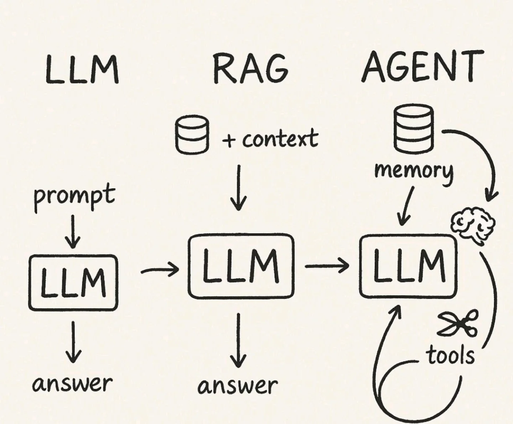

### What Problem Does RAG Solve?

Instead of asking the LLM to answer from its outdated memory, we have the system:
1. **Retrieve** — search for trusted documents from our own database
2. **Augment** — hand those documents to the LLM as "reference material"
3. **Generate** — answer the question based on those documents

### The Two Workflows

Think of the system as a library with **two separate jobs**:

1. **Storing Data (Ingestion):** *The Librarian's job.*
   - Task: Organize new books on shelves so they're ready to be found.
   - When: Done **once upfront**, before anyone asks questions.

2. **Serving Data (Retrieval & Generation):** *The Receptionist's job.*
   - Task: Find the relevant book when a visitor asks, then read the answer aloud.
   - The **Augment** step happens here — the moment the Receptionist opens the book and shows it to the LLM as a reference for the answer.
   - When: Done **on demand**, each time a user asks a question.

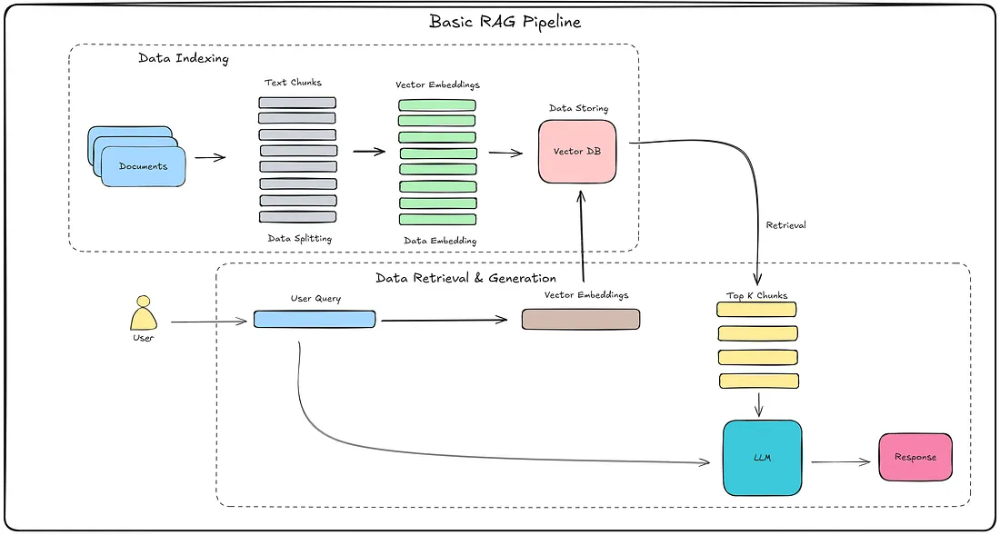

---

## How Docling Parses PDFs

Traditional parsers (PyPDF, PyMuPDF) extract text blindly based on character coordinates — they lose structure when encountering multi-column layouts, merged table cells, or page headers/footers.

**Docling** uses a **Vision-Language Model (VLM)** to "see" each page like a human eye before reconstructing its structure:

- **Table Understanding:** Detects abstract grids and converts them to clean Markdown tables, preserving row-column relationships.
- **Layout Analysis:** Automatically detects headings, subheadings, paragraphs, and — critically — strips headers and footers so page numbers don't contaminate the knowledge base.
- **OCR Capabilities:** Seamlessly reads both typed text and text locked in flattened image scans, while preserving the original heading hierarchy.

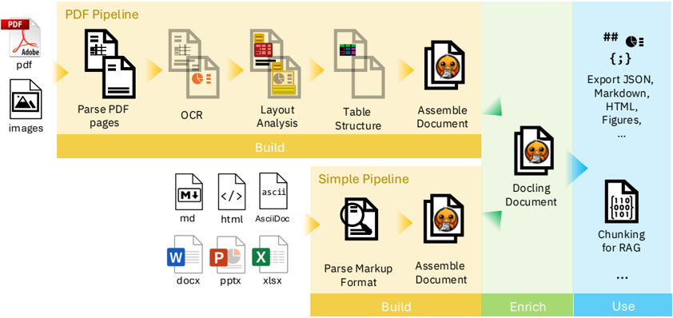

---

## Understanding Hybrid Search

The system uses **two search strategies simultaneously** to maximize recall:

- **Dense Search (Semantic):** Catches meaning-similar text. "Car accident" matches "vehicle collision" despite completely different words.
- **Sparse Search (Keyword):** Catches exact terms. "Article 404" matches precisely — no semantic drift.
- **Hybrid Search:** Combines both for near-complete coverage.

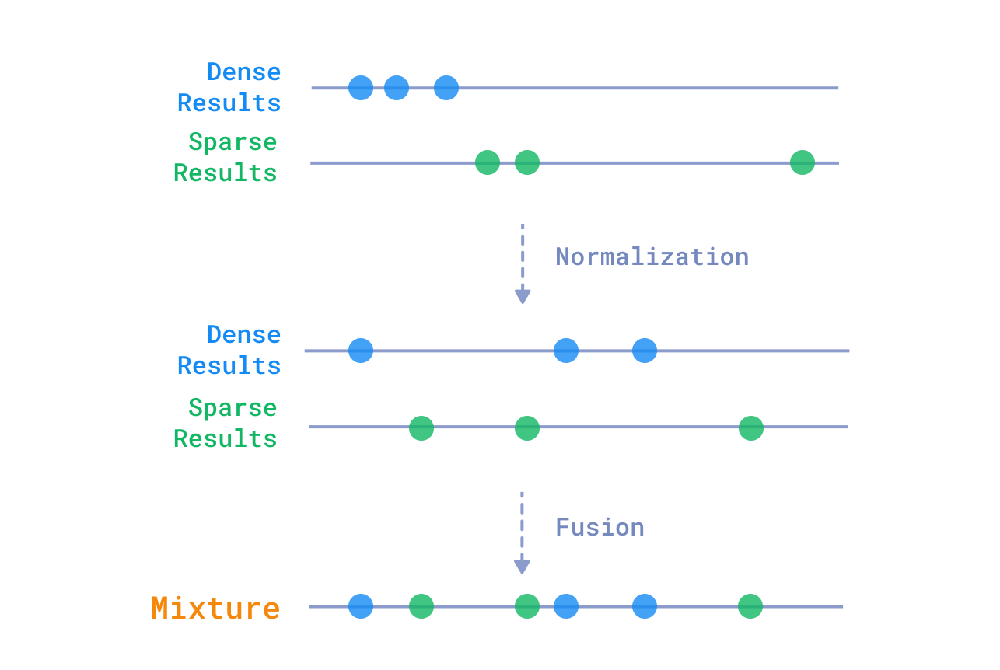

---

## Query Routing: The AI Receptionist

The Query Router classifies every incoming question before triggering any search:

- **SEARCH:** Factual question → full retrieval pipeline
- **SUMMARIZATION:** Summary request → retrieval with broader context
- **CHIT_CHAT:** Casual greeting → direct LLM response, no database query
- **AMBIGUOUS:** Unclear intent → ask for clarification

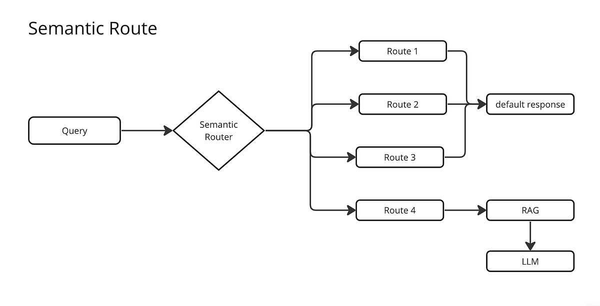

---

## RRF Fusion: Merging Multiple Search Results

The system fires multiple search queries in parallel (original + rewritten, Dense + Sparse), then merges all results using **Reciprocal Rank Fusion (RRF)**:

A document that consistently ranks high across **multiple** search strategies is almost certainly relevant. RRF promotes these documents to the top of the final ranking.

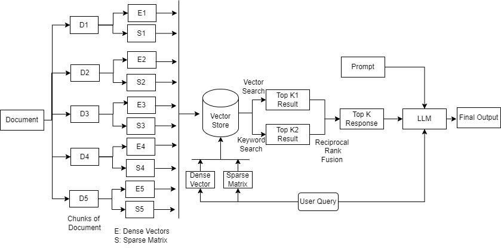

---

## Application Architecture

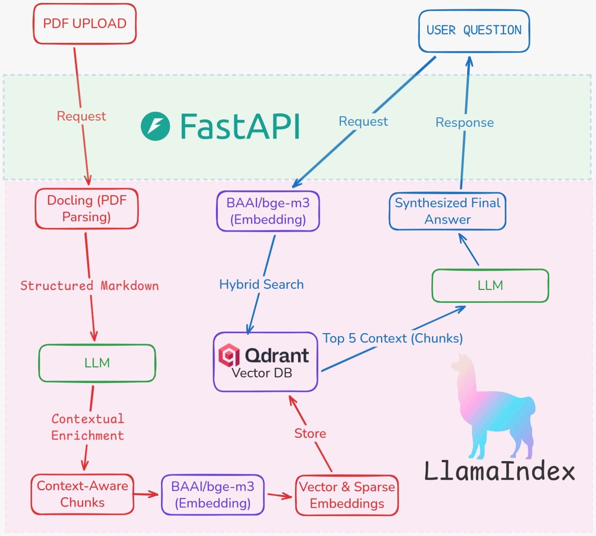

The system consists of **three components**:

| Component | Technology | Port | Role |
|-----------|-----------|------|------|
| **Frontend** | Streamlit | 8501 | Web UI for uploading PDFs, chatting, and managing documents |
| **Gateway** | ASP.NET Core (.NET) | 8080 | Public API, chat orchestration, query routing, citation validation |
| **Worker** | FastAPI (Python) | 8000 | PDF ingestion, embedding, hybrid retrieval, reranking |
| **Vector DB** | Qdrant (Docker) | 6333/6334 | Dense + Sparse vector storage, hybrid search |

### Separation of Concerns

| Aspect | Gateway (.NET) | Worker (Python) |
|--------|----------------|-----------------|
| **Focus** | Orchestration & business logic | ML pipeline & data processing |
| **Main Tasks** | Routing, answer generation, citation validation, document management | PDF parsing, embedding, hybrid search, reranking |
| **Qdrant Access** | Native gRPC (document CRUD) | REST API (ingestion & search) |
| **LLM Usage** | Multi-agent (router, chit-chat, grounded-answer) | Enrichment during ingestion |

---

## User Interface

### Main View

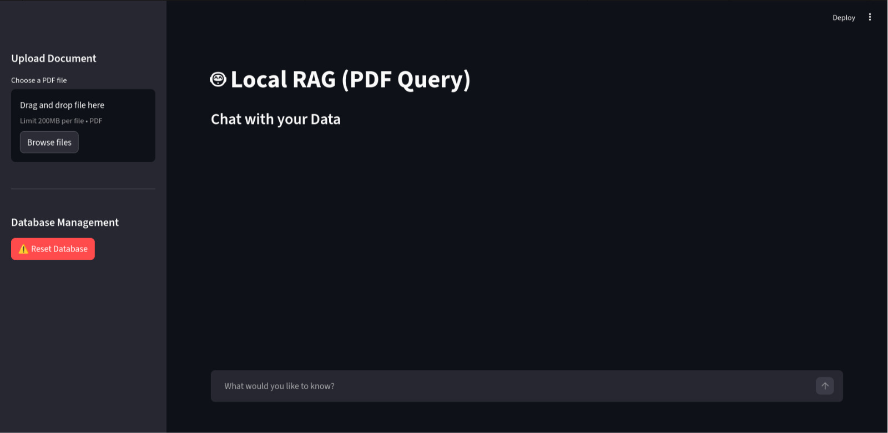

The Streamlit interface features:
1. **Sidebar — Upload Document:** Area for uploading one or more PDF files and an "Ingest Document" button
2. **Sidebar — Document Management:** List of ingested documents with per-document delete options
3. **Sidebar — Database Management:** Reset button to clear all Qdrant data
4. **Chat Area:** Input for questions and area displaying answers with source references
5. **Streaming Response:** Answers appear token by token in real-time (SSE)
6. **Expandable Sources:** Each answer includes sources that can be expanded to view the original text

### Upload & Ingestion Flow

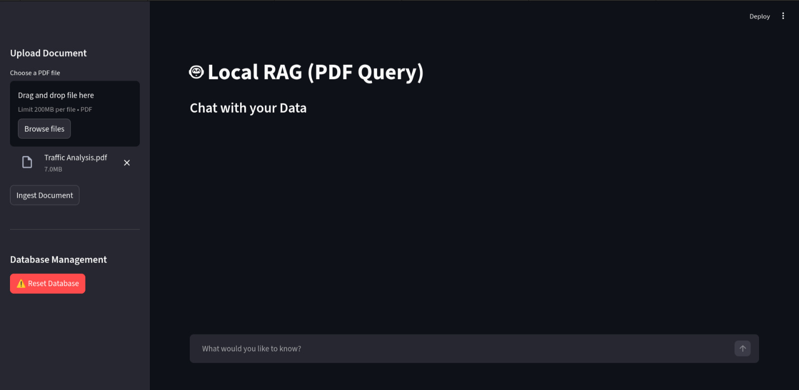

Users select PDF files from their local computer via the Streamlit file uploader.

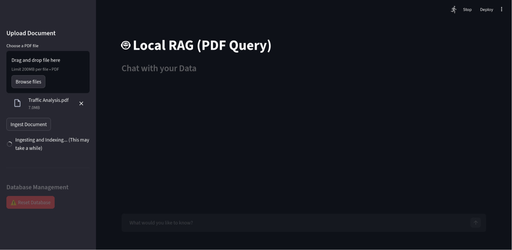

The ingestion process may take several minutes depending on PDF size and hardware specifications.

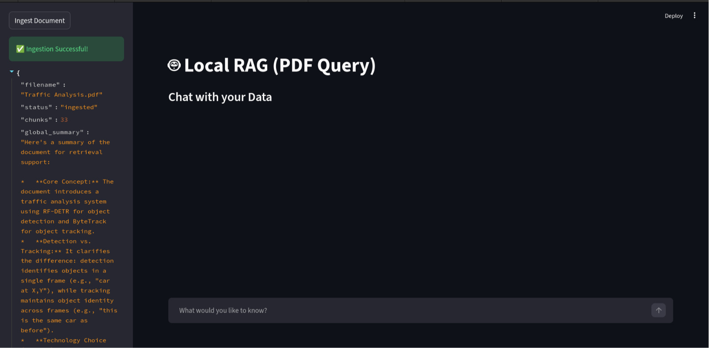

On completion, the system displays the filename, status, chunk count, auto-generated global summary, and unique doc_id.

### Chat in Action

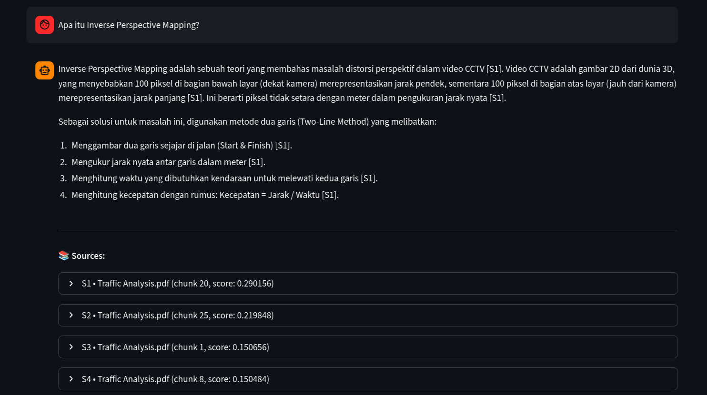

**Relevant Answer.** The LLM provides answers based on retrieved chunks. Citations like `[S1]`, `[S2]` indicate which sources were used. Users can expand to view the original text.

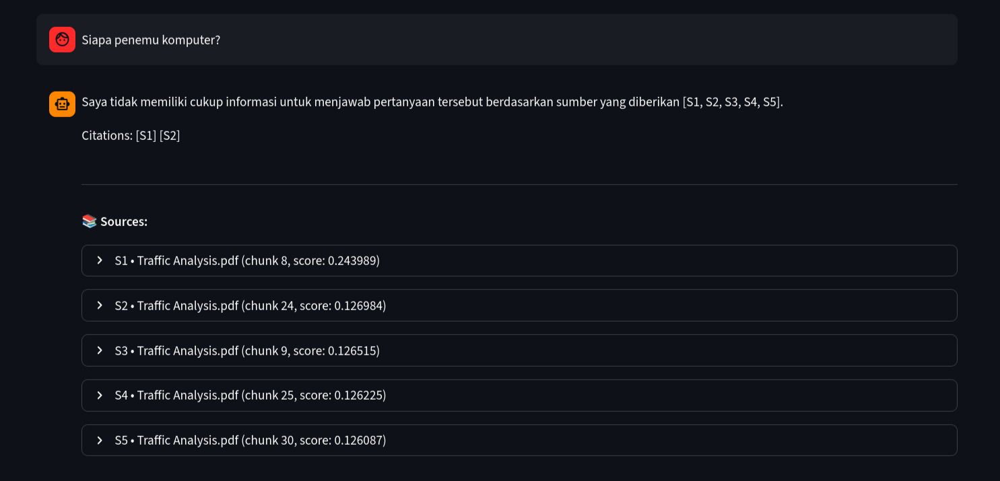

**Irrelevant/Ambiguous Questions.** When the question is outside the document scope, the system acknowledges it cannot answer rather than hallucinating.

---

## Running with Docker

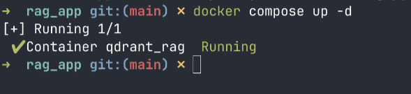

Qdrant runs at `localhost:6333` (REST) and `localhost:6334` (gRPC) with data stored in the `qdrant-storage` volume.

---

## GPU & Memory Usage

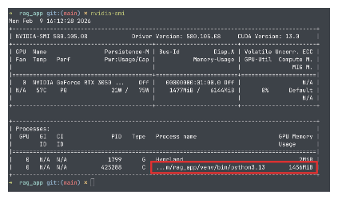

**Cloud API (recommended):** When using Gemini/OpenAI as the LLM provider, only the embedding model (BGE-M3) needs GPU — consuming approximately **1.4GB VRAM**. No GPU is needed for the LLM itself.

**Local LLM (Ollama):** If running a local LLM, add the model's VRAM requirements on top of the embedding model (minimum 4GB VRAM total recommended).

---

## Code Tour Highlights

### Gateway: Agent Setup (Program.cs)

```csharp
// Program.cs (condensed)
builder.Services.AddAgentOrchestration(options =>
{
    options.UseGemini(geminiApiKey);

    options.AddAgent("query-router", agent => {
        agent.UseModel(routerModel);
        agent.UseTemperature(0.1f);
        agent.UseSystemPrompt(PromptTemplates.RouterSystemPrompt);
    });

    options.AddAgent("chit-chat", agent => {
        agent.UseModel(chitChatModel);
        agent.UseTemperature(0.7f);
        agent.UseSystemPrompt(PromptTemplates.ChitChatSystemPrompt);
    });

    options.AddAgent("grounded-answer", agent => {
        agent.UseModel(groundedModel);
        agent.UseTemperature(0.1f);
        agent.UseSystemPrompt(PromptTemplates.GroundedAnswerSystemPrompt);
    });

    // Resilience pipeline
    options.Pipeline(pipeline => {
        pipeline.UseRetry(retry => retry.MaxRetries = 3);
        pipeline.UseTimeout(TimeSpan.FromSeconds(90));
        pipeline.UseRateLimit(rate => rate.PermitsPerMinute = 120);
    });
});
```

### Gateway Code Map

| Component | File | Responsibility |
|-----------|------|---------------|
| Chat endpoints | `Controllers/ChatController.cs` | `/api/chat`, `/api/chat/stream` |
| Proxy + doc mgmt | `Controllers/ApiProxyController.cs` | `/api/ingest`, `/api/documents` |
| System prompts | `Services/PromptTemplates.cs` | Router, answer, repair prompts |
| Worker communication | `Services/PythonWorkerClient.cs` | HTTP to `/internal/retrieve-context` |
| Citation validation | `Services/CitationValidator.cs` | Extract & validate `[Sx]` tags |
| Route parsing | `Services/RouteDecisionParser.cs` | Parse router JSON output |
| Document CRUD | `Services/QdrantDocumentService.cs` | Native gRPC to Qdrant |

### Worker: Entry Point (main.py)

```python
# main.py (condensed)
from fastapi import FastAPI
from contextlib import asynccontextmanager
from app.bootstrap.container import init_container

@asynccontextmanager
async def lifespan(app: FastAPI):
    init_container()  # Load BGE-M3 + Reranker singletons
    yield

app = FastAPI(title="RAG Worker", lifespan=lifespan)
app.include_router(router, prefix="/api")
app.include_router(internal_router)
```

### Worker Code Map

| Component | File | Responsibility |
|-----------|------|---------------|
| Ingestion endpoint | `app/api/endpoints.py` | `POST /api/ingest` |
| Retrieval endpoint | `app/api/endpoints.py` | `POST /internal/retrieve-context` |
| DI container | `app/bootstrap/container.py` | Wires all use cases |
| Configuration | `app/core/config.py` | All settings (Pydantic) |
| Ingestion features | `app/features/ingestion/` | Docling, chunking, embedding, upsert |
| Retrieval features | `app/features/retrieval/` | Search, rewrite, RRF, rerank |
| Model singletons | `app/shared/runtime/` | BGE-M3, Reranker (loaded once) |

### Worker Architecture: Hexagonal (Ports & Adapters)

```
features/
├── ingestion/
│   ├── application/    → Use cases (orchestrate ingestion flow)
│   ├── infrastructure/ → Implementations (Docling, chunking, embedding, Qdrant upsert)
│   └── ports/          → Interfaces/contracts
│
├── retrieval/
│   ├── application/    → Use cases (orchestrate retrieval flow)
│   ├── infrastructure/ → Implementations (search, RRF, reranker, context assembly)
│   └── ports/          → Interfaces/contracts
│
└── common/             → Shared utilities (text normalization, ID generation)
```

---

## Full Architecture Diagram

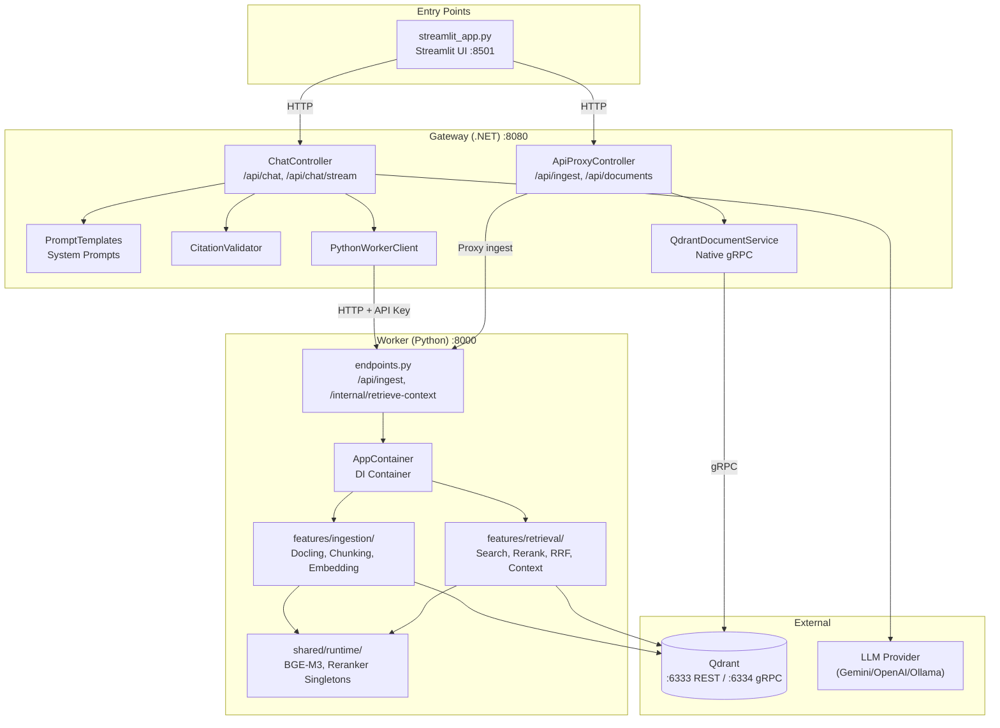

---

## Evaluation & Testing

### Quick Chat Check (`test_rag.py`)

A smoke test script that verifies the pipeline works end-to-end:

```bash
cd worker
python3 test_rag.py
```

Sends a test query to `http://localhost:8080/api` using streaming (SSE), with fallback to non-streaming.

### Quality Evaluation (`evaluate_rag.py`)

Runs a series of queries and measures answer quality:

```bash
cd worker
python3 evaluate_rag.py
python3 evaluate_rag.py --cases ./my_eval_cases.json  # Custom test cases
python3 evaluate_rag.py --out ./report.json            # Save report
```

#### Metrics

| Metric | Description | Target |
|--------|-------------|--------|
| `success_rate` | Percentage of successful requests (HTTP 200) | 100% |
| `citation_presence_rate` | Percentage of answers containing `[S1]`, `[S2]` citations | > 90% |
| `citation_valid_rate` | Percentage of valid citations (ID matches sources) | 100% |
| `avg_source_count` | Average number of sources per answer | ~5 |
| `avg_grounding_overlap` | Average token overlap between answer and sources | > 0.5 |

#### Example Output

```
RAG Evaluation
================================================================================
q1       OK    citations=['S1', 'S2'] sources=5 grounding=0.72
q2       OK    citations=['S1', 'S3'] sources=5 grounding=0.65
q3       OK    citations=['S2']       sources=5 grounding=0.58
--------------------------------------------------------------------------------
cases_total: 3
success_rate: 1.000
citation_presence_rate: 1.000
citation_valid_rate: 1.000
avg_source_count: 5.000
avg_grounding_overlap: 0.650
```

### API Testing with Postman

Postman serves as the **API contract** between the RAG team and backend engineers integrating the system:

#### Environment Variables

| Variable | Value |
|----------|-------|
| `gateway_base_url` | `http://localhost:8080` |
| `worker_base_url` | `http://localhost:8000` |
| `internal_api_key` | *(your INTERNAL_API_KEY)* |

#### Chat Endpoint (Most Important for Integration)

```http
POST {{gateway_base_url}}/api/chat
Content-Type: application/json

{
  "messages": [
    { "role": "user", "content": "What is the summary of this document?" }
  ]
}
```

**Response:**

```json
{
  "response": "Based on the document, ... [S1] [S2]",
  "sources": [
    {
      "id": "S1",
      "filename": "document.pdf",
      "doc_id": "abc123",
      "chunk_id": "...",
      "text": "...original text snippet..."
    }
  ]
}
```

#### Worker Internal Endpoint (Debug Only)

```http
POST {{worker_base_url}}/internal/retrieve-context
X-Internal-Api-Key: {{internal_api_key}}
Content-Type: application/json

{
  "messages": [
    { "role": "user", "content": "What is the approval flow in this SOP?" }
  ],
  "max_sources": 5
}
```

For the full Postman guide with all response shapes, see `POSTMAN.md` in the project root.

**Next:** [02 — Ingestion Pipeline](02-ingestion-pipeline.md) provides the technical reference for each ingestion component.
