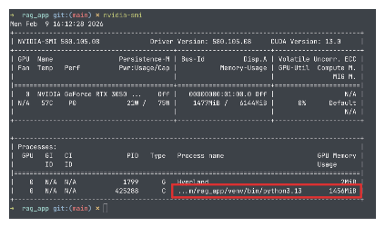
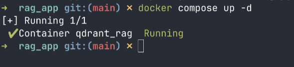

# 1.2 Cara Menjalankan Aplikasi

Dokumen ini menjelaskan langkah-langkah untuk menjalankan aplikasi RAG, baik menggunakan Docker maupun secara lokal.

---

## Daftar Isi
- [1. Prasyarat](#1-prasyarat)
- [2. Menjalankan Qdrant (Docker Compose)](#2-menjalankan-qdrant-docker-compose)
- [3. Konfigurasi Secrets](#3-konfigurasi-secrets)
- [4. Menjalankan Aplikasi](#4-menjalankan-aplikasi)
- [5. Testing API dengan Postman](#5-testing-api-dengan-postman)
- [6. Troubleshooting Umum](#6-troubleshooting-umum)

---

## 1. Prasyarat

Sebelum menjalankan aplikasi, pastikan sistem Anda memenuhi persyaratan berikut:

### A. Software yang Diperlukan

| Software | Versi Minimum | Keterangan |
|----------|---------------|------------|
| **Python** | 3.10+ (direkomendasikan 3.13) | Runtime Worker (FastAPI) |
| **.NET SDK** | 10.0+ | Runtime Gateway (ASP.NET Core) |
| **Docker & Docker Compose** | Terbaru | Untuk menjalankan Qdrant |
| **Ollama** | Terbaru | Untuk menjalankan LLM lokal (Opsional) |
| **CUDA Toolkit** | 12.x (opsional) | Jika menggunakan GPU NVIDIA |
| **Postman** | Terbaru | Untuk testing API (opsional, lihat [section 5](#5-testing-api-dengan-postman)) |

### B. Model Lokal (Opsional)

Jika Anda berencana menggunakan **Local LLM** (tanpa internet/biaya API), unduh model berikut. **Jika menggunakan Cloud API (Gemini/OpenAI), lewati langkah ini.**

```bash
# Unduh model LLM (gemma3:4b direkomendasikan untuk VRAM 6GB)
ollama pull gemma3:4b

# Pastikan Ollama berjalan
ollama serve
```

### C. Catatan GPU

**Rekomendasi:** Penggunaan **Cloud API (seperti Gemini)** sangat disarankan untuk performa terbaik dan kebutuhan hardware yang minim.

Jika menggunakan Local LLM, aplikasi ini dioptimalkan untuk GPU NVIDIA dengan minimal VRAM 4GB. Jika menggunakan Cloud API, kebutuhan VRAM hanya sekitar **1.5GB** (hanya untuk embedding).

Berikut penggunaan memori tipikal:



**nvidia-smi output.** Embedding model BGE-M3 menggunakan sekitar 1.4GB VRAM. Sisa VRAM digunakan untuk Ollama saat inferensi.

---

## 2. Menjalankan Qdrant (Docker Compose)

Docker Compose digunakan untuk menjalankan **Qdrant** (Vector Database).

### Langkah-langkah:

**1. Jalankan Qdrant dari root project:**
```bash
docker compose up -d
```



**Docker Compose berhasil.** Qdrant berjalan di `localhost:6333` (REST) dan `localhost:6334` (gRPC) dengan data disimpan di volume `qdrant_storage`.

**2. Verifikasi Qdrant berjalan:**
```bash
# Cek status container
docker ps | grep qdrant

# Atau akses dashboard Qdrant di browser
# http://localhost:6333/dashboard
```

### Konfigurasi docker-compose.yml:
```yaml
services:
  qdrant:
    image: qdrant/qdrant:latest
    container_name: qdrant_rag
    ports:
      - "6333:6333"
      - "6334:6334"
    volumes:
      - qdrant_storage:/qdrant/storage
    restart: always

volumes:
  qdrant_storage:
```

---

## 3. Konfigurasi Secrets

Sistem membutuhkan API key di **dua tempat** — satu untuk tiap service.

### A. Generate Internal API Key

```bash
openssl rand -hex 24
# → contoh: 711f9fdf363c689d23b475b47ae826327ce351e1496901ee
```

Simpan key ini — akan digunakan di Worker DAN Gateway.

### B. Worker Secrets (`.env`)

Salin template dan edit:
```bash
cp .env.example .env
```

Edit `.env`:
```env
INTERNAL_API_KEY="<paste key dari langkah A>"
GOOGLE_API_KEY="AIzaSy..."
```

### C. Gateway Secrets (`gateway/appsettings.Development.json`)

Buat file `gateway/appsettings.Development.json`:
```json
{
  "Gateway": {
    "InternalApiKey": "<key yang sama dengan .env>"
  },
  "Gemini": {
    "ApiKey": "<GOOGLE_API_KEY yang sama dengan .env>"
  }
}
```

> **Penting:** File `appsettings.json` berisi default config (models, timeouts, URL) yang di-track di git. Secrets diletakkan di `appsettings.Development.json` yang **gitignored**. .NET otomatis merge keduanya saat runtime.

> **Kedua service harus menggunakan `INTERNAL_API_KEY` yang sama** — Gateway mengirimnya sebagai header, Worker memvalidasinya.

---

## 4. Menjalankan Aplikasi

Setelah Qdrant dan secrets terkonfigurasi, jalankan **3 komponen** di terminal terpisah:

### A. Terminal 1 — Worker (Python)

```bash
cd worker
python3 -m venv venv && source venv/bin/activate
pip install -r requirements.txt
python3 main.py
```

Output yang diharapkan:
```
INFO:     Loading Shared BGE-M3 Model (GPU): BAAI/bge-m3
INFO:     Loading cross-encoder reranker: BAAI/bge-reranker-base
INFO:     Uvicorn running on http://0.0.0.0:8000
```

> **First run:** Model BGE-M3 (~1.7GB) dan BGE-reranker-base akan otomatis diunduh. Ini hanya terjadi sekali.

### B. Terminal 2 — Gateway (.NET)

```bash
cd gateway
export $(grep -v '^#' ../.env | xargs)
dotnet run
```

Output yang diharapkan:
```
info: Microsoft.Hosting.Lifetime[14]
      Now listening on: http://localhost:8080
```

> **Catatan:** Perintah `export` memuat shared secrets dari `.env` ke environment Gateway.

### C. Terminal 3 — Streamlit UI

```bash
streamlit run streamlit_app.py
```

Output yang diharapkan:
```
  You can now view your Streamlit app in your browser.

  Local URL: http://localhost:8501
  Network URL: http://192.168.x.x:8501
```

> UI terhubung ke Gateway di `http://localhost:8080/api` secara default. Override dengan:
> ```bash
> export RAG_API_URL="http://localhost:8080/api"
> ```

### Ringkasan Port

| Service | Port | URL |
|---------|------|-----|
| Qdrant (REST) | 6333 | http://localhost:6333/dashboard |
| Qdrant (gRPC) | 6334 | - |
| Worker (Python) | 8000 | http://localhost:8000 |
| Gateway (.NET) | 8080 | http://localhost:8080 |
| Streamlit UI | 8501 | http://localhost:8501 |

---

## 5. Testing API dengan Postman

### Mengapa Postman?

Postman digunakan sebagai **tool standar untuk testing dan dokumentasi API**. Ini sangat penting untuk:
-   **Integrasi Backend Engineer:** Postman collection menjadi rujukan bagi backend engineer yang akan mengintegrasikan API RAG ke dalam sistem lain (website, mobile app, internal tools).
-   **Onboarding Cepat:** Developer baru bisa langsung test semua endpoint tanpa menulis kode.
-   **Dokumentasi Hidup:** Collection Postman berfungsi sebagai dokumentasi API yang selalu up-to-date.

### Setup Environment Postman

Buat environment baru (misal: `rag-local`) dengan variabel:

| Variable | Value |
|----------|-------|
| `gateway_base_url` | `http://localhost:8080` |
| `worker_base_url` | `http://localhost:8000` |
| `internal_api_key` | *(INTERNAL_API_KEY Anda)* |

### Endpoint yang Bisa Ditest

#### Ingestion (Upload PDF)
-   **Method:** `POST`
-   **URL:** `{{gateway_base_url}}/api/ingest`
-   **Body:** `form-data` — Key: `file` (type: File), Value: pilih PDF

#### Chat (Tanya Jawab)
-   **Method:** `POST`
-   **URL:** `{{gateway_base_url}}/api/chat`
-   **Headers:** `Content-Type: application/json`
-   **Body (raw JSON):**
```json
{
  "messages": [
    { "role": "user", "content": "Apa ringkasan dokumen ini?" }
  ]
}
```

#### Retrieval Only (Worker Internal)
-   **Method:** `POST`
-   **URL:** `{{worker_base_url}}/internal/retrieve-context`
-   **Headers:** `Content-Type: application/json`, `X-Internal-Api-Key: {{internal_api_key}}`
-   **Body (raw JSON):**
```json
{
  "messages": [
    { "role": "user", "content": "Apa alur persetujuan di SOP ini?" }
  ],
  "max_sources": 5
}
```

#### Document Management
| Method | Endpoint | Fungsi |
|--------|----------|--------|
| `GET` | `/api/documents` | List semua dokumen |
| `GET` | `/api/documents/{docId}` | Detail satu dokumen |
| `DELETE` | `/api/documents/{docId}` | Hapus berdasarkan doc_id |
| `DELETE` | `/api/documents/by-filename?filename=X` | Hapus berdasarkan filename |
| `DELETE` | `/api/reset` | Hapus seluruh koleksi |

Untuk panduan lengkap beserta contoh response, lihat file `POSTMAN.md` di root project.

---

## 6. Troubleshooting Umum

### A. "Connection refused" ke Qdrant

**Gejala:**
```
qdrant_client.http.exceptions.UnexpectedResponse: Connection refused
```

**Solusi:**
1. Pastikan Docker berjalan: `docker ps`
2. Restart Qdrant: `docker compose restart qdrant`
3. Cek port tidak terpakai: `lsof -i :6333`

### B. "CUDA out of memory"

**Gejala:**
```
torch.cuda.OutOfMemoryError: CUDA out of memory
```

**Solusi:**
1. Gunakan Cloud API (Gemini) — tidak butuh GPU untuk LLM
2. Pastikan hanya satu instance embedding model berjalan
3. Jika pakai local LLM, gunakan model lebih kecil: `gemma3:1b`

### C. Model BGE-M3 Tidak Terload

**Gejala:**
```
OSError: BAAI/bge-m3 not found
```

**Solusi:**
Model akan otomatis diunduh saat pertama kali dijalankan. Pastikan:
1. Koneksi internet aktif
2. Ada ruang disk cukup (~2GB untuk model)
3. Jika offline, unduh manual ke cache HuggingFace

### D. Ollama "Connection Error"

**Gejala:**
```
httpx.ConnectError: [Errno 111] Connection refused
```

**Solusi:**
1. Pastikan Ollama service berjalan: `ollama serve`
2. Cek model sudah diunduh: `ollama list`
3. Verifikasi URL di `.env`: `OLLAMA_BASE_URL="http://localhost:11434"`

### E. Gateway "401/403" saat Chat

**Gejala:**
```json
{"detail": "Missing or invalid internal API key"}
```

**Solusi:**
1. Pastikan `INTERNAL_API_KEY` di `.env` dan `appsettings.Development.json` sama persis
2. Restart Gateway setelah mengubah config
3. Pastikan perintah `export $(grep -v '^#' ../.env | xargs)` dijalankan sebelum `dotnet run`

### F. Gateway Timeout

**Gejala:**
```json
{"detail": "Permintaan melebihi batas waktu."}
```

**Solusi:**
1. Pastikan Worker berjalan di `localhost:8000`
2. Tingkatkan `WorkerTimeoutSeconds` di `gateway/appsettings.json` (default: 600)
3. Untuk ingestion dokumen besar, proses memang bisa memakan waktu lama