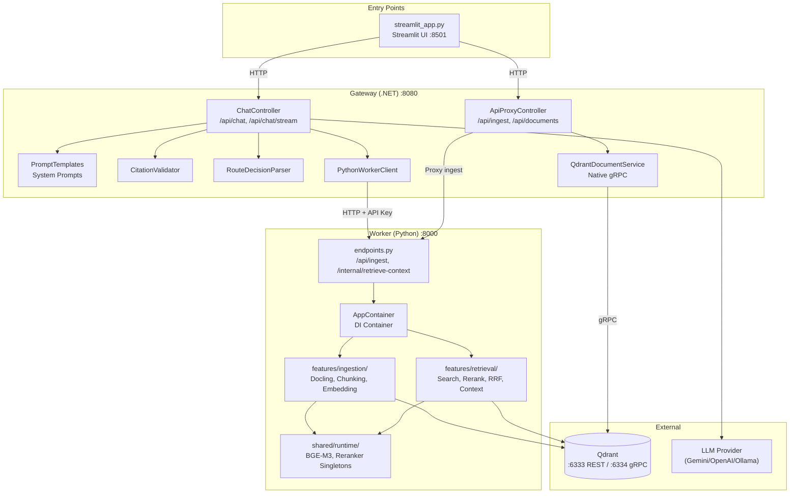

# 1.4 Tur Kode dan Arsitektur

Dokumen ini adalah panduan eksplorasi kode aplikasi RAG, menjelaskan struktur direktori, tanggung jawab setiap modul, dan bagaimana komponen-komponen saling terhubung.

---

## Daftar Isi
- [1. Struktur Direktori](#1-struktur-direktori)
- [2. Gateway (.NET) — Code Tour](#2-gateway-net--code-tour)
  - [A. Program.cs — Entry Point](#a-programcs--entry-point)
  - [B. Controllers](#b-controllers)
  - [C. Services](#c-services)
  - [D. Models](#d-models)
- [3. Worker (Python) — Code Tour](#3-worker-python--code-tour)
  - [A. main.py — Entry Point](#a-mainpy--entry-point)
  - [B. API Layer](#b-api-layer)
  - [C. Features](#c-features)
  - [D. Bootstrap & Shared](#d-bootstrap--shared)
- [4. Streamlit UI](#4-streamlit-ui)
- [5. Diagram Arsitektur Lengkap](#5-diagram-arsitektur-lengkap)

---

## 1. Struktur Direktori

```
enterprise-rag-system/
├── docker-compose.yml              # Qdrant container
├── .env.example                     # Secrets (Worker + shared)
├── streamlit_app.py                 # Streamlit chat + admin UI
│
├── gateway/                         # .NET API Gateway
│   ├── RagGateway.csproj
│   ├── Program.cs                   # Service registration + agent setup
│   ├── appsettings.json             # Default config (tracked in git)
│   ├── appsettings.Development.json # API keys & secrets (gitignored)
│   ├── Controllers/
│   │   ├── ChatController.cs        # POST /api/chat, /api/chat/stream
│   │   └── ApiProxyController.cs    # Proxy ingest + native doc management
│   ├── Services/
│   │   ├── QdrantDocumentService.cs # Native Qdrant gRPC operations
│   │   ├── PromptTemplates.cs       # System prompts (router/answer/repair)
│   │   ├── PythonWorkerClient.cs    # HTTP client untuk Worker
│   │   ├── CitationValidator.cs     # Validasi sitasi dalam jawaban
│   │   ├── MessageNormalizer.cs     # Format pesan chat
│   │   └── RouteDecisionParser.cs   # Parse JSON output router
│   └── Models/
│       ├── ApiContracts.cs          # Public API request/response
│       ├── DocumentContracts.cs     # Document management DTOs
│       ├── GatewayOptions.cs        # Konfigurasi gateway
│       ├── QdrantOptions.cs         # Konfigurasi Qdrant
│       └── WorkerContracts.cs       # Worker API models
│
└── worker/                          # Python RAG Worker
    ├── main.py                      # FastAPI entry point
    ├── requirements.txt
    ├── evaluate_rag.py              # RAG quality evaluation
    ├── test_rag.py                  # Quick CLI chat check
    └── app/
        ├── api/
        │   └── endpoints.py         # Route handlers (ingest + internal retrieve)
        ├── bootstrap/
        │   └── container.py         # Dependency injection container
        ├── core/
        │   └── config.py            # Settings (mostly hardcoded best-config)
        ├── models/
        │   └── schemas.py           # Pydantic request/response models
        ├── features/
        │   ├── ingestion/           # PDF parsing, chunking, embedding, upsert
        │   │   ├── application/     # Use cases
        │   │   ├── infrastructure/  # Implementations (Docling, chunking, embedding)
        │   │   └── ports/           # Interfaces/contracts
        │   ├── retrieval/           # Hybrid search, reranking, context assembly
        │   │   ├── application/     # Use cases
        │   │   ├── infrastructure/  # Implementations (search, reranker, RRF)
        │   │   └── ports/           # Interfaces/contracts
        │   └── common/              # Shared text utilities
        └── shared/
            └── runtime/             # Singleton initialization (embeddings, reranker)
```

---

## 2. Gateway (.NET) — Code Tour

### A. Program.cs — Entry Point

File ini mengkonfigurasi seluruh dependency injection dan agent pipeline.

```csharp
// Program.cs (ringkasan)
var builder = WebApplication.CreateBuilder(args);

// Qdrant native gRPC client
builder.Services.Configure<QdrantOptions>(config.GetSection("Qdrant"));
builder.Services.AddSingleton<QdrantDocumentService>();

// Gateway options + Worker HTTP client
builder.Services.Configure<GatewayOptions>(config.GetSection("Gateway"));
builder.Services.AddHttpClient<PythonWorkerClient>();

// Multi-Agent Pipeline (3 agen LLM)
builder.Services.AddAgentOrchestration(options =>
{
    options.UseGemini(geminiApiKey);

    options.AddAgent("query-router", agent => {
        agent.UseModel(routerModel);
        agent.UseTemperature(0.1f);
        agent.UseSystemPrompt(PromptTemplates.RouterSystemPrompt);
    });

    options.AddAgent("chit-chat", agent => {
        agent.UseModel(chitChatModel);
        agent.UseTemperature(0.7f);
        agent.UseSystemPrompt(PromptTemplates.ChitChatSystemPrompt);
    });

    options.AddAgent("grounded-answer", agent => {
        agent.UseModel(groundedModel);
        agent.UseTemperature(0.1f);
        agent.UseSystemPrompt(PromptTemplates.GroundedAnswerSystemPrompt);
    });

    // Resilience pipeline
    options.Pipeline(pipeline => {
        pipeline.UseRetry(retry => retry.MaxRetries = 3);
        pipeline.UseTimeout(TimeSpan.FromSeconds(90));
        pipeline.UseRateLimit(rate => rate.PermitsPerMinute = 120);
    });
});
```

**Tanggung Jawab:**
-   Registrasi semua service + DI container
-   Konfigurasi 3 LLM agent dengan model dan temperature masing-masing
-   Setup resilience (retry, timeout, rate limit)
-   Global exception handler

### B. Controllers

#### ChatController.cs

Menghandle 2 endpoint chat utama.

| Method | Path | Fungsi |
|--------|------|--------|
| `POST` | `/api/chat` | Non-streaming chat — return full answer + sources |
| `POST` | `/api/chat/stream` | Streaming chat via SSE (Server-Sent Events) |

**Alur Internal `Chat()`:**
1.  Normalize messages (`MessageNormalizer`)
2.  Route query via `query-router` agent
3.  Jika SEARCH/SUMMARIZATION: panggil Worker → generate grounded answer → validate citation
4.  Jika CHIT_CHAT: jawab langsung via `chit-chat` agent
5.  Jika AMBIGUOUS: kembalikan clarification question

#### ApiProxyController.cs

| Method | Path | Fungsi |
|--------|------|--------|
| `POST` | `/api/ingest` | Proxy upload PDF ke Worker |
| `GET` | `/api/documents` | List semua dokumen (native gRPC) |
| `GET` | `/api/documents/{docId}` | Detail satu dokumen |
| `DELETE` | `/api/documents/{docId}` | Hapus berdasarkan doc_id |
| `DELETE` | `/api/documents/by-filename` | Hapus berdasarkan filename |
| `DELETE` | `/api/reset` | Hapus seluruh koleksi |

**Catatan:** Ingest di-proxy ke Worker karena butuh library Python (Docling, BGE-M3). Document management langsung via Qdrant gRPC karena hanya operasi CRUD metadata.

### C. Services

| Service | Tanggung Jawab |
|---------|---------------|
| `PromptTemplates` | System prompts untuk ketiga agent + builder functions untuk user prompts |
| `PythonWorkerClient` | HTTP client yang berkomunikasi dengan Worker (`/internal/retrieve-context`) |
| `CitationValidator` | Ekstraksi dan validasi `[S1]`, `[S2]` dalam jawaban LLM |
| `RouteDecisionParser` | Parse JSON output dari query-router agent |
| `MessageNormalizer` | Normalisasi format pesan (role + content) |
| `QdrantDocumentService` | Operasi dokumen langsung ke Qdrant via gRPC (list, get, delete, reset) |

### D. Models

| Model | Fungsi |
|-------|--------|
| `ApiContracts` | `ChatRequestDto`, `ChatResponseDto` — kontrak publik API |
| `WorkerContracts` | Model komunikasi Gateway ↔ Worker |
| `DocumentContracts` | DTO untuk document management |
| `GatewayOptions` | POCO konfigurasi (WorkerBaseUrl, timeout, model names) |
| `QdrantOptions` | POCO konfigurasi Qdrant (host, port, collection) |

---

## 3. Worker (Python) — Code Tour

### A. main.py — Entry Point

```python
# main.py (ringkasan)
from fastapi import FastAPI
from contextlib import asynccontextmanager
from app.api.endpoints import router, internal_router
from app.bootstrap.container import init_container

@asynccontextmanager
async def lifespan(app: FastAPI):
    init_container()  # Initialize singletons (embedding, reranker)
    yield

app = FastAPI(title="RAG Worker", lifespan=lifespan)
app.include_router(router, prefix="/api")
app.include_router(internal_router)
```

**Tanggung Jawab:**
-   Inisialisasi FastAPI + lifespan untuk model loading
-   Mount public routes (`/api/ingest`) dan internal routes (`/internal/retrieve-context`)

### B. API Layer

Worker hanya punya **2 endpoint**:

| Method | Path | Akses | Fungsi |
|--------|------|-------|--------|
| `POST` | `/api/ingest` | Public | Upload dan proses PDF (batch) |
| `POST` | `/internal/retrieve-context` | Internal (API key required) | Retrieval untuk Gateway |

**Internal API Key Guard:**
```python
def _require_internal_api_key(
    x_internal_api_key: str | None = Header(default=None)
) -> None:
    if x_internal_api_key != settings.INTERNAL_API_KEY:
        raise HTTPException(status_code=403, detail="Invalid API key")
```

### C. Features

Worker menggunakan arsitektur **Hexagonal (Ports & Adapters)** dengan pembagian:

```
features/
├── ingestion/
│   ├── application/    → Use cases (orchestrate ingestion flow)
│   ├── infrastructure/ → Implementations:
│   │       ├── Docling PDF parser
│   │       ├── Schema v2 chunker
│   │       ├── Picture description (Vision AI)
│   │       ├── Table visual interpretation
│   │       ├── Text normalization
│   │       └── Qdrant upsert
│   └── ports/          → Interfaces/contracts
│
├── retrieval/
│   ├── application/    → Use cases (orchestrate retrieval flow)
│   ├── infrastructure/ → Implementations:
│   │       ├── Qdrant hybrid search
│   │       ├── Weighted RRF fusion
│   │       ├── Cross-encoder reranker
│   │       ├── Table parent expansion
│   │       ├── Diversity filter
│   │       ├── Rule-based query rewrite
│   │       └── Context assembly + source labeling
│   └── ports/          → Interfaces/contracts
│
└── common/             → Shared utilities (text normalization, ID generation)
```

**Prinsip:**
-   **ports/** mendefinisikan *apa* yang harus dilakukan (interface)
-   **infrastructure/** mendefinisikan *bagaimana* melakukannya (implementasi)
-   **application/** mengorkestrasikan urutan eksekusi

### D. Bootstrap & Shared

#### container.py — Dependency Injection

```python
# container.py (ringkasan)
class AppContainer:
    """Central DI container for all use cases."""
    ingest_documents: IngestDocumentsUseCase
    retrieve_context: RetrieveContextUseCase

def init_container() -> None:
    """Initialize singletons and wire dependencies."""
    # Load BGE-M3 embedding model
    # Load BGE-reranker-base cross-encoder
    # Create Qdrant client
    # Wire use cases
```

#### shared/runtime/ — Model Singletons

Mengelola inisialisasi model ML dengan **Singleton Pattern** agar hanya di-load sekali:
-   **BGE-M3 Embedding Model** — Dense (1024d) + Sparse vectors
-   **BGE-Reranker-Base** — Cross-encoder untuk re-ranking (FP16)

---

## 4. Streamlit UI

```python
# streamlit_app.py (ringkasan)
import streamlit as st
import requests

API_URL = os.environ.get("RAG_API_URL", "http://localhost:8080/api")

# Sidebar: Upload & Document Management
uploaded_files = st.file_uploader("Choose PDF files", type=["pdf"], accept_multiple_files=True)
if st.button("Ingest"):
    response = requests.post(f"{API_URL}/ingest", files=...)

# Main: Streaming Chat Interface
if prompt := st.chat_input("Ask about your documents..."):
    # Uses SSE streaming (/api/chat/stream)
    response = requests.post(f"{API_URL}/chat/stream", json={"messages": [...]}, stream=True)
```

**Tanggung Jawab:**
-   Antarmuka upload PDF (multi-file)
-   Document management (list, delete)
-   Streaming chat interface (konsumsi SSE events)
-   Berkomunikasi dengan **Gateway** (default port 8080)

---

## 5. Diagram Arsitektur Lengkap



---

## Navigasi

| ← Sebelumnya | Selanjutnya → |
|:---|---:|
| [2.3 Alur Ingestion dan Chat](2.3-alur-ingestion-dan-chat.md) | [2.5 Evaluasi dan Testing](2.5-evaluasi-dan-testing.md) |
