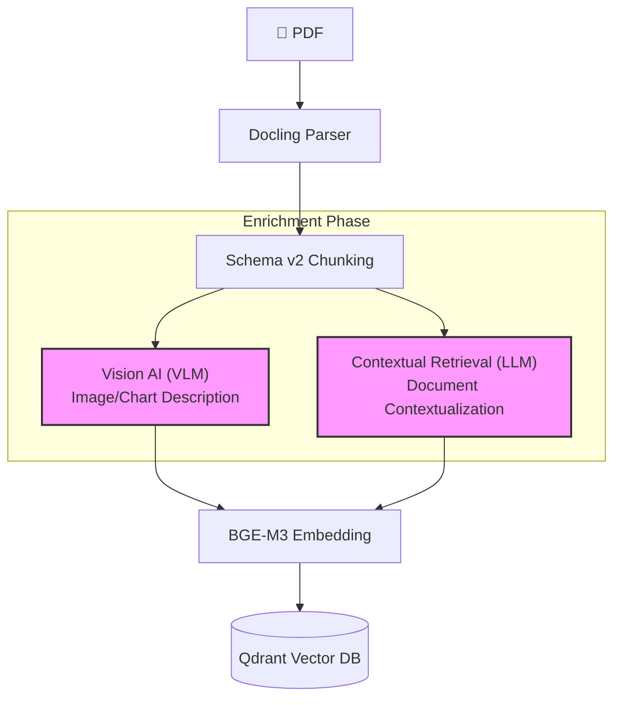
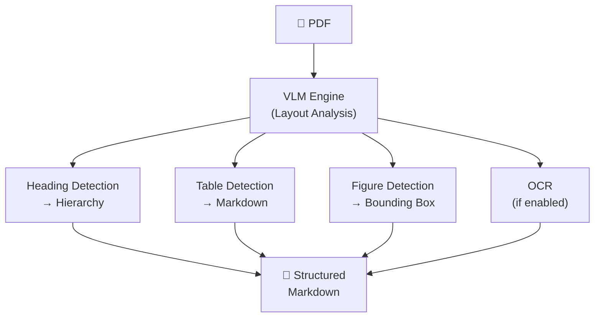
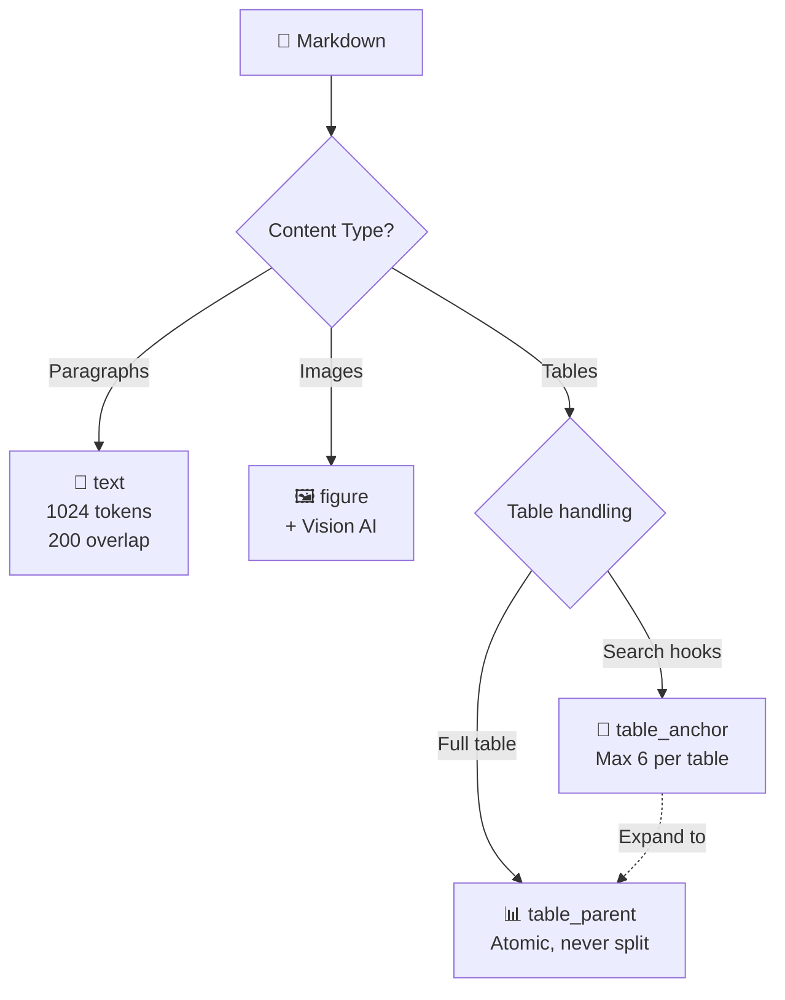
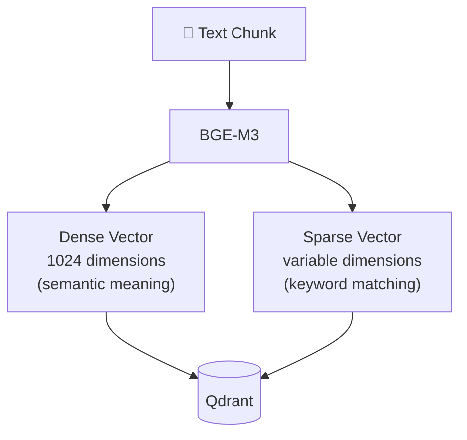

# 02 — Ingestion Pipeline

The ingestion pipeline transforms raw PDF documents into searchable vectors stored in Qdrant. It runs once per document — before any questions are asked.



---

## Parser: Docling

Docling is an IBM-built PDF parser that uses a Vision-Language Model to understand document structure — not just extract text, but recognize headings, tables, figures, and layout.

### Why Not PyPDF?

| Aspect | PyPDF (Traditional) | Docling (VLM-Based) |
|--------|---------------------|---------------------|
| Text extraction | Character-by-character, no structure | Layout-aware, preserves hierarchy |
| Tables | Broken into scattered text fragments | Reconstructed as Markdown tables |
| Figures | Ignored (just `image_123.jpg`) | Detected with bounding boxes |
| Multi-column | Columns merged incorrectly | Columns read in correct order |
| Output format | Raw text | Structured Markdown |

### How It Works



After parsing, the output undergoes **normalization**: hyphenation repairs, boilerplate removal (headers/footers/page numbers), and page marker cleanup.

### Configuration

| Parameter | Value | Description |
|-----------|-------|-------------|
| `ENABLE_OCR` | `False` | Enable for scanned documents |
| `TABLE_FORMER_MODE` | `accurate` | Table detection quality (`accurate` vs `fast`) |

---

## Chunking: Schema v2

Schema v2 is a **content-aware** chunking strategy that classifies content by type instead of blindly splitting every N characters.

### The Problem with Fixed-Size Chunking

Fixed-size chunking splits documents at arbitrary character boundaries:
- Words split mid-syllable: `"Perusaha..."` → `"...aan meluncurkan"`
- Tables broken into meaningless row fragments
- Context lost at chunk boundaries

### The Schema v2 Solution



| Chunk Type | Size | Purpose |
|-----------|------|---------|
| `text` | Max 1024 tokens, overlap 200 | Narrative content with heading context preserved |
| `figure` | Variable | Image + Vision AI description for text search |
| `table_parent` | Entire table | Atomic — never split across chunks |
| `table_anchor` | Short (~100-200 words) | Searchable summaries that expand to full table when matched |

### Key Design Decisions

| Decision | Rationale |
|----------|-----------|
| 200-token overlap | Prevents context loss at chunk boundaries |
| Atomic tables | Table rows are meaningless without headers — splitting destroys them |
| Table anchors | Large tables are too big for embedding similarity — anchors act as searchable proxies |
| Max 6 anchors/table | Prevents one huge table from dominating search results |

### Configuration

| Parameter | Value | Description |
|-----------|-------|-------------|
| `CHUNK_SIZE` | `1024` | Maximum tokens per text chunk |
| `CHUNK_OVERLAP` | `200` | Overlapping tokens between consecutive chunks |
| `CHUNKING_SCHEMA_VERSION` | `2` | Use Schema v2 (4 chunk types) |
| `ENABLE_TABLE_ANCHORS` | `True` | Generate searchable table summaries |
| `TABLE_ANCHOR_MAX_PER_TABLE` | `6` | Max anchors per table |

---

## Enrichment: Generative AI (Vision AI & Contextual Retrieval)

Enrichment menambahkan **metadata dan deskripsi** ke chunks yang tidak dapat dicari (*unsearchable*). Fase ini beroperasi *setelah chunking selesai, tetapi sebelum proses embedding.

### Feature 1: Chart & Figure Description (Menggunakan VLM)

Vision Language Model (VLM) "melihat" gambar/diagram dalam PDF dan menghasilkan deskripsi teks agar dapat dicari:

| Provider | Type | Strengths | Weaknesses |
|----------|------|-----------|------------|
| Google Gemini Flash | Cloud API | Fast, accurate on complex charts | Requires internet, data leaves premises |
| Qwen 2.5 VL | Local/Cloud | Open-weight, good multilingual support | Requires GPU (high VRAM) |
| Ollama (LLaVA/Moondream) | Local CLI | Ultra lightweight, no internet | Lower accuracy on complex diagrams |

### Feature 2: Flowchart Interpretation (Menggunakan VLM)

SOP document sering berisi flowchart prosedural dalam bentuk gambar. VLM menginterpretasikan arah panah, node keputusan, dan *role handoffs* — mengubahnya menjadi teks naratif yang dapat dicari.

### Feature 3: Contextual Retrieval (Menggunakan LLM)

Menyelesaikan masalah "Lost-in-the-Middle": sebuah chunk berbunyi `"Keuntungan naik 50%"` menjadi tidak berguna tanpa mengetahui *keuntungan siapa*, *tahun berapa*, *bab apa*.

**Solusi:** Sebuah lightweight LLM membaca seluruh dokumen dari hasil parser (Markdown utuh), mem-*generate* ringkasan konteks singkat, dan **menempelkannya (stamping) ke seluruh chunks** sebagai metadata pelengkap:

- **Tanpa konteks:** `"Net profit increased 5% year-on-year"`
- **Dengan konteks LLM:** `[CONTEXT: Q3 2024 Financial Report, PT Acme Corp, Chapter II Financial Performance] "Net profit increased 5% year-on-year"`

### Configuration

| Parameter | Value | Description |
|-----------|-------|-------------|
| `ENABLE_PICTURE_DESCRIPTION` | `False` | Enable VLM untuk charts/figures |
| `PICTURE_DESCRIPTION_MODEL` | `gemini-2.0-flash` | VLM model yang digunakan |
| `PICTURE_DESCRIPTION_ONLY_CHARTS` | `True` | Hanya mendeskripsikan charts |
| `ENABLE_TABLE_VISUAL_INTERPRETATION`| `False` | Enable flowchart interpretation |
| `ENABLE_CONTEXT_RETRIEVAL` | `True` | Enable Contextual Retrieval LLM |
| `CONTEXTUAL_GENERATION_MODEL` | `Qwen-2.5-72B` | LLM model untuk membuat ringkasan |

---

## Embedding: BAAI/bge-m3

BGE-M3 converts text into numerical vectors for similarity search. The "M3" stands for **Multi-lingual, Multi-function, Multi-granularity**.

### Why BGE-M3?

| Advantage | Detail |
|-----------|--------|
| **Multilingual** | Fluent in Indonesian, English, and 100+ languages |
| **Dual output** | Produces Dense (1024d) + Sparse vectors in a single pass |
| **Long context** | Handles up to 8192 tokens per input |
| **Open-source** | Free, no API costs, runs locally |

### How It Works



- **Dense Vector** — captures semantic meaning. `"car accident"` is close to `"vehicle collision"` despite different words
- **Sparse Vector** — captures exact keywords. `"Article 404"` matches precisely, no semantic drift

---

## Vector Storage: Qdrant

Qdrant is a Rust-built vector database optimized for hybrid search.

### Why Qdrant?

| Advantage | Detail |
|-----------|--------|
| **Rust performance** | Low memory, fast queries — runs on a developer laptop via Docker |
| **Native hybrid search** | Dense + Sparse scoring in a single `query()` call, no external fusion |
| **gRPC support** | Binary protocol for high-throughput operations (Gateway ↔ Qdrant) |
| **Payload filtering** | Filter by metadata (filename, department, date) during search |

### Stored Data Structure

Each chunk is stored as a point in Qdrant:

```json
{
  "id": "deterministic-uuid",
  "vector": {
    "dense": [0.023, -0.147, 0.891, "...1024 floats"],
    "sparse": {"indices": [142, 5891], "values": [0.8, 0.3]}
  },
  "payload": {
    "doc_id": "a1b2c3d4",
    "filename": "financial-report.pdf",
    "chunk_index": 7,
    "chunk_type": "text",
    "text": "Net profit increased 15%...",
    "heading_context": "Chapter 2: Financial Performance"
  }
}
```

### Configuration

| Parameter | Value | Description |
|-----------|-------|-------------|
| `QDRANT_HOST` | `localhost` | Qdrant server address |
| `QDRANT_PORT` | `6333` | REST API port (Worker uses this) |
| gRPC Port | `6334` | Binary protocol port (Gateway uses this) |
| `COLLECTION_NAME` | `pdf_rag` | Collection name — must match in Worker and Gateway |

---

## Key Design Decisions

| Decision | Rationale |
|----------|-----------|
| Docling over PyPDF | Structure-aware parsing produces cleaner chunks |
| Schema v2 over fixed-size | Content-type chunking prevents table destruction and context loss |
| BGE-M3 over ada-002 | Multilingual, dual-output, open-source, no API cost |
| Qdrant over ChromaDB | Production-grade performance, native hybrid search |
| Deterministic document IDs | Content-based hashing enables duplicate detection and clean re-upload |

**Next:** [02 — Retrieval Pipeline](03-retrieval-pipeline.md) covers how the system searches these vectors at query time.
