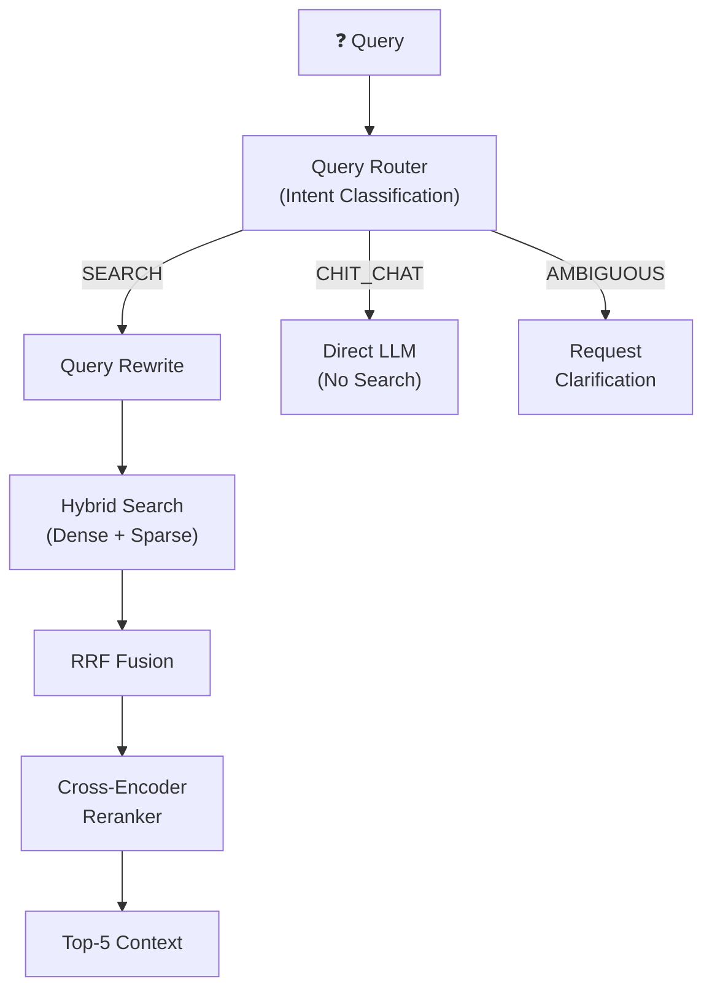
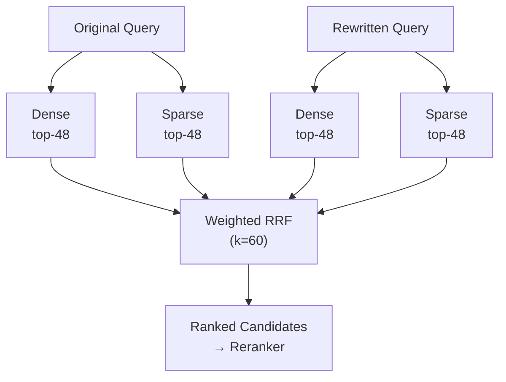
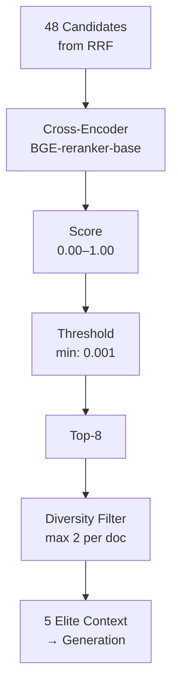

# 03 — Retrieval Pipeline

The retrieval pipeline finds the most relevant document chunks for a given question. It runs on every query — from intent classification through hybrid search, fusion, and reranking.



---

## Query Router

The Query Router is the first agent that intercepts every question. It classifies user intent using a lightweight LLM call before any search happens.

### Intent Categories

| Intent | Description | Action |
|--------|-------------|--------|
| `SEARCH` | Factual question answerable from documents | Full retrieval pipeline |
| `SUMMARIZATION` | Request to summarize a document/topic | Full retrieval, broader context |
| `CHIT_CHAT` | Casual conversation, greetings | Direct LLM response, no search |
| `AMBIGUOUS` | Unclear intent, needs clarification | Ask for more context |

### How It Works

The Router receives the latest message plus conversation history, and outputs structured JSON:

```json
{
  "intention": "SEARCH",
  "rewritten_query": "penalties for smoking violations in office area per company regulations",
  "reasoning": "User is asking about smoking penalties, which requires document search"
}
```

**Key behavior:** The Router also **rewrites** vague queries into explicit search terms, incorporating conversation context. Example:
- User says: `"What about the third offense?"` (after discussing salary policy)
- Router rewrites: `"what is the penalty for the third salary policy violation"`

### Configuration

| Parameter | Value | Description |
|-----------|-------|-------------|
| `Gateway:RouterModel` | `gemini-2.5-flash` | LLM model for routing |
| Temperature | `0.1` | Low temperature for consistent classification |

---

## Query Rewrite (Rule-Based)

After routing confirms `SEARCH`, the system generates an **expanded query** to improve recall. This runs in the Worker.

### Why Rule-Based?

| Mode | Speed | Cost | Quality |
|------|-------|------|---------|
| `rule` (default) | Instant (<1ms) | Free | Good for typical queries |
| `llm` | 1-3 seconds | API cost per query | Better for complex queries |

The rule-based rewriter applies synonym expansion and formal term insertion without an LLM call.

### How It Works

Both the **original query** and the **rewritten query** are searched in parallel — the original catches exact keyword matches, while the rewrite catches semantic variations.

### Configuration

| Parameter | Value | Description |
|-----------|-------|-------------|
| `QUERY_REWRITE_ENABLED` | `True` | Enable/disable rewrite |
| `QUERY_REWRITE_MODE` | `rule` | `rule` (fast) or `llm` (thorough) |
| `QUERY_REWRITE_WEIGHT` | `0.6` | Weight of rewritten query in fusion (vs 0.4 for original) |

---

## Hybrid Search

The system searches Qdrant using **both** Dense and Sparse vectors simultaneously.

### Two Search Strategies

| Strategy | Vector Type | Catches | Misses |
|----------|------------|---------|--------|
| **Dense (semantic)** | 1024-dim float | `"car accident"` ≈ `"vehicle crash"` | Exact codes like `"Article 404"` |
| **Sparse (keyword)** | BM25-style | `"Article 404"` matches exactly | `"car accident"` ≠ `"vehicle crash"` |
| **Hybrid** | Both | Everything | Very little |

### Alpha Parameter

`HYBRID_ALPHA` controls the balance between Dense and Sparse:

| Value | Behavior | Best For |
|-------|----------|----------|
| 0.0 | 100% keyword (Sparse) | Technical docs with specific codes |
| 0.3 | **70% keyword, 30% semantic** (default) | Mixed documents |
| 0.5 | 50/50 | Narrative documents |
| 1.0 | 100% semantic (Dense) | Conceptual questions |

### Configuration

| Parameter | Value | Description |
|-----------|-------|-------------|
| `HYBRID_ALPHA` | `0.3` | Dense/Sparse balance |
| `DENSE_TOP_K` | `48` | Candidates from Dense search |
| `SPARSE_TOP_K` | `48` | Candidates from Sparse search |

---

## RRF Fusion

Reciprocal Rank Fusion merges results from multiple search runs (original query + rewritten query, Dense + Sparse) into a single ranked list.

### How It Works



**Core principle:** A document that appears in the top results across **multiple** search strategies is almost certainly relevant. RRF promotes consistently top-ranked documents regardless of which strategy found them.

### Configuration

| Parameter | Value | Description |
|-----------|-------|-------------|
| `FUSION_MODE` | `weighted_rrf` | Fusion algorithm |
| `FUSION_RRF_K` | `60` | Smoothing constant (higher = more weight to lower-ranked results) |

---

## Cross-Encoder Reranker

The reranker is the **quality gate** — a Cross-Encoder model that reads each query-document pair jointly to score relevance with much higher precision than embedding similarity alone.

### Bi-Encoder vs Cross-Encoder

| Aspect | Bi-Encoder (Stage 1) | Cross-Encoder (Stage 2) |
|--------|----------------------|-------------------------|
| Speed | Ultra fast (million docs/sec) | Slow (pair-by-pair) |
| Accuracy | Good enough for top-48 | Excellent for final ranking |
| How it works | Encodes query and doc separately | Reads query + doc **together** |
| Word order sensitivity | Low | High (understands grammar) |

### Reranking Pipeline



1. **Cross-Encoder scoring** — reads each candidate paired with the query
2. **Threshold filter** — removes chunks scoring below `RERANK_MIN_SCORE`
3. **Top-K selection** — keeps the 8 highest-scoring candidates
4. **Diversity filter** — max 2 chunks per document to prevent one source dominating
5. **Table expansion** — if a `table_anchor` is selected, expands to its `table_parent`

### Configuration

| Parameter | Value | Description |
|-----------|-------|-------------|
| `RERANKER_MODEL` | `BAAI/bge-reranker-base` | Cross-Encoder model |
| `RERANKER_USE_FP16` | `True` | Half-precision for speed |
| `RERANK_CANDIDATES_K` | `48` | Input candidates to reranker |
| `RERANK_TOP_K` | `8` | Output after reranking |
| `RERANK_MIN_SCORE` | `0.001` | Minimum relevance score |
| `MAX_SOURCES` | `5` | Final sources sent to LLM |
| `MAX_SOURCES_PER_DOC` | `2` | Diversity cap per document |

---

## Key Design Decisions

| Decision | Rationale |
|----------|-----------|
| Router-first architecture | Avoid wasting search on greetings; classify before searching |
| Rule-based query rewrite | Zero latency, zero cost — LLM rewrite available but not needed for typical queries |
| Parallel dual-query search | Original query catches keywords; rewrite catches semantics |
| Two-stage retrieval | Fast embedding narrows 10K+ chunks to 48; slow cross-encoder refines to 5 |
| Diversity filter | Prevents one long document from monopolizing all context slots |

**Next:** [03 — Generation Pipeline](04-generation-pipeline.md) covers how the system generates answers from the retrieved context.
