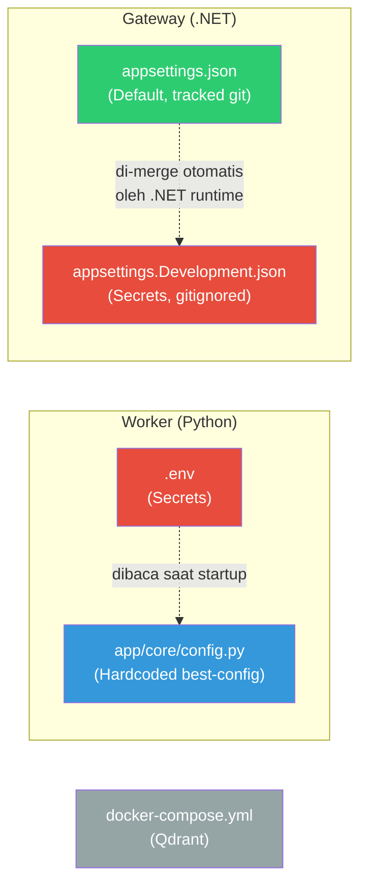

# 4.1 Referensi Konfigurasi

Dokumen ini mengumpulkan **semua pengaturan** sistem RAG dalam satu halaman. Gunakan sebagai rujukan cepat saat perlu mengubah perilaku sistem.

---

## Apa yang Akan Anda Pelajari

- Di mana file konfigurasi berada dan bagaimana mereka saling terkait
- Semua variabel environment dan setting yang tersedia
- Nilai default dan kapan perlu mengubahnya

---

## Peta File Konfigurasi



**Legenda warna:**
- 🔴 **Merah** = berisi secrets, **TIDAK** boleh di-commit ke git
- 🔵 **Biru** = hardcoded, hanya bisa diubah dengan mengedit kode Python
- 🟢 **Hijau** = default non-secret, tracked di git
- ⚪ **Abu** = infrastruktur (Qdrant)

---

## 1. Environment Variables (`.env`) — Worker

File `.env` di root project dibaca oleh Worker saat startup. Salin dari template:

```bash
cp .env.example .env
```

| Variabel | Wajib | Default | Penjelasan |
|----------|:-----:|---------|------------|
| `INTERNAL_API_KEY` | ✅ | *(kosong)* | Kunci rahasia untuk autentikasi Gateway ↔ Worker. Generate dengan `openssl rand -hex 24`. Harus **sama persis** di kedua service. |
| `GOOGLE_API_KEY` | ✅ | *(kosong)* | API key Google Gemini. Dapatkan dari [Google AI Studio](https://aistudio.google.com/). |
| `QDRANT_HOST` | ❌ | `localhost` | Alamat server Qdrant. Ubah jika Qdrant berjalan di host lain. |
| `QDRANT_PORT` | ❌ | `6333` | Port REST Qdrant. |
| `QDRANT_TIMEOUT` | ❌ | `8` | Timeout koneksi Qdrant dalam detik. |
| `COLLECTION_NAME` | ❌ | `pdf_rag` | Nama koleksi Qdrant tempat vektor disimpan. |

> **Catatan:** Variabel opsional hanya perlu diubah jika setup Anda berbeda dari default (misal: Qdrant di server remote).

---

## 2. Gateway Secrets (`gateway/appsettings.Development.json`)

File ini **tidak** ada di repository — Anda harus membuatnya sendiri. .NET runtime otomatis merge setting dari file ini dengan `appsettings.json`.

```json
{
  "Gateway": {
    "InternalApiKey": "<key yang sama dengan .env>"
  },
  "Gemini": {
    "ApiKey": "<GOOGLE_API_KEY yang sama dengan .env>"
  }
}
```

| Setting | Penjelasan |
|---------|------------|
| `Gateway:InternalApiKey` | **Harus sama** dengan `INTERNAL_API_KEY` di `.env`. Gateway mengirimnya sebagai header `X-Internal-Api-Key`, Worker memvalidasinya. |
| `Gemini:ApiKey` | **Harus sama** dengan `GOOGLE_API_KEY` di `.env`. Digunakan untuk semua panggilan LLM dari Gateway. |

> ⚠️ **Penting:** File ini gitignored. Jangan pernah commit secrets ke repository.

---

## 3. Gateway Defaults (`gateway/appsettings.json`)

Setting non-secret yang tracked di git. Mengandung konfigurasi operasional Gateway.

### Gateway

| Setting | Default | Tipe | Penjelasan |
|---------|---------|------|------------|
| `Gateway:WorkerBaseUrl` | `http://localhost:8000` | string | URL Worker. Ubah jika Worker berjalan di host/port lain. |
| `Gateway:WorkerTimeoutSeconds` | `600` | int | Timeout (detik) untuk panggilan ke Worker. 600 detik = 10 menit. Ingestion PDF besar bisa memakan waktu lama. |
| `Gateway:MaxSources` | `5` | int | Maksimal sumber yang diminta dari Worker per jawaban. |
| `Gateway:RouterModel` | `gemini-2.5-flash` | string | Model LLM untuk Query Router. Temperature: 0.1 (ketat). |
| `Gateway:ChitChatModel` | `gemini-2.5-flash` | string | Model LLM untuk Chit-Chat Agent. Temperature: 0.7 (kreatif). |
| `Gateway:GroundedAnswerModel` | `gemini-2.5-flash` | string | Model LLM untuk Grounded Answer Agent. Temperature: 0.1 (ketat). |

### Qdrant

| Setting | Default | Tipe | Penjelasan |
|---------|---------|------|------------|
| `Qdrant:Host` | `localhost` | string | Host server Qdrant untuk akses gRPC dari Gateway. |
| `Qdrant:Port` | `6334` | int | Port **gRPC** Qdrant (bukan REST). Gateway menggunakan gRPC untuk operasi dokumen. |
| `Qdrant:CollectionName` | `pdf_rag` | string | Nama koleksi. **Harus sama** dengan `COLLECTION_NAME` di Worker. |
| `Qdrant:Timeout` | `8` | int | Timeout koneksi Qdrant dalam detik. |
| `Qdrant:DocumentListMaxPoints` | `5000` | int | Maksimal poin yang di-scan saat listing dokumen. |
| `Qdrant:DocumentListPageSize` | `250` | int | Ukuran halaman saat scroll Qdrant. |

---

## 4. Hardcoded Worker Settings (`worker/app/core/config.py`)

Setting ini **tidak dapat diubah via `.env`**. Mereka di-hardcode sebagai konfigurasi terbaik hasil tuning. Untuk mengubahnya, edit file `config.py` langsung.

### Model

| Parameter | Nilai | Penjelasan |
|-----------|-------|------------|
| `EMBEDDING_MODEL` | `BAAI/bge-m3` | Model embedding. Menghasilkan Dense (1024d) + Sparse vectors. |
| `LLM_PROVIDER` | `gemini` | Provider LLM utama. |
| `LLM_MODEL` | `gemini-2.5-flash` | Model LLM utama (inference). |
| `FAST_LLM_PROVIDER` | `gemini` | Provider LLM cepat (enrichment). |
| `FAST_LLM_MODEL` | `gemini-2.5-flash-lite` | Model LLM cepat untuk tugas ringan. |

### Chunking

| Parameter | Nilai | Penjelasan |
|-----------|-------|------------|
| `CHUNK_SIZE` | `1024` | Ukuran maksimal chunk dalam token. |
| `CHUNK_OVERLAP` | `200` | Token yang tumpang-tindih antar chunk berturutan. |
| `CHUNKING_SCHEMA_VERSION` | `2` | Versi skema chunking (Schema v2 = 4 tipe chunk). |
| `ENABLE_TABLE_ANCHORS` | `True` | Membuat anchor teks pendek untuk tabel besar. |
| `TABLE_ANCHOR_MAX_PER_TABLE` | `6` | Maksimal anchor per tabel. |

### PDF Processing

| Parameter | Nilai | Penjelasan |
|-----------|-------|------------|
| `ENABLE_OCR` | `False` | OCR untuk dokumen scan. Aktifkan jika memproses PDF scan. |
| `ENABLE_PICTURE_DESCRIPTION` | `False` | Deskripsi gambar/chart via Vision AI. |
| `PICTURE_DESCRIPTION_PROVIDER` | `local` | Provider Vision AI (`local` atau `gemini_api`). |
| `PICTURE_DESCRIPTION_MODEL` | `gemini-2.0-flash` | Model untuk deskripsi gambar. |
| `PICTURE_DESCRIPTION_ONLY_CHARTS` | `True` | Hanya deskripsikan chart/grafik, bukan semua gambar. |
| `ENABLE_TABLE_VISUAL_INTERPRETATION` | `False` | Interpretasi visual tabel SOP (flowchart dalam tabel). |
| `TABLE_VISUAL_INTERPRETATION_MODEL` | `gemini-2.5-flash-lite` | Model untuk interpretasi tabel. |
| `TABLE_VISUAL_ROUTING_MODE` | `auto_signal` | Mode deteksi tabel yang perlu interpretasi visual. |
| `TABLE_VISUAL_DETECTOR_BIAS` | `precision` | Bias detektor: `precision` (sedikit tapi akurat) atau `recall` (banyak tapi mungkin salah). |

### Retrieval

| Parameter | Nilai | Penjelasan |
|-----------|-------|------------|
| `HYBRID_ALPHA` | `0.3` | Keseimbangan Dense vs Sparse. 0.0 = murni keyword, 1.0 = murni semantic. Default 0.3 berarti 70% keyword, 30% semantic. |
| `DENSE_TOP_K` | `48` | Kandidat dari pencarian Dense. |
| `SPARSE_TOP_K` | `48` | Kandidat dari pencarian Sparse. |
| `FUSION_MODE` | `weighted_rrf` | Mode peleburan ranking. |
| `FUSION_RRF_K` | `60` | Konstanta RRF (mengatur smoothing ranking). |
| `RERANKER_MODEL` | `BAAI/bge-reranker-base` | Model Cross-Encoder untuk reranking. |
| `RERANKER_USE_FP16` | `True` | Gunakan half-precision untuk kecepatan + hemat VRAM. |
| `RERANK_CANDIDATES_K` | `48` | Kandidat yang dikirim ke reranker. |
| `RERANK_TOP_K` | `8` | Hasil akhir setelah reranking. |
| `RERANK_MIN_SCORE` | `0.001` | Skor minimum agar chunk lolos reranking. |
| `MAX_SOURCES` | `5` | Maksimal sumber dalam respons. |
| `MAX_SOURCES_PER_DOC` | `2` | Maksimal chunk per dokumen (diversity filter). |
| `TABLE_PARENT_EXPANSION_ENABLED` | `True` | Expand table_anchor ke table_parent saat ditemukan relevan. |

### Query Rewrite

| Parameter | Nilai | Penjelasan |
|-----------|-------|------------|
| `QUERY_REWRITE_ENABLED` | `True` | Aktifkan penulisan ulang query otomatis. |
| `QUERY_REWRITE_MODE` | `rule` | Mode rewrite: `rule` (cepat, gratis) atau `llm` (lambat, berbayar). |
| `QUERY_REWRITE_WEIGHT` | `0.6` | Bobot query yang ditulis ulang vs query asli. |
| `QUERY_REWRITE_MAX_TERMS` | `12` | Maksimal kata dalam query yang ditulis ulang. |

### Conversation

| Parameter | Nilai | Penjelasan |
|-----------|-------|------------|
| `CONVERSATION_HISTORY_MAX_MESSAGES` | `8` | Jumlah pesan riwayat yang disertakan untuk follow-up questions. |

---

## 5. Docker Compose (`docker-compose.yml`)

Hanya menjalankan Qdrant:

```yaml
services:
  qdrant:
    image: qdrant/qdrant:latest
    container_name: rag-qdrant
    ports:
      - "6333:6333"   # REST API
      - "6334:6334"   # gRPC
    volumes:
      - qdrant-storage:/qdrant/storage
    restart: unless-stopped

volumes:
  qdrant-storage:
```

| Parameter | Nilai | Penjelasan |
|-----------|-------|------------|
| Port `6333` | REST API | Untuk Worker dan Qdrant Dashboard (`http://localhost:6333/dashboard`) |
| Port `6334` | gRPC | Untuk Gateway (native document operations) |
| Volume `qdrant-storage` | Persistent | Data bertahan meskipun container di-restart |

---

## Tips Konfigurasi

### Kapan Mengubah Setting?

| Skenario | Yang Diubah |
|----------|-------------|
| Ganti API key | `.env` + `appsettings.Development.json` |
| Ganti model LLM di Gateway | `appsettings.json` → `RouterModel`, `GroundedAnswerModel` |
| Ganti model LLM di Worker | `config.py` → `LLM_MODEL`, `FAST_LLM_MODEL` |
| Tuning kualitas pencarian | `config.py` → `HYBRID_ALPHA`, `RERANK_TOP_K`, `MAX_SOURCES` |
| Qdrant di server remote | `.env` → `QDRANT_HOST` + `appsettings.json` → `Qdrant:Host` |
| Timeout terlalu pendek | `appsettings.json` → `Gateway:WorkerTimeoutSeconds` |

### Kesalahan Umum

1. **`INTERNAL_API_KEY` berbeda** di Worker dan Gateway → Error 401/403 saat chat
2. **`COLLECTION_NAME` berbeda** di Worker dan Gateway → Data tidak ditemukan
3. **Lupa `export` secrets** sebelum `dotnet run` → Gateway tidak punya API key
4. **Port Qdrant tertukar** → Worker pakai 6333 (REST), Gateway pakai 6334 (gRPC)

---

## Navigasi

| ← Sebelumnya | Selanjutnya → |
|:---|---:|
| [3.1 Riwayat Migrasi](../03-Migrasi/3.1-riwayat-migrasi.md) | [5.1 Observability](../05-Operasional/5.1-observability.md) |
