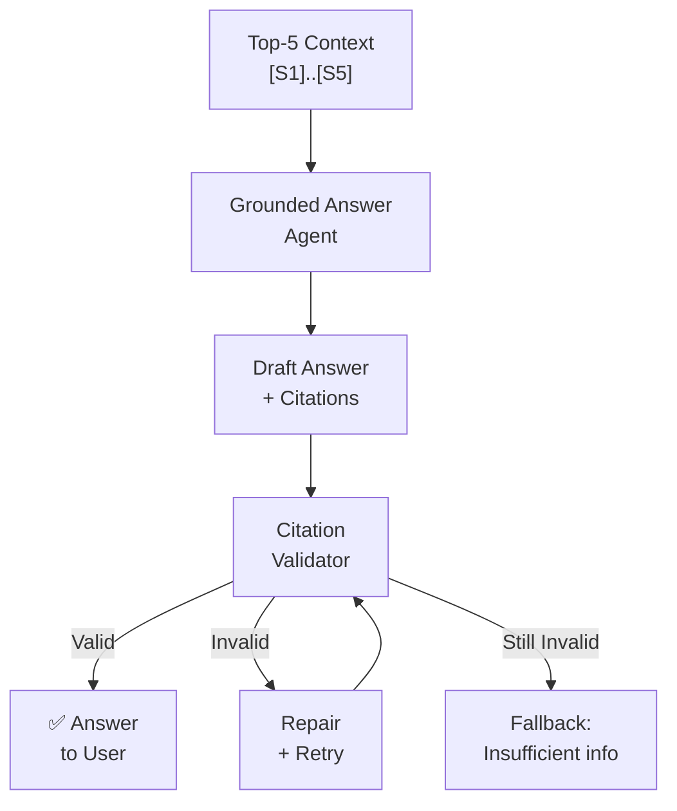
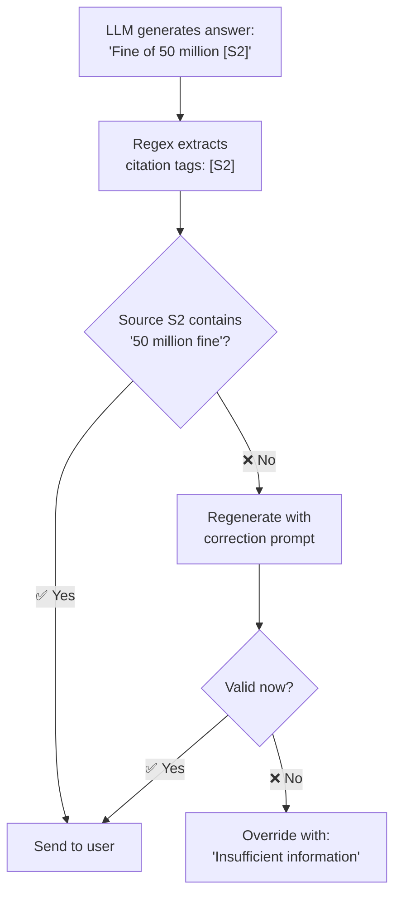

# 04 — Generation Pipeline

The generation pipeline takes the retrieved context and produces a grounded, cited answer. It uses a multi-agent architecture where each agent has a specific role, followed by an automated citation validation loop.

---

## Multi-Agent Architecture

The Gateway runs three specialized LLM agents, each with distinct system prompts and temperature settings:

### Agent 1: Query Router

Routes incoming questions to the appropriate handler. Covered in detail in [02 — Retrieval Pipeline](03-retrieval-pipeline.md).

| Setting | Value |
|---------|-------|
| Model | `gemini-2.5-flash` |
| Temperature | 0.1 (deterministic) |
| Output | JSON with intent + rewritten query |

### Agent 2: Chit-Chat Agent

Handles casual conversation (greetings, off-topic questions) without any document search.

| Setting | Value |
|---------|-------|
| Model | `gemini-2.5-flash` |
| Temperature | 0.7 (conversational) |
| Tools | None |
| Context | Conversation history only |

### Agent 3: Grounded Answer Agent

The primary agent — generates answers strictly based on retrieved context with mandatory citation tags.

| Setting | Value |
|---------|-------|
| Model | `gemini-2.5-flash` |
| Temperature | 0.1 (factual) |
| Input | User question + top-5 sources `[S1]..[S5]` |
| Output | Answer with inline citations `[S1]`, `[S2]` |

**System prompt enforces:**
- Every factual claim must cite a source using `[Sx]` tags
- If no source supports a claim, state "information not available"
- Never invent information beyond what the sources contain

### Supported LLM Models

All agents support swappable models via configuration:

| Model | Strengths | Considerations |
|-------|-----------|----------------|
| **Gemini 2.5 Flash** (default) | Fast, cheap, 1M token context | Requires internet |
| **Gemini 2.5 Pro** | More capable reasoning | Slower, more expensive |
| **GPT-4o-mini** | Excellent instruction following | 128K context, higher cost |
| **GPT-4o** | Top-tier reasoning | Most expensive |
| **Qwen 2.5 (14B/32B via Ollama)** | 100% offline, data privacy | Requires GPU (>16GB VRAM) |
| **DeepSeek R1** | Strong mathematical reasoning | Verbose output |

---

## Citation Validation & Repair Loop

The citation validator is the system's **integrity checkpoint** — it ensures every `[Sx]` tag in the answer actually refers to content present in the corresponding source document.

### Why This Matters

Even with retrieved context, LLMs can hallucinate citations:
- Claim `"Immediate termination applies [S2]"` but source S2 contains nothing about termination
- Invent fake footnotes that look legitimate but reference non-existent sources

### How It Works

### The Three Phases

| Phase | Action | Outcome |
|-------|--------|---------|
| **1. Validation** | Regex extracts `[S1]`, `[S2]` tags → cross-check against source texts | Pass or fail |
| **2. Repair** | If failed: re-invoke LLM with a strict correction prompt demanding removal or revision of the invalid citation | Second chance |
| **3. Fallback** | If repair also fails: replace entire answer with a generic "insufficient information" message | Honest failure |

### Repair Prompt

When a citation is invalid, the system sends a strict correction:

> Your draft answer "${draft}" contains citation [S2] that is NOT supported by source document #2. Revise your answer immediately. Remove any claims not directly supported by the provided sources. If no source supports the information, explicitly state that the information is not available.

---

## Streaming

The Gateway supports two response modes:

### Non-Streaming (`/api/chat`)

Returns the complete answer as a single JSON response after all processing (routing → retrieval → generation → validation) completes.

### Streaming (`/api/chat/stream`)

Returns Server-Sent Events (SSE) as the answer is generated:

| Event Type | When Sent | Content |
|-----------|-----------|---------|
| `sources` | After retrieval, before generation | Source metadata (filenames, texts) |
| `delta` | During generation | Text token fragments |
| `warning` | If citation validation detects issues | Validation warnings |
| `done` | End of stream | Completion signal |

---

## Key Design Decisions

| Decision | Rationale |
|----------|-----------|
| Three specialized agents | Each has optimal temperature and prompt for its role |
| Citation validation as a separate phase | Catches hallucinations that system prompts alone cannot prevent |
| Auto-repair before fallback | Gives the LLM a second chance with explicit correction, often succeeds |
| Generic fallback message | Honest "I don't know" is better than confident but wrong |
| Streaming sources first | Client can render source metadata while waiting for the answer |

**Next:** [04 — Application](05-application.md) covers the project structure, setup, and code organization.
