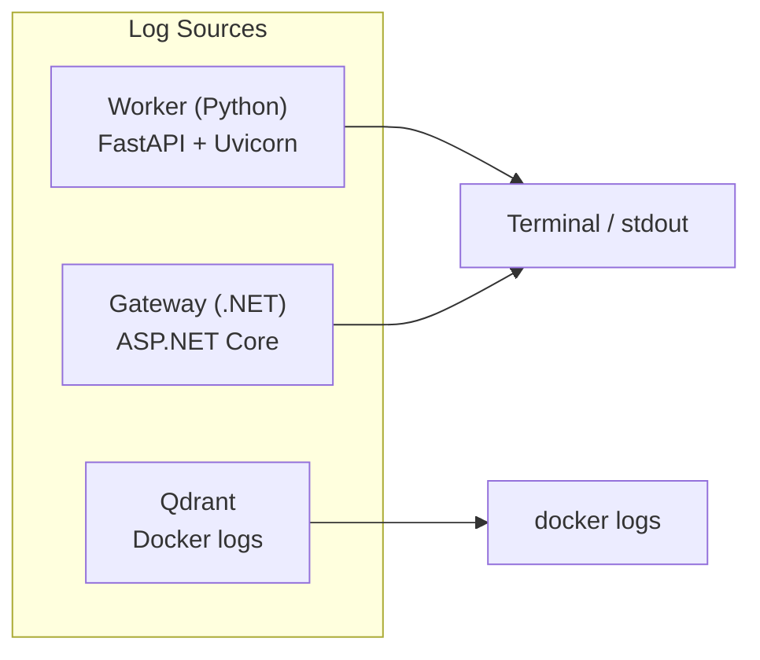
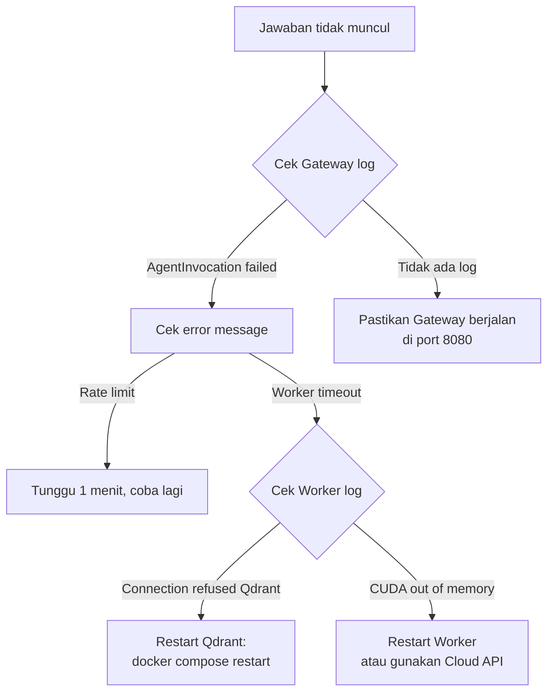

# 5.1 Observability: Logging dan Monitoring

Dokumen ini menjelaskan bagaimana sistem RAG mencatat aktivitasnya, dan bagaimana Anda bisa membaca log untuk memahami apa yang terjadi di balik layar.

---

## Apa yang Akan Anda Pelajari

- Jenis log yang dihasilkan oleh setiap komponen
- Cara membaca dan memahami log
- Tips debugging dengan log

---

## Sumber Log

Sistem RAG memiliki **tiga komponen** yang masing-masing menghasilkan log:



---

## 1. Worker Logs (Python)

Worker menggunakan Python `logging` dan Uvicorn.

### Startup Logs

Saat Worker pertama kali dijalankan:

```
INFO:     Loading Shared BGE-M3 Model (GPU): BAAI/bge-m3
INFO:     Loading cross-encoder reranker: BAAI/bge-reranker-base
INFO:     Uvicorn running on http://0.0.0.0:8000
```

**Yang perlu diperhatikan:**
- Model berhasil di-load ke GPU/CPU
- Port 8000 terbuka dan siap menerima request

### Request Logs

Setiap request HTTP dicatat oleh Uvicorn:

```
INFO:     192.168.1.100:54321 - "POST /api/ingest HTTP/1.1" 200 OK
INFO:     192.168.1.100:54322 - "POST /internal/retrieve-context HTTP/1.1" 200 OK
```

**Cara membaca:**
- `POST /api/ingest` → seseorang mengupload PDF
- `POST /internal/retrieve-context` → Gateway meminta konteks pencarian
- `200 OK` → berhasil
- `403 Forbidden` → API key salah
- `500 Internal Server Error` → ada bug, lihat traceback di bawahnya

### Error Logs

Jika terjadi error, Python menampilkan traceback lengkap:

```
ERROR:    Exception in ASGI application
Traceback (most recent call last):
  File "worker/app/features/ingestion/...", line 42
    ...
qdrant_client.http.exceptions.UnexpectedResponse: Connection refused
```

**Tips:** Baris terakhir traceback biasanya berisi penyebab utama. Dalam contoh di atas: koneksi ke Qdrant gagal.

---

## 2. Gateway Logs (.NET)

Gateway menggunakan `Microsoft.Extensions.Logging` dengan format terstruktur.

### Startup Logs

```
info: Microsoft.Hosting.Lifetime[14]
      Now listening on: http://localhost:8080
info: Microsoft.Hosting.Lifetime[0]
      Application started. Press Ctrl+C to shut down.
```

### Agent Invocation Logs

Setiap panggilan LLM dicatat oleh `Nedo.AspNet.AgentOrchestration`:

```
[INF] AgentInvocation started  { InvocationId: "01ABC123", Agent: "query-router", Provider: "gemini", Model: "gemini-2.5-flash" }
[INF] AgentInvocation completed { InvocationId: "01ABC123", Duration: "0.85s", Tokens: 150 }
```

**Cara membaca:**
- `InvocationId` → ID unik per panggilan, gunakan untuk melacak satu request
- `Agent` → agen mana yang dipanggil (`query-router`, `chit-chat`, atau `grounded-answer`)
- `Duration` → berapa lama panggilan LLM
- `Tokens` → berapa token yang digunakan (berpengaruh ke biaya)

### Error Logs

```
[ERR] AgentInvocation failed { InvocationId: "01ABC123", Error: "Rate limit exceeded" }
[WRN] Citation validation failed, attempting repair...
[INF] Citation repair succeeded after 1 attempt
```

**Log penting yang perlu diperhatikan:**
- `Rate limit exceeded` → terlalu banyak panggilan ke Gemini, sistem akan retry otomatis
- `Citation validation failed` → LLM mengarang sitasi, sistem memperbaiki otomatis
- `Worker timeout` → Worker terlalu lama merespons

---

## 3. Qdrant Logs

Akses log Qdrant melalui Docker:

```bash
docker logs rag-qdrant
docker logs rag-qdrant --tail 50    # 50 baris terakhir
docker logs rag-qdrant -f            # follow (real-time)
```

Log penting:
- `Collection created` → koleksi baru dibuat
- `Points upserted` → data berhasil disimpan
- `Search completed` → pencarian berhasil

---

## 4. Tips Debugging dengan Log

### Alur Debug: "Jawaban Tidak Muncul"



### Checklist Debug Umum

| Gejala | Cek Log | Penyebab Umum |
|--------|---------|---------------|
| Tidak ada respons | Gateway terminal | Gateway belum berjalan |
| Error 403 | Worker terminal | `INTERNAL_API_KEY` tidak cocok |
| Jawaban lambat | Gateway log → Duration | Model LLM lambat atau Worker overloaded |
| Jawaban mengarang | Gateway log → Citation | Citation Validator bekerja, periksa repair log |
| Upload gagal | Worker terminal | Docling error, cek traceback |

### Melihat Log Secara Real-Time

Buka tiga terminal terpisah:

```bash
# Terminal 1: Worker
cd worker && python3 main.py

# Terminal 2: Gateway
cd gateway && dotnet run

# Terminal 3: Qdrant
docker logs rag-qdrant -f
```

Saat mengirim request dari UI atau curl, perhatikan ketiga terminal untuk melacak alur lengkap.

---

## Navigasi

| ← Sebelumnya | Selanjutnya → |
|:---|---:|
| [4.1 Referensi Konfigurasi](../04-Konfigurasi/4.1-referensi-konfigurasi.md) | [5.2 Reliability](5.2-reliability.md) |
