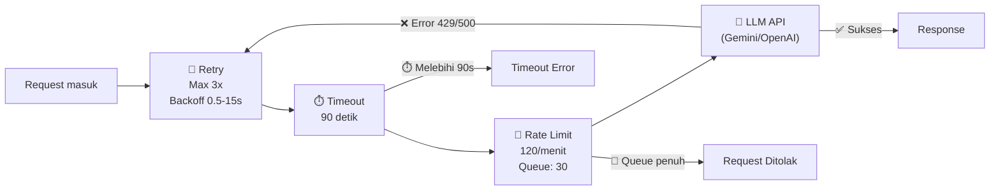
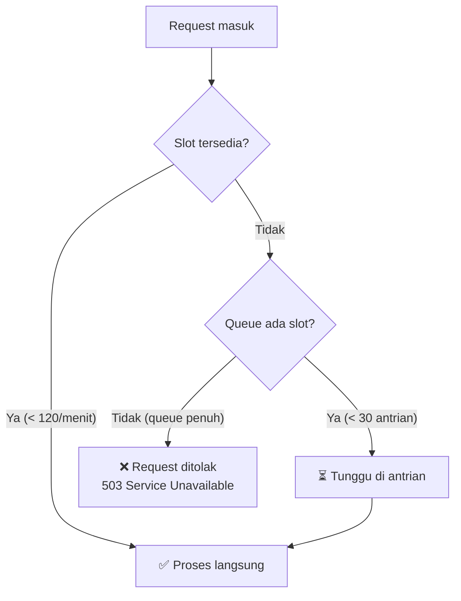
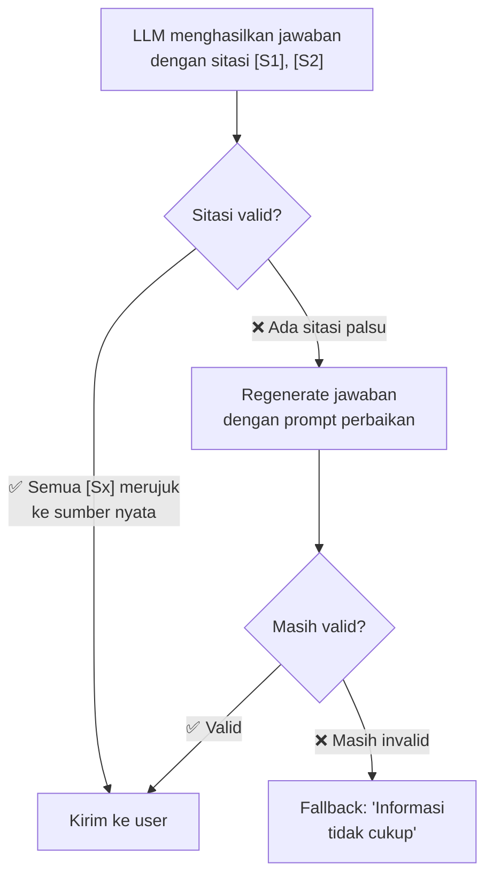

# 5.2 Reliability: Ketahanan Sistem

Dokumen ini menjelaskan mekanisme ketahanan yang melindungi sistem RAG dari kegagalan, termasuk retry otomatis, timeout, dan rate limiting.

---

## Apa yang Akan Anda Pelajari

- Bagaimana sistem menangani kegagalan API secara otomatis
- Mekanisme retry, timeout, dan rate limiting
- Skenario kegagalan umum dan cara sistem menanganinya

---

## Resilience Pipeline

Gateway menggunakan pipeline ketahanan berbasis `Polly` yang melindungi setiap panggilan LLM:



---

## 1. Retry (Percobaan Ulang Otomatis)

**Apa yang terjadi:** Jika panggilan LLM gagal (misal: server Gemini sedang sibuk), sistem otomatis mencoba lagi.

| Parameter | Nilai | Penjelasan |
|-----------|-------|------------|
| Max Retries | 3 | Maksimal 3 kali percobaan ulang |
| Initial Delay | 500ms | Jeda awal sebelum retry pertama |
| Max Delay | 15 detik | Jeda maksimum (bertambah tiap retry) |
| Jitter | Ya | Jeda ditambah variasi acak untuk mencegah semua request retry bersamaan |

**Contoh alur retry:**

```
Percobaan 1: Kirim request → Error 429 (Rate Limited)
  [jeda ~500ms]
Percobaan 2: Kirim ulang → Error 429 (masih limit)
  [jeda ~2s]
Percobaan 3: Kirim ulang → Error 429 (masih limit)
  [jeda ~8s]
Percobaan 4: Kirim ulang → ✅ 200 OK (berhasil!)
```

**Error yang di-retry:** `429 Too Many Requests`, `500 Internal Server Error`, `502 Bad Gateway`, `503 Service Unavailable`, network timeout.

**Error yang TIDAK di-retry:** `400 Bad Request`, `401 Unauthorized`, `403 Forbidden` — ini adalah error yang harus diperbaiki, bukan dicoba ulang.

---

## 2. Timeout (Batas Waktu)

**Apa yang terjadi:** Jika panggilan LLM memakan waktu terlalu lama, sistem membatalkannya agar tidak menyumbat antrian.

| Timeout | Nilai | Penjelasan |
|---------|-------|------------|
| Agent Timeout | 90 detik | Waktu maksimal satu panggilan LLM |
| Worker Timeout | 600 detik | Waktu maksimal Gateway menunggu Worker (termasuk ingestion) |

**Kenapa 90 detik untuk LLM?**
- Panggilan LLM normal selesai dalam 1-5 detik
- Jika sudah 90 detik, kemungkinan besar ada masalah
- Membatalkan lebih baik daripada menunggu selamanya

**Kenapa 600 detik untuk Worker?**
- Ingestion PDF besar (100+ halaman) memang bisa memakan beberapa menit
- Melibatkan: parsing, chunking, embedding batch, upsert ke Qdrant
- 600 detik (10 menit) cukup untuk PDF berukuran wajar

---

## 3. Rate Limiting (Pembatasan Laju)

**Apa yang terjadi:** Sistem membatasi jumlah panggilan LLM agar tidak melampaui kuota API dan menghindari tagihan berlebih.

| Parameter | Nilai | Penjelasan |
|-----------|-------|------------|
| Permits Per Minute | 120 | Maksimal 120 panggilan LLM per menit |
| Queue Limit | 30 | Jika melebihi 120/menit, hingga 30 request menunggu di antrian |

**Apa yang terjadi saat limit tercapai?**



---

## 4. Citation Validation & Repair

Selain ketahanan infrastruktur, sistem juga memiliki ketahanan **kualitas jawaban**:



Ini memastikan jawaban yang sampai ke pengguna selalu didukung sumber yang nyata, atau sistem mengakui ketidaktahuannya.

---

## 5. Skenario Kegagalan dan Perilaku Sistem

| Skenario | Apa yang Terjadi | Dampak ke User |
|----------|------------------|----------------|
| **Gemini API down** | Retry 3x dengan backoff → gagal → error message | Pesan error, coba lagi nanti |
| **Gemini rate limit** | Retry otomatis dengan jeda, biasanya berhasil | Jawaban sedikit lebih lambat |
| **Worker crash** | Gateway timeout setelah 600s | Pesan timeout, restart Worker |
| **Qdrant down** | Worker gagal search/upsert → Gateway timeout | Pesan error, restart Qdrant |
| **Network putus** | Retry 3x → timeout → error | Pesan error, periksa koneksi |
| **LLM halusinasi** | Citation Validator mendeteksi → repair → fallback | Jawaban diperbaiki atau "informasi tidak cukup" |
| **PDF corrupt** | Docling gagal parse → Worker return error | Pesan error ingestion |

---

## 6. Monitoring Kesehatan Sistem

### Quick Health Check

```bash
# Cek Qdrant
curl -s http://localhost:6333/healthz
# Output: {"title":"qdrant - vectorass engine","version":"..."}

# Cek Worker
curl -s http://localhost:8000/docs
# Jika terbuka → Worker berjalan

# Cek Gateway
curl -s http://localhost:8080/api/documents
# Jika respond → Gateway berjalan
```

### Tanda-tanda Masalah

| Tanda | Kemungkinan Masalah |
|-------|---------------------|
| Jawaban sangat lambat (>30 detik) | Rate limit Gemini atau Worker overloaded |
| Banyak "informasi tidak cukup" | Retrieval perlu tuning atau dokumen belum di-ingest |
| Error 403 berulang | API key tidak cocok antara Gateway dan Worker |
| Worker restart terus | Memory leak atau CUDA out of memory |

---

## Navigasi

| ← Sebelumnya | Selanjutnya → |
|:---|---:|
| [5.1 Observability](5.1-observability.md) | [5.3 Troubleshooting](5.3-troubleshooting.md) |
