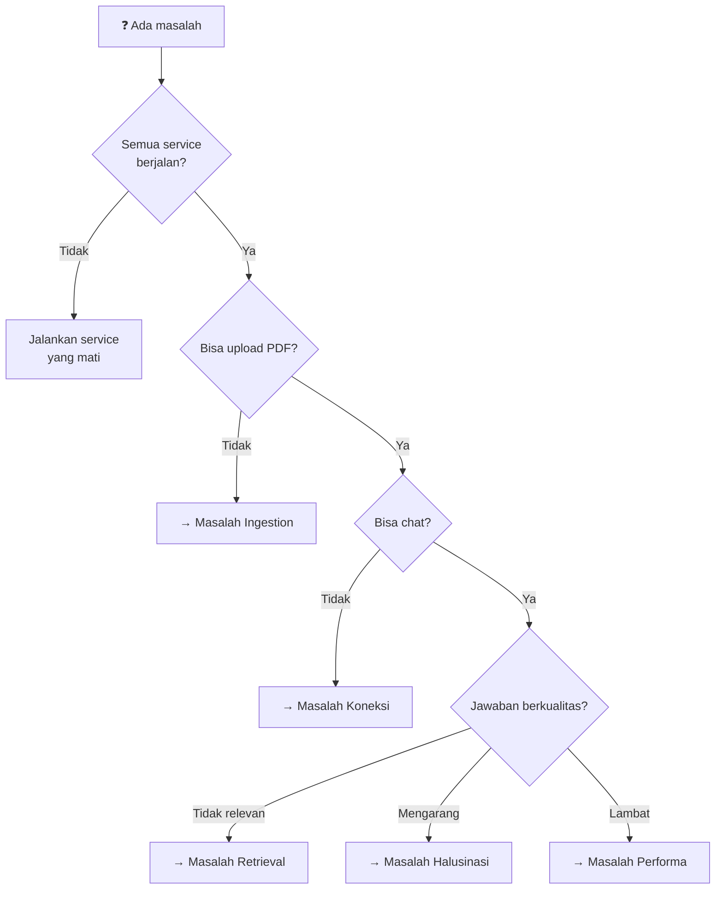

# 5.3 Troubleshooting: Diagnosis dan Solusi Masalah

Dokumen ini adalah panduan lengkap untuk mendiagnosis dan menyelesaikan masalah umum pada sistem RAG.

---

## Apa yang Akan Anda Pelajari

- Cara mendiagnosis masalah secara sistematis
- Solusi untuk masalah yang paling sering terjadi
- Langkah-langkah eskalasi jika masalah tidak terselesaikan

---

## Pohon Keputusan Diagnosis

Gunakan diagram berikut sebagai titik awal:



---

## 1. Masalah Koneksi

### A. "Connection refused" ke Qdrant

**Gejala:**
```
qdrant_client.http.exceptions.UnexpectedResponse: Connection refused
```

**Solusi:**
1. Pastikan Docker berjalan: `docker ps`
2. Restart Qdrant: `docker compose restart`
3. Cek port tidak terpakai: `lsof -i :6333`
4. Verifikasi Qdrant sehat: `curl http://localhost:6333/healthz`

### B. Gateway Error 401/403 saat Chat

**Gejala:**
```json
{"detail": "Missing or invalid internal API key"}
```

**Penyebab:** `INTERNAL_API_KEY` tidak sama di Worker dan Gateway.

**Solusi:**
1. Pastikan `.env` dan `gateway/appsettings.Development.json` menggunakan key yang **identik**
2. Restart Gateway setelah mengubah config
3. Pastikan perintah `export $(grep -v '^#' ../.env | xargs)` dijalankan sebelum `dotnet run`

### C. Gateway Timeout

**Gejala:**
```json
{"detail": "Permintaan melebihi batas waktu."}
```

**Solusi:**
1. Pastikan Worker berjalan di `localhost:8000`
2. Cek Worker log untuk error
3. Untuk dokumen besar, tingkatkan `WorkerTimeoutSeconds` di `gateway/appsettings.json` (default: 600)

### D. Worker Tidak Bisa Diakses

**Gejala:** Gateway timeout, tapi Worker log tidak menunjukkan request masuk.

**Solusi:**
1. Verifikasi Worker berjalan: `curl http://localhost:8000/docs`
2. Cek firewall: `sudo ufw status`
3. Pastikan Worker bind ke `0.0.0.0`, bukan `127.0.0.1`

---

## 2. Masalah Ingestion

### A. Model BGE-M3 Tidak Terload

**Gejala:**
```
OSError: BAAI/bge-m3 not found
```

**Solusi:**
1. Pastikan koneksi internet aktif (model diunduh saat pertama kali)
2. Pastikan ada ruang disk cukup (~2GB)
3. Jika offline, unduh manual ke cache HuggingFace:
   ```bash
   # Di mesin yang punya internet
   python3 -c "from FlagEmbedding import BGEM3FlagModel; BGEM3FlagModel('BAAI/bge-m3')"
   # Lalu copy folder ~/.cache/huggingface ke mesin offline
   ```

### B. "CUDA out of memory"

**Gejala:**
```
torch.cuda.OutOfMemoryError: CUDA out of memory
```

**Solusi:**
1. Gunakan Cloud API (Gemini) — tidak butuh GPU untuk LLM, hanya embedding (~1.4GB VRAM)
2. Pastikan hanya satu instance Worker berjalan
3. Jika pakai local LLM, gunakan model lebih kecil (`gemma3:1b`)
4. Cek penggunaan GPU: `nvidia-smi`

### C. PDF Gagal Diparse

**Gejala:** Ingestion error tanpa chunk yang dibuat.

**Solusi:**
1. Pastikan file benar-benar PDF, bukan file lain yang di-rename
2. PDF terenkripsi/dilindungi password tidak bisa diproses
3. Cek Worker log untuk error Docling spesifik
4. Coba dengan PDF berbeda untuk isolasi masalah

### D. Duplikat Dokumen

**Gejala:** Dokumen yang sama muncul lebih dari sekali di daftar dokumen.

**Solusi:**
- Re-upload PDF dengan nama file yang **sama** akan otomatis menggantikan versi lama
- Jika tetap duplikat, hapus manual:
  ```bash
  curl -X DELETE "http://localhost:8080/api/documents/by-filename?filename=dokumen.pdf"
  ```
- Reset seluruh database jika perlu:
  ```bash
  curl -X DELETE http://localhost:8080/api/reset
  ```

---

## 3. Masalah Kualitas Jawaban

### A. Jawaban Tidak Relevan

**Kemungkinan penyebab:**
1. **Chunks tidak ditemukan** — dokumen belum di-ingest atau query terlalu berbeda dari isi dokumen
2. **Router salah klasifikasi** — pertanyaan dianggap CHIT_CHAT padahal SEARCH

**Solusi:**
- Verifikasi dokumen sudah di-ingest: `curl http://localhost:8080/api/documents`
- Cek Gateway log apakah routing benar
- Coba pertanyaan yang lebih eksplisit

### B. Jawaban Terlalu Umum

**Kemungkinan penyebab:** Cross-encoder gagal memfilter dokumen spesifik.

**Solusi (di `worker/app/core/config.py`):**
- Naikkan `RERANK_TOP_K` dari 8 ke 12 untuk lebih banyak konteks
- Turunkan `HYBRID_ALPHA` dari 0.3 ke 0.2 untuk lebih prioritaskan keyword
- Naikkan `MAX_SOURCES_PER_DOC` dari 2 ke 3 jika hanya punya 1-2 dokumen

### C. Jawaban Mengarang (Halusinasi)

**Kemungkinan penyebab:** LLM menambahkan informasi yang tidak ada di konteks.

**Solusi:**
- Sistem sudah memiliki Citation Validation + Repair otomatis
- Jika masih terjadi, cek Gateway log apakah repair berfungsi
- Periksa apakah `RerankerMinScore` terlalu rendah (dokumen tidak relevan lolos)

### D. Informasi Hilang (Missing Context)

**Kemungkinan penyebab:** Informasi terpecah di beberapa chunks dan tidak semua terpilih.

**Solusi:**
- Tingkatkan `CHUNK_OVERLAP` dari 200 ke 300 (di `config.py`)
- Aktifkan `TABLE_PARENT_EXPANSION_ENABLED` = `True` (sudah default)
- Naikkan `RERANK_TOP_K` untuk menambah konteks

---

## 4. Masalah Performa

### A. Jawaban Sangat Lambat (>30 detik)

**Diagnosis:**
1. Cek Gateway log → berapa lama setiap langkah
2. Cek Worker log → berapa lama retrieval

**Solusi berdasarkan bottleneck:**

| Bottleneck | Indikasi | Solusi |
|------------|----------|--------|
| LLM API lambat | Agent duration >10s | Ganti model ke yang lebih cepat, atau cek koneksi internet |
| Retrieval lambat | Worker log menunjukkan embedding/search lama | Cek GPU utilization, pastikan model di GPU |
| Qdrant lambat | Search duration >2s | Restart Qdrant, cek disk space |

### B. Worker Startup Lambat

**Normal:** First-run memerlukan download model (~1.7GB untuk BGE-M3 + ~400MB untuk reranker). Ini hanya terjadi sekali.

**Jika selalu lambat:** Model di-load ke CPU karena tidak ada GPU. Pertimbangkan mesin dengan GPU NVIDIA.

---

## 5. Masalah Ollama (Local LLM)

### A. "Connection Error" ke Ollama

**Gejala:**
```
httpx.ConnectError: [Errno 111] Connection refused
```

**Solusi:**
1. Pastikan Ollama berjalan: `ollama serve`
2. Cek model sudah diunduh: `ollama list`
3. Verifikasi URL: default `http://localhost:11434`

---

## 6. Langkah Reset Darurat

Jika semua usaha gagal, lakukan reset bertahap:

```bash
# 1. Hentikan semua service
# Ctrl+C di terminal Worker dan Gateway

# 2. Reset Qdrant (hapus semua data vektor)
curl -X DELETE http://localhost:8080/api/reset

# 3. Restart Qdrant
docker compose restart

# 4. Restart Worker
cd worker && python3 main.py

# 5. Restart Gateway
cd gateway && export $(grep -v '^#' ../.env | xargs) && dotnet run

# 6. Re-ingest dokumen
curl -X POST http://localhost:8080/api/ingest -F "file=@dokumen.pdf"
```

---

## Navigasi

| ← Sebelumnya | Selanjutnya → |
|:---|---:|
| [5.2 Reliability](5.2-reliability.md) | [6.1 Hello RAG](../06-Tutorial/6.1-hello-rag.md) |
