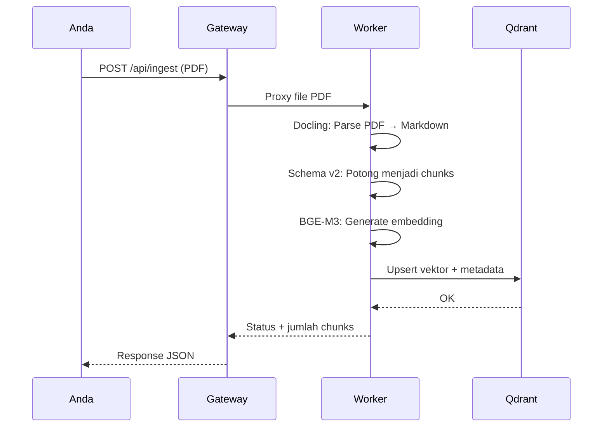
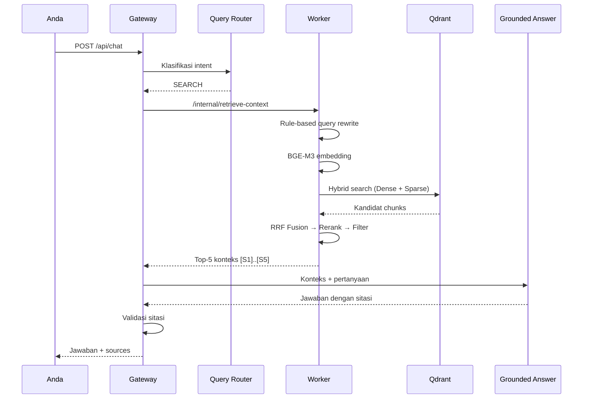

# 6.1 Tutorial: Hello RAG — Alur Kerja Terkecil

Tutorial ini memandu Anda menjalankan sistem RAG dari nol hingga mendapatkan jawaban pertama. Semua langkah bisa di-copy-paste langsung.

---

## Apa yang Akan Anda Pelajari

- Menyiapkan dan menjalankan semua service
- Mengupload PDF pertama
- Mengirim pertanyaan dan mendapat jawaban bersitasi
- Memahami apa yang terjadi di setiap langkah

---

## Prasyarat

Pastikan sudah terinstal:
- Python 3.10+ dan pip
- .NET SDK 10.0+
- Docker dan Docker Compose
- Google API Key ([dapatkan di sini](https://aistudio.google.com/))

---

## Langkah 1: Konfigurasi Secrets

### Generate internal API key:

```bash
openssl rand -hex 24
# Contoh output: 711f9fdf363c689d23b475b47ae826327ce351e1496901ee
# Simpan key ini — akan digunakan di dua tempat
```

### Buat `.env` di root project:

```bash
cp .env.example .env
```

Edit `.env` — isi dua variabel:

```env
INTERNAL_API_KEY="711f9fdf363c689d23b475b47ae826327ce351e1496901ee"
GOOGLE_API_KEY="AIzaSy..."
```

### Buat `gateway/appsettings.Development.json`:

```json
{
  "Gateway": {
    "InternalApiKey": "711f9fdf363c689d23b475b47ae826327ce351e1496901ee"
  },
  "Gemini": {
    "ApiKey": "AIzaSy..."
  }
}
```

> ⚠️ **Penting:** API key di `.env` dan `appsettings.Development.json` harus **identik**.

---

## Langkah 2: Jalankan Qdrant

```bash
docker compose up -d
```

Verifikasi:

```bash
curl -s http://localhost:6333/healthz
# Output: {"title":"qdrant - vector search engine","version":"..."}
```

✅ Qdrant berjalan di `localhost:6333` (REST) dan `localhost:6334` (gRPC).

---

## Langkah 3: Jalankan Worker

Buka **Terminal 1**:

```bash
cd worker
python3 -m venv venv && source venv/bin/activate
pip install -r requirements.txt
python3 main.py
```

Tunggu hingga muncul:

```
INFO:     Loading Shared BGE-M3 Model (GPU): BAAI/bge-m3
INFO:     Loading cross-encoder reranker: BAAI/bge-reranker-base
INFO:     Uvicorn running on http://0.0.0.0:8000
```

> **First run:** Download model ~2GB, memakan waktu beberapa menit.

✅ Worker berjalan di `localhost:8000`.

---

## Langkah 4: Jalankan Gateway

Buka **Terminal 2**:

```bash
cd gateway
export $(grep -v '^#' ../.env | xargs)
dotnet run
```

Tunggu hingga muncul:

```
info: Microsoft.Hosting.Lifetime[14]
      Now listening on: http://localhost:8080
```

✅ Gateway berjalan di `localhost:8080`.

---

## Langkah 5: Upload PDF Pertama

Siapkan file PDF apa saja. Untuk contoh ini, kita gunakan PDF bernama `dokumen.pdf`.

```bash
curl -X POST "http://localhost:8080/api/ingest" \
     -F "file=@/path/to/dokumen.pdf"
```

**Output yang diharapkan:**

```json
[
  {
    "filename": "dokumen.pdf",
    "status": "ingested",
    "chunks": 42,
    "summary": "Dokumen ini membahas tentang...",
    "doc_id": "a1b2c3d4..."
  }
]
```

**Apa yang terjadi di balik layar:**



✅ Dokumen berhasil di-ingest. Sekarang bisa ditanya!

---

## Langkah 6: Tanyakan Sesuatu

### Non-streaming (jawaban lengkap sekaligus):

```bash
curl -X POST "http://localhost:8080/api/chat" \
     -H "Content-Type: application/json" \
     -d '{"messages":[{"role":"user","content":"Apa ringkasan dokumen ini?"}]}'
```

**Output yang diharapkan:**

```json
{
  "response": "Berdasarkan dokumen, ... [S1]. Selain itu, ... [S2].",
  "sources": [
    {
      "id": "S1",
      "filename": "dokumen.pdf",
      "text": "...potongan teks asli..."
    },
    {
      "id": "S2",
      "filename": "dokumen.pdf",
      "text": "...potongan teks lain..."
    }
  ]
}
```

### Streaming (jawaban token per token):

```bash
curl -N -X POST "http://localhost:8080/api/chat/stream" \
     -H "Content-Type: application/json" \
     -d '{"messages":[{"role":"user","content":"Apa ringkasan dokumen ini?"}]}'
```

**Apa yang terjadi di balik layar:**



✅ Selamat! Anda telah menjalankan alur RAG lengkap dari nol.

---

## Langkah 7: Lihat Dokumen yang Ter-ingest

```bash
# List semua dokumen
curl -s http://localhost:8080/api/documents | python3 -m json.tool
```

---

## Langkah Berikutnya

| Topik | Dokumen |
|-------|---------|
| Memahami detail ingestion | [6.2 Contoh Ingestion](6.2-contoh-ingestion.md) |
| Memahami detail query | [6.3 Contoh Query](6.3-contoh-query.md) |
| Mengubah konfigurasi | [6.4 Kustomisasi](6.4-kustomisasi.md) |
| Menggunakan UI Streamlit | [2.2 Cara Menjalankan](../02-Application/2.2-cara-menjalankan-aplikasi.md) |

---

## Navigasi

| ← Sebelumnya | Selanjutnya → |
|:---|---:|
| [5.3 Troubleshooting](../05-Operasional/5.3-troubleshooting.md) | [6.2 Contoh Ingestion](6.2-contoh-ingestion.md) |
