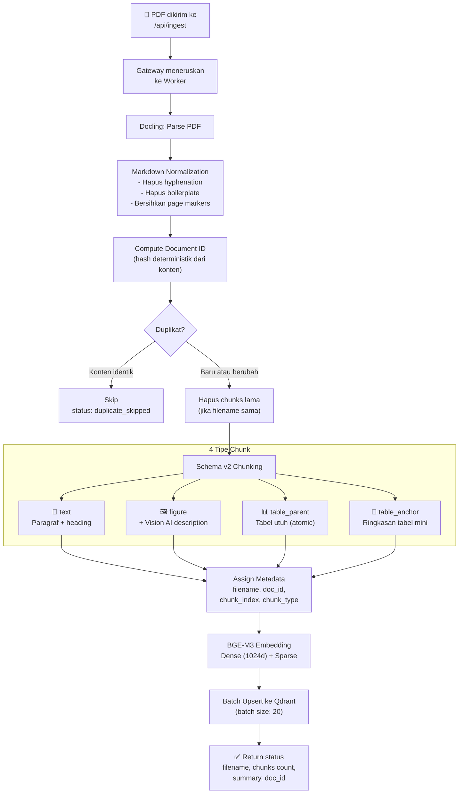

# 6.2 Tutorial: Contoh Ingestion — Dari PDF ke Vektor

Tutorial ini menjelaskan secara detail apa yang terjadi saat Anda mengupload PDF ke sistem RAG, termasuk setiap tahap proses dan output yang dihasilkan.

---

## Apa yang Akan Anda Pelajari

- Detail setiap tahap pipeline ingestion
- Apa yang disimpan di Qdrant setelah ingestion
- Cara memverifikasi bahwa ingestion berhasil
- Bagaimana re-upload dan penghapusan dokumen bekerja

---

## Alur Ingestion Lengkap



---

## Tahap Demi Tahap

### 1. Upload File

```bash
# Upload satu file
curl -X POST "http://localhost:8080/api/ingest" \
     -F "file=@laporan-keuangan-2024.pdf"

# Upload beberapa file sekaligus
curl -X POST "http://localhost:8080/api/ingest" \
     -F "file=@laporan-q1.pdf" \
     -F "file=@laporan-q2.pdf" \
     -F "file=@laporan-q3.pdf"
```

### 2. Parsing (Docling)

Docling membaca PDF dan menghasilkan Markdown terstruktur:

**Input:** File PDF dengan teks, tabel, dan gambar
**Output:** Markdown clean dengan heading hierarchy, tabel format Markdown, dan referensi gambar

Fitur parsing:
- Layout Analysis — mendeteksi judul, sub-bab, paragraf
- Table Understanding — tabel dikonversi ke format Markdown
- OCR — membaca teks dari dokumen scan (jika `ENABLE_OCR=True`)
- Header/Footer removal — nomor halaman dan header tidak masuk ke knowledge base

### 3. Chunking (Schema v2)

Dokumen dipecah menjadi chunks berdasarkan tipe konten:

| Tipe | Ukuran | Penjelasan |
|------|--------|------------|
| `text` | Max 1024 token, overlap 200 | Paragraf narasi dengan heading konteks |
| `figure` | Variabel | Gambar + deskripsi Vision AI |
| `table_parent` | Seluruh tabel | Tabel utuh, tidak pernah dipotong |
| `table_anchor` | Pendek (~100-200 kata) | Ringkasan tabel untuk pencarian, max 6 per tabel |

### 4. Embedding (BGE-M3)

Setiap chunk diubah menjadi dua jenis vektor:

- **Dense Vector** (1024 dimensi) — menangkap makna semantik
- **Sparse Vector** (variable) — menangkap kata kunci spesifik

### 5. Upsert ke Qdrant

Vektor disimpan di Qdrant dengan metadata lengkap.

**Contoh data yang disimpan per chunk:**

```json
{
  "id": "uuid-deterministik",
  "vector": {
    "dense": [0.023, -0.147, 0.891, ...],
    "sparse": {"indices": [142, 5891, ...], "values": [0.8, 0.3, ...]}
  },
  "payload": {
    "doc_id": "a1b2c3d4",
    "filename": "laporan-keuangan-2024.pdf",
    "chunk_index": 7,
    "chunk_type": "text",
    "text": "Laba bersih perusahaan meningkat 15% year-on-year...",
    "heading_context": "Bab 2: Kinerja Finansial > Analisa Profitabilitas"
  }
}
```

---

## Memverifikasi Ingestion

### Cek dokumen yang ter-ingest:

```bash
curl -s http://localhost:8080/api/documents | python3 -m json.tool
```

**Output:**

```json
[
  {
    "doc_id": "a1b2c3d4",
    "filename": "laporan-keuangan-2024.pdf",
    "chunk_count": 42,
    "chunk_types": {
      "text": 35,
      "table_parent": 4,
      "table_anchor": 3
    }
  }
]
```

### Cek detail satu dokumen:

```bash
curl -s http://localhost:8080/api/documents/a1b2c3d4 | python3 -m json.tool
```

### Lihat di Qdrant Dashboard:

Buka `http://localhost:6333/dashboard` di browser. Anda bisa melihat koleksi `pdf_rag`, jumlah poin (chunks), dan metadata tiap chunk.

---

## Re-upload dan Penghapusan

### Re-upload (update dokumen):

Upload ulang PDF dengan **nama file yang sama** — sistem otomatis menghapus chunks lama dan menggantinya:

```bash
# Versi baru dokumen yang sama
curl -X POST "http://localhost:8080/api/ingest" \
     -F "file=@laporan-keuangan-2024.pdf"
```

### Hapus satu dokumen:

```bash
# Berdasarkan doc_id
curl -X DELETE "http://localhost:8080/api/documents/a1b2c3d4"

# Berdasarkan filename
curl -X DELETE "http://localhost:8080/api/documents/by-filename?filename=laporan-keuangan-2024.pdf"
```

### Reset seluruh database:

```bash
curl -X DELETE "http://localhost:8080/api/reset"
```

> ⚠️ **Peringatan:** Reset menghapus **semua** data. Dokumen perlu di-ingest ulang.

---

## Common Pitfalls

| Masalah | Penyebab | Solusi |
|---------|----------|--------|
| Chunks = 0 | PDF kosong atau corrupt | Coba PDF lain |
| Ingestion sangat lama | PDF besar (>100 halaman) + embedding batch | Normal, tunggu. Tingkatkan timeout jika perlu |
| Tabel terpecah | Chunking schema mungkin tidak mendeteksi tabel | Pastikan `CHUNKING_SCHEMA_VERSION = 2` |
| Gambar tidak dideskripsikan | Vision AI nonaktif | Set `ENABLE_PICTURE_DESCRIPTION = True` di `config.py` |

---

## Navigasi

| ← Sebelumnya | Selanjutnya → |
|:---|---:|
| [6.1 Hello RAG](6.1-hello-rag.md) | [6.3 Contoh Query](6.3-contoh-query.md) |
