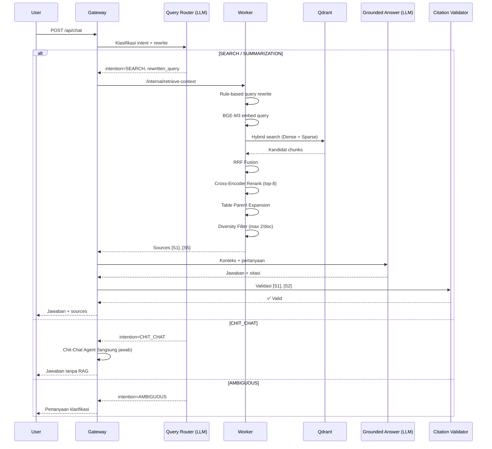

# 6.3 Tutorial: Contoh Query — Dari Pertanyaan ke Jawaban

Tutorial ini menjelaskan secara detail apa yang terjadi saat Anda mengirim pertanyaan ke sistem RAG, termasuk setiap tahap proses di Gateway dan Worker.

---

## Apa yang Akan Anda Pelajari

- Bagaimana pertanyaan diproses langkah demi langkah
- Perbedaan antara streaming dan non-streaming
- Cara membaca sumber (sources) dalam jawaban
- Apa yang terjadi saat pertanyaan tidak relevan

---

## Alur Query Lengkap



---

## Contoh 1: Pertanyaan Faktual (SEARCH)

### Request:

```bash
curl -X POST "http://localhost:8080/api/chat" \
     -H "Content-Type: application/json" \
     -d '{
       "messages": [
         {"role": "user", "content": "Apa sanksi bagi pegawai yang merokok di area kantor?"}
       ]
     }'
```

### Response:

```json
{
  "response": "Berdasarkan dokumen tata tertib, sanksi bagi pegawai yang merokok di area kantor mencakup teguran tertulis untuk pelanggaran pertama [S1], dan skorsing hingga 3 hari untuk pelanggaran berulang [S2]. Jika pelanggaran dilakukan lebih dari 3 kali dalam satu semester, dapat dikenakan pemutusan hubungan kerja [S1].",
  "sources": [
    {
      "id": "S1",
      "filename": "tata-tertib-karyawan.pdf",
      "doc_id": "abc123",
      "chunk_id": "chunk-017",
      "text": "Pasal 12 - Pelanggaran Merokok: (1) Pelanggaran pertama dikenakan teguran tertulis. (2) Pelanggaran kedua dikenakan skorsing 1-3 hari. (3) Pelanggaran ketiga atau lebih dalam satu semester dapat dikenakan PHK."
    },
    {
      "id": "S2",
      "filename": "tata-tertib-karyawan.pdf",
      "doc_id": "abc123",
      "chunk_id": "chunk-018",
      "text": "Skorsing sebagaimana dimaksud pada ayat (2) berlaku tanpa upah dan tidak dihitung sebagai cuti tahunan."
    }
  ]
}
```

### Cara Membaca Response:

- **`[S1]`, `[S2]`** di dalam jawaban merujuk ke sumber di array `sources`
- Setiap sumber memiliki `text` — potongan asli dari dokumen
- Anda bisa memverifikasi klaim dengan membaca teks asli sumbernya
- `filename` menunjukkan dokumen asal

---

## Contoh 2: Obrolan Ringan (CHIT_CHAT)

### Request:

```bash
curl -X POST "http://localhost:8080/api/chat" \
     -H "Content-Type: application/json" \
     -d '{"messages":[{"role":"user","content":"Halo, apa kabar?"}]}'
```

### Response:

```json
{
  "response": "Halo! Saya baik-baik saja, terima kasih. Ada yang bisa saya bantu terkait dokumen yang sudah diupload?",
  "sources": []
}
```

**Catatan:** Tidak ada retrieval yang dilakukan. Router mengklasifikasikan ini sebagai CHIT_CHAT dan langsung menjawab.

---

## Contoh 3: Pertanyaan Ambigu (AMBIGUOUS)

### Request:

```bash
curl -X POST "http://localhost:8080/api/chat" \
     -H "Content-Type: application/json" \
     -d '{"messages":[{"role":"user","content":"Yang itu berapa?"}]}'
```

### Response:

```json
{
  "response": "Mohon maaf, bisakah Anda memperjelas pertanyaan Anda? 'Yang itu' merujuk ke apa tepatnya? Mungkin Anda bisa menyebutkan topik atau dokumen yang dimaksud.",
  "sources": []
}
```

---

## Contoh 4: Streaming (SSE)

### Request:

```bash
curl -N -X POST "http://localhost:8080/api/chat/stream" \
     -H "Content-Type: application/json" \
     -d '{"messages":[{"role":"user","content":"Ringkas isi dokumen ini"}]}'
```

### Output SSE (event per event):

```
data: {"type":"sources","sources":[{"id":"S1","filename":"doc.pdf","text":"..."}]}

data: {"type":"delta","text":"Berdasarkan"}

data: {"type":"delta","text":" dokumen"}

data: {"type":"delta","text":", isi utamanya"}

data: {"type":"delta","text":" membahas tentang... [S1]"}

data: {"type":"done","finish_reason":"stop"}
```

### Tipe Event SSE:

| Event | Kapan Dikirim | Isi |
|-------|---------------|-----|
| `sources` | Setelah retrieval, sebelum jawaban | Metadata sumber |
| `delta` | Saat LLM menghasilkan token | Potongan teks jawaban |
| `warning` | Jika sitasi invalid terdeteksi | Peringatan validasi |
| `done` | Akhir stream | Signal selesai |

---

## Contoh 5: Follow-up Question

Sistem mendukung pertanyaan lanjutan yang merujuk konteks sebelumnya:

```bash
curl -X POST "http://localhost:8080/api/chat" \
     -H "Content-Type: application/json" \
     -d '{
       "messages": [
         {"role": "user", "content": "Apa sanksi merokok?"},
         {"role": "assistant", "content": "Sanksi merokok mencakup teguran tertulis [S1]..."},
         {"role": "user", "content": "Bagaimana dengan pelanggaran ketiga?"}
       ]
     }'
```

Router melihat riwayat chat dan memahami bahwa "pelanggaran ketiga" merujuk ke konteks "sanksi merokok" dari percakapan sebelumnya.

---

## Tips Debugging Query

| Gejala | Yang Perlu Dicek |
|--------|------------------|
| Jawaban "informasi tidak cukup" | Dokumen belum di-ingest, atau pertanyaan di luar cakupan dokumen |
| Jawaban tanpa sitasi | Mungkin diklasifikasikan sebagai CHIT_CHAT |
| Sitasi `[S1]` tapi isinya tidak relevan | Retrieval perlu tuning (lihat [6.4 Kustomisasi](6.4-kustomisasi.md)) |
| Response kosong | Cek Gateway dan Worker log untuk error |

---

## Navigasi

| ← Sebelumnya | Selanjutnya → |
|:---|---:|
| [6.2 Contoh Ingestion](6.2-contoh-ingestion.md) | [6.4 Kustomisasi](6.4-kustomisasi.md) |
