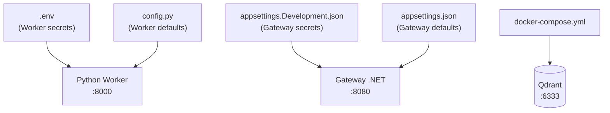

# 06 — Configuration Reference

All system configuration is managed through four files. This document provides the complete reference for every setting.



---

## Configuration Files Overview

| File | Tracked in Git? | Contains Secrets? | Used By |
|------|:---:|:---:|---------|
| `.env` | ❌ No (`.gitignore`) | ✅ Yes | Worker |
| `gateway/appsettings.Development.json` | ❌ No (`.gitignore`) | ✅ Yes | Gateway |
| `gateway/appsettings.json` | ✅ Yes | ❌ No | Gateway |
| `worker/app/core/config.py` | ✅ Yes | ❌ No | Worker |
| `docker-compose.yml` | ✅ Yes | ❌ No | Qdrant |

---

## `.env` — Worker Secrets

This file is loaded by the Python Worker on startup. Create it from `.env.example`:

```bash
cp .env.example .env
```

| Variable | Example Value | Description |
|----------|--------------|-------------|
| `GOOGLE_API_KEY` | `AIzaSy...` | Google Gemini API key |
| `INTERNAL_API_KEY` | `711f9fdf...` | Shared secret for Gateway ↔ Worker authentication |
| `QDRANT_HOST` | `localhost` | Qdrant server hostname |
| `QDRANT_PORT` | `6333` | Qdrant REST port |
| `QDRANT_API_KEY` | *(empty)* | Qdrant API key (if authentication is enabled) |
| `COLLECTION_NAME` | `pdf_rag` | Qdrant collection name |

> **Critical:** `INTERNAL_API_KEY` and `GOOGLE_API_KEY` must be identical in `.env` and `appsettings.Development.json`.

---

## `gateway/appsettings.Development.json` — Gateway Secrets

Create this file manually (it's gitignored):

```json
{
  "Gateway": {
    "InternalApiKey": "711f9fdf363c689d23b475b47ae826327ce351e1496901ee"
  },
  "Gemini": {
    "ApiKey": "AIzaSy..."
  }
}
```

---

## `gateway/appsettings.json` — Gateway Defaults

These are non-secret settings tracked in Git:

| Setting | Default | Description |
|---------|---------|-------------|
| `Gateway:WorkerBaseUrl` | `http://localhost:8000` | Worker URL |
| `Gateway:WorkerTimeoutSeconds` | `600` | Timeout for Worker calls |
| `Gateway:RouterModel` | `gemini-2.5-flash` | LLM for query routing |
| `Gateway:ChitChatModel` | `gemini-2.5-flash` | LLM for casual chat |
| `Gateway:GroundedAnswerModel` | `gemini-2.5-flash` | LLM for document answers |
| `Qdrant:Host` | `localhost` | Qdrant host for Gateway (gRPC) |
| `Qdrant:Port` | `6334` | Qdrant gRPC port |
| `Qdrant:CollectionName` | `pdf_rag` | Must match Worker's `COLLECTION_NAME` |

---

## `worker/app/core/config.py` — Worker Defaults

These settings are hardcoded in Python. Changing them requires editing the source code:

### Embedding Settings

| Parameter | Default | Description |
|-----------|---------|-------------|
| `EMBEDDING_MODEL` | `BAAI/bge-m3` | Embedding model name |
| `EMBEDDING_DEVICE` | `cpu` | `cpu` or `cuda` |
| `EMBEDDING_USE_FP16` | `False` | Half precision (enable for GPU) |
| `EMBEDDING_BATCH_SIZE` | `8` | Chunks per embedding batch |

### Chunking Settings

| Parameter | Default | Description |
|-----------|---------|-------------|
| `CHUNK_SIZE` | `1024` | Maximum tokens per chunk |
| `CHUNK_OVERLAP` | `200` | Overlap between chunks |
| `CHUNKING_SCHEMA_VERSION` | `2` | Schema version (v2 = 4 chunk types) |
| `ENABLE_TABLE_ANCHORS` | `True` | Generate table search anchors |
| `TABLE_ANCHOR_MAX_PER_TABLE` | `6` | Max anchors per table |

### Retrieval Settings

| Parameter | Default | Description |
|-----------|---------|-------------|
| `HYBRID_ALPHA` | `0.3` | Dense/Sparse balance (0=keyword, 1=semantic) |
| `DENSE_TOP_K` | `48` | Dense search candidates |
| `SPARSE_TOP_K` | `48` | Sparse search candidates |
| `RERANKER_MODEL` | `BAAI/bge-reranker-base` | Cross-encoder model |
| `RERANKER_USE_FP16` | `True` | Half precision for reranker |
| `RERANK_CANDIDATES_K` | `48` | Candidates sent to reranker |
| `RERANK_TOP_K` | `8` | Results after reranking |
| `RERANK_MIN_SCORE` | `0.001` | Minimum relevance score |
| `MAX_SOURCES` | `5` | Final sources returned |
| `MAX_SOURCES_PER_DOC` | `2` | Diversity cap per document |

### Vision AI Settings

| Parameter | Default | Description |
|-----------|---------|-------------|
| `ENABLE_PICTURE_DESCRIPTION` | `False` | Enable chart/figure description |
| `PICTURE_DESCRIPTION_MODEL` | `gemini-2.0-flash` | Vision model |
| `PICTURE_DESCRIPTION_ONLY_CHARTS` | `True` | Only describe charts (not photos) |

### Query Rewrite Settings

| Parameter | Default | Description |
|-----------|---------|-------------|
| `QUERY_REWRITE_ENABLED` | `True` | Enable query rewriting |
| `QUERY_REWRITE_MODE` | `rule` | `rule` or `llm` |
| `QUERY_REWRITE_WEIGHT` | `0.6` | Weight for rewritten query in fusion |

---

## `docker-compose.yml` — Qdrant

```yaml
services:
  qdrant:
    image: qdrant/qdrant:latest
    container_name: qdrant-rag
    ports:
      - "6333:6333"   # REST API (used by Worker)
      - "6334:6334"   # gRPC (used by Gateway)
    volumes:
      - qdrant-storage:/qdrant/storage
    restart: unless-stopped

volumes:
  qdrant-storage:
```

| Port | Protocol | Used By |
|------|---------|---------|
| 6333 | REST | Worker (Python `qdrant-client`) |
| 6334 | gRPC | Gateway (.NET `Qdrant.Client`) |

---

## Quick Reference: Generating API Keys

```bash
# Generate a secure random key for INTERNAL_API_KEY
openssl rand -hex 24
```

**Next:** [07 — Observability](07-observability.md) covers structured logging and debugging.
