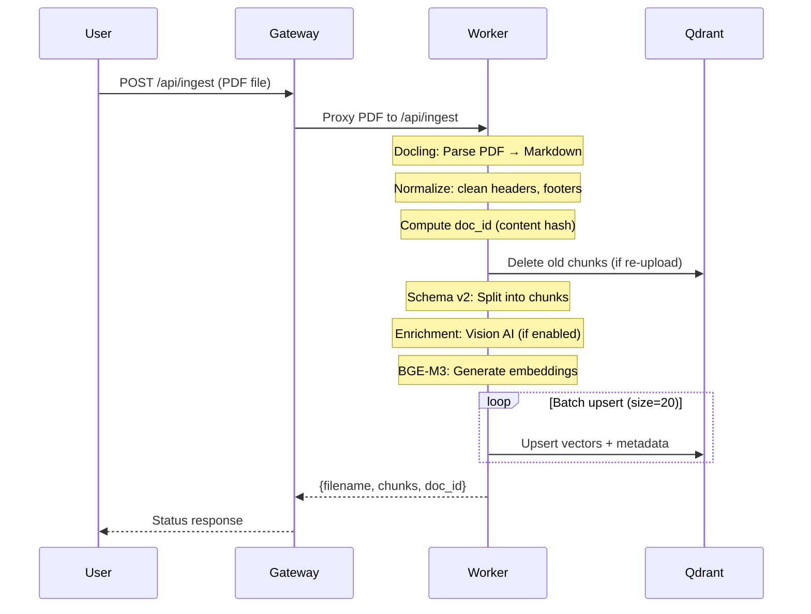
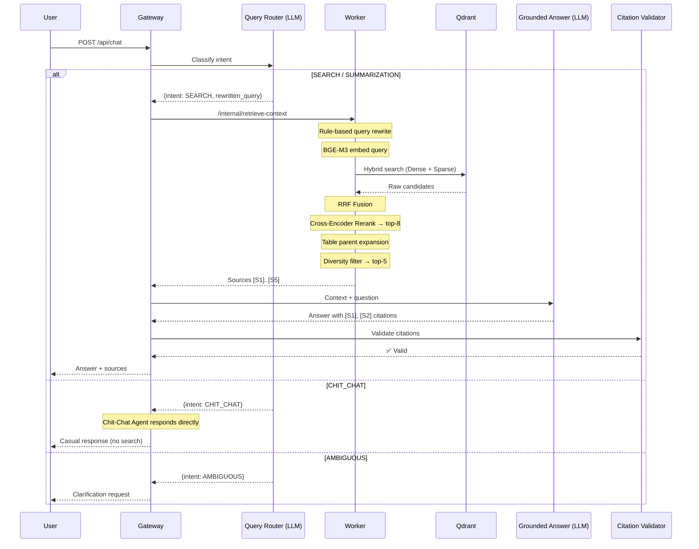

# 06 — Data Flow

This document traces the complete data flow for the two primary operations: **ingestion** (uploading a document) and **chat** (asking a question). It also covers evaluation metrics and migration history.

---

## Ingestion Flow

When a user uploads a PDF, the following sequence executes end-to-end:

### Duplicate Detection

Documents are identified by a **deterministic content hash**. Re-uploading the same content returns `status: duplicate_skipped`. Re-uploading a modified version of the same filename deletes old chunks first, then re-ingests.

---

## Chat Flow

When a user asks a question, the following sequence executes:

### Conversation History

Follow-up questions include conversation history (up to `CONVERSATION_HISTORY_MAX_MESSAGES = 8`). The Router uses this history to resolve pronouns and context:

- User: `"Apa sanksi merokok?"` → SEARCH
- User: `"Bagaimana kalau pelanggaran ketiga?"` → Router understands "pelanggaran ketiga" refers to smoking violations from the previous turn

---

## Evaluation

The system measures answer quality across three dimensions:

### Retrieval Quality

| Metric | What It Measures | Good Value |
|--------|-----------------|------------|
| **Context Precision** | Are the retrieved chunks relevant? | > 0.7 |
| **Context Recall** | Are all relevant chunks found? | > 0.6 |

### Answer Quality

| Metric | What It Measures | Good Value |
|--------|-----------------|------------|
| **Faithfulness** | Is the answer grounded in sources? | > 0.8 |
| **Answer Relevance** | Does the answer address the question? | > 0.7 |
| **Groundedness** | Word overlap between answer and sources | > 0.4 |

### Testing Approach

Evaluation uses a dataset of question-answer-context triples. Each test case specifies:
- **Question:** input query
- **Ground truth:** expected answer
- **Expected sources:** which documents should be retrieved

---

## Migration History

The system evolved from a Python monolith to the current two-service architecture:

| Version | Architecture | Key Change |
|---------|-------------|------------|
| v1 | Python monolith (Streamlit + LangChain) | Single file, basic RAG |
| v2 | Python monolith (FastAPI + LlamaIndex) | Structured pipeline, hybrid search |
| v3 (current) | Python Worker + .NET Gateway | Enterprise features: citation validation, multi-agent, Polly resilience |

### Why the Migration?

| Problem in v2 | Solution in v3 |
|---------------|----------------|
| LLM errors crash the whole app | Gateway isolates LLM concerns with retry/timeout |
| No citation validation | .NET Gateway adds regex + LLM validation loop |
| Single-provider lock-in | AgentOrchestration library supports Gemini/OpenAI/Claude |
| No structured logging | .NET structured logging + InvocationId tracing |

**Next:** [06 — Configuration Reference](07-configuration.md) documents every setting in one page.
