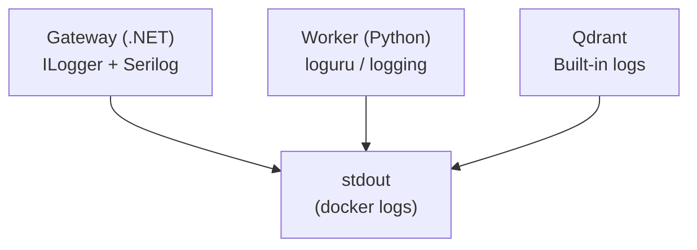

# 07 — Observability

This document covers structured logging across all three components and debugging techniques for common scenarios.

---

## Logging Architecture



All three components write structured logs to stdout, viewable via terminal or `docker logs`.

---

## Gateway Logs (.NET)

The Gateway uses ASP.NET Core's `ILogger` with structured log entries:

```
info: RagController[0]
      Chat request received { ConversationId: "abc-123", MessageLength: 42 }
info: QueryRouterAgent[0]
      Intent classified { Intent: "SEARCH", RewrittenQuery: "salary policy third violation" }
info: WorkerClient[0]
      Worker responded { Sources: 5, Duration: "1.23s" }
warn: CitationValidator[0]
      Invalid citation detected { Tag: "[S3]", Action: "repair" }
```

### Key Log Categories

| Category | What It Logs |
|----------|-------------|
| `RagController` | Incoming HTTP requests, response status |
| `QueryRouterAgent` | Intent classification results |
| `GroundedAnswerAgent` | LLM generation, token usage |
| `CitationValidator` | Validation results, repair attempts |
| `WorkerClient` | HTTP calls to Worker, timing |
| `Polly` | Retry attempts, circuit breaker state |

### Adjusting Log Level

In `appsettings.json`:

```json
{
  "Logging": {
    "LogLevel": {
      "Default": "Information",
      "Microsoft.AspNetCore": "Warning",
      "Polly": "Debug"
    }
  }
}
```

---

## Worker Logs (Python)

The Worker uses Python's `logging` module with structured output:

```
2024-01-15 10:30:45 INFO  [ingestion] Parsing PDF: financial-report.pdf (pages=42)
2024-01-15 10:31:12 INFO  [ingestion] Chunking complete: 156 chunks (text=120, table_parent=8, table_anchor=24, figure=4)
2024-01-15 10:31:45 INFO  [ingestion] Embedding complete: 156 vectors in 33.2s
2024-01-15 10:31:46 INFO  [ingestion] Upserted to Qdrant: collection=pdf_rag, points=156
```

```
2024-01-15 10:32:00 INFO  [retrieval] Query: "salary policy violations"
2024-01-15 10:32:01 INFO  [retrieval] Hybrid search: dense=48, sparse=48
2024-01-15 10:32:02 INFO  [retrieval] RRF fusion: 72 unique candidates
2024-01-15 10:32:03 INFO  [retrieval] Reranked: 8 → 5 sources (top_score=0.94)
```

### Key Log Categories

| Category | What It Logs |
|----------|-------------|
| `ingestion` | Parse progress, chunk stats, embedding timing |
| `retrieval` | Search queries, candidate counts, rerank scores |
| `config` | Loaded settings on startup |

---

## Qdrant Logs

Qdrant runs in Docker and logs to stdout:

```bash
docker logs qdrant-rag --tail 50 -f
```

Useful log entries:

| Log Pattern | Meaning |
|------------|---------|
| `Collection pdf_rag created` | New collection initialized |
| `Upsert 156 points` | Vectors stored successfully |
| `Search completed in 23ms` | Query performance |
| `Storage usage: 1.2GB` | Disk consumption |

---

## Debugging Techniques

### 1. End-to-End Request Trace

Follow a single request through all three services:

```bash
# Terminal 1: Gateway logs
cd gateway && dotnet run 2>&1 | grep -i "chat\|router\|worker\|citation"

# Terminal 2: Worker logs
cd worker && python3 main.py 2>&1 | grep -i "retrieval\|rerank\|search"

# Terminal 3: Qdrant logs
docker logs qdrant-rag --tail 20 -f
```

### 2. Health Checks

| Component | Command | Expected |
|-----------|---------|----------|
| Qdrant | `curl http://localhost:6333/healthz` | `ok` |
| Worker | `curl http://localhost:8000/health` | `{"status": "ok"}` |
| Gateway | `curl http://localhost:8080/health` | `200 OK` |

### 3. Qdrant Dashboard

Open `http://localhost:6333/dashboard` in a browser to inspect:
- Collection statistics (point count, segment count)
- Vector dimensions and index type
- Storage usage and performance metrics

---

## Key Design Decisions

| Decision | Rationale |
|----------|-----------|
| Structured logging to stdout | Cloud-native pattern, compatible with Docker, Kubernetes, CloudWatch |
| No centralized log aggregation | Keeps the system simple; add ELK/Grafana when scaling |
| Correlation via ConversationId | Trace a single user conversation across Gateway ↔ Worker |

**Next:** [08 — Reliability](08-reliability.md) covers retry, timeout, and rate limiting.
