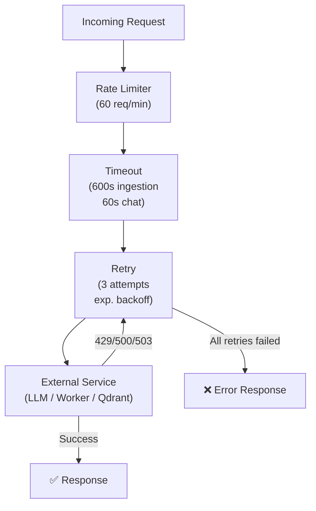
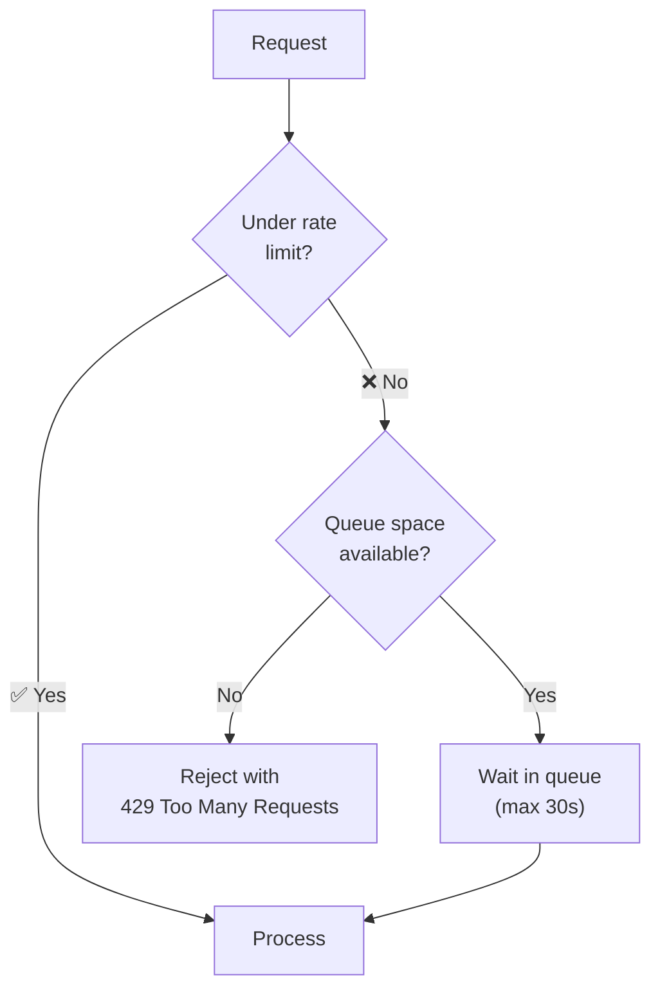

# 09 — Reliability

The Gateway implements a resilience pipeline using Polly to handle transient failures, enforce timeouts, and prevent overloading external services.

---

## Resilience Pipeline



---

## Retry Policy

The Gateway retries transient failures using exponential backoff with jitter:

### Default Settings

| Parameter | Value | Description |
|-----------|-------|-------------|
| Max retries | 3 | Total attempts before giving up |
| Initial delay | 500ms | Wait before first retry |
| Backoff multiplier | 2x | Each retry doubles the wait |
| Max delay | 30s | Upper bound on wait time |
| Jitter | ±25% | Randomization to avoid thundering herd |

### Retry Timeline Example

```
Attempt 1: immediate
  → 429 Too Many Requests

Wait: 500ms (+jitter)

Attempt 2:
  → 503 Service Unavailable

Wait: 1000ms (+jitter)

Attempt 3:
  → 200 OK ✅
```

### Retried HTTP Status Codes

| Code | Meaning | Retry? |
|------|---------|--------|
| 429 | Too Many Requests | ✅ Yes |
| 500 | Internal Server Error | ✅ Yes |
| 502 | Bad Gateway | ✅ Yes |
| 503 | Service Unavailable | ✅ Yes |
| 408 | Request Timeout | ✅ Yes |
| 400 | Bad Request | ❌ No (client error) |
| 401 | Unauthorized | ❌ No (config issue) |
| 404 | Not Found | ❌ No (wrong endpoint) |

---

## Timeout Policy

Different operations have different timeout limits:

| Operation | Timeout | Rationale |
|-----------|---------|-----------|
| Chat (query) | 60s | LLM generation is typically 2-10s |
| Ingestion | 600s (10 min) | Large PDF parsing + embedding is slow |
| Worker health check | 5s | Simple ping should be instant |

### What Happens on Timeout

1. `CancellationToken` fires
2. HTTP connection to Worker/LLM is aborted
3. Gateway returns `504 Gateway Timeout`
4. Worker/LLM call is not retried (timeout is a hard limit)

---

## Rate Limiting

Rate limiting prevents overwhelming external APIs (especially LLM providers with per-minute quotas):

### Default Settings

| Parameter | Value | Description |
|-----------|-------|-------------|
| Permits per minute | 60 | Maximum requests per minute |
| Scope | Per provider | Each LLM provider has its own limit |
| Queue size | 10 | Requests waiting when limit is reached |
| Queue timeout | 30s | Max wait time in queue |

### Rate Limit Behavior



---

## Failure Scenarios

| Scenario | Behavior |
|----------|----------|
| **Qdrant down** | Gateway returns 503, retries 3 times, then reports "service unavailable" |
| **Worker down** | Gateway returns 502, retries 3 times, then reports "worker unreachable" |
| **LLM API rate limited** | Gateway queues request (up to 30s), then retries with backoff |
| **LLM API outage** | Gateway retries 3 times, then returns error with diagnostic message |
| **Large PDF timeout** | Worker continues processing; next upload attempt skips (duplicate detection) |

---

## Circuit Breaker (Future)

The system is designed to support circuit breaker patterns but does not currently implement them. When a provider consistently fails, the circuit breaker would:
1. **Closed** → Normal operation, all requests pass through
2. **Open** → Provider is down, fail fast without calling
3. **Half-Open** → Allow one test request to check recovery

---

## Key Design Decisions

| Decision | Rationale |
|----------|-----------|
| Polly for resilience | .NET standard library, battle-tested, supports all patterns |
| Exponential backoff with jitter | Prevents thundering herd after provider recovery |
| Separate timeouts per operation | Ingestion needs 10 minutes; chat should fail fast at 60s |
| Per-provider rate limiting | Different LLM APIs have different quotas |
| No circuit breaker yet | Single-provider setup doesn't benefit; add when multi-provider |

**Next:** [09 — Troubleshooting](10-troubleshooting.md) provides symptom-based diagnosis and solutions.
