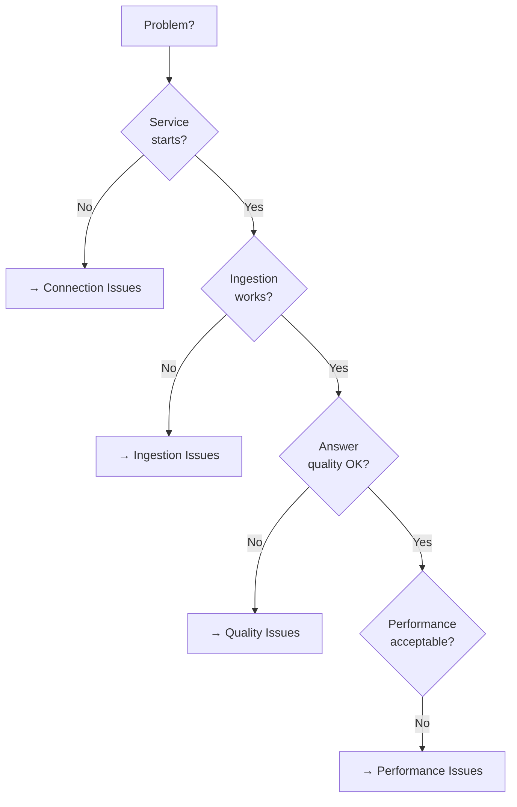

# 09 — Troubleshooting

This document provides symptom-based diagnosis and solutions for common issues. Follow the decision tree, then jump to the relevant section.

---

## Decision Tree



---

## Connection Issues

### Problem: Qdrant refuses connection

**Symptoms:** `Connection refused on port 6333` or `Failed to connect to Qdrant`

**Diagnosis:**

```bash
# 1. Check if Qdrant container is running
docker ps | grep qdrant

# 2. Check container logs
docker logs qdrant-rag --tail 20

# 3. Verify ports
curl http://localhost:6333/healthz
```

**Solutions:**

| Cause | Fix |
|-------|-----|
| Container not running | `docker compose up -d` |
| Port conflict | `docker ps -a` to find conflicts; change ports in `docker-compose.yml` |
| Volume permissions | `docker compose down -v && docker compose up -d` (⚠️ deletes data) |

### Problem: Gateway cannot reach Worker

**Symptoms:** `502 Bad Gateway` or `WorkerClient: Connection refused`

**Diagnosis:**

```bash
# Check Worker is running
curl http://localhost:8000/health

# Check Gateway config
grep "WorkerBaseUrl" gateway/appsettings.json
```

**Solutions:**

| Cause | Fix |
|-------|-----|
| Worker not started | `cd worker && python3 main.py` |
| Wrong URL | Verify `WorkerBaseUrl` in `appsettings.json` is `http://localhost:8000` |
| API key mismatch | Ensure `INTERNAL_API_KEY` in `.env` matches `Gateway:InternalApiKey` in `appsettings.Development.json` |

### Problem: Gateway fails with "Unauthorized"

**Symptoms:** `401 Unauthorized` on Worker calls

**Solution:** The `INTERNAL_API_KEY` values must be identical in both files:

```bash
# Check .env
grep INTERNAL_API_KEY .env

# Check appsettings.Development.json
grep InternalApiKey gateway/appsettings.Development.json
```

Make sure `export $(grep -v '^#' ../.env | xargs)` is run before `dotnet run`.

---

## Ingestion Issues

### Problem: PDF upload returns error

**Symptoms:** `500 Internal Server Error` on `/api/ingest`

**Diagnosis:**

```bash
# Check Worker logs for parsing errors
# Look for: "Error parsing PDF" or "Docling failed"
```

**Solutions:**

| Cause | Fix |
|-------|-----|
| Corrupt PDF | Try a different PDF file |
| PDF is scanned (image-only) | Enable OCR: set `ENABLE_OCR=True` in `config.py` |
| Out of memory | Reduce PDF size, or increase system RAM |
| Docling timeout | Large PDFs (>100 pages) take longer; check Worker hasn't crashed |

### Problem: Zero chunks produced

**Symptoms:** Ingestion succeeds but `chunks: 0` in response

**Solutions:**

| Cause | Fix |
|-------|-----|
| PDF is password-protected | Remove password protection first |
| PDF contains only images | Enable `ENABLE_OCR=True` |
| PDF is empty or corrupt | Verify with `pdfinfo filename.pdf` |

---

## Quality Issues

### Problem: Answer says "information not available" despite relevant documents being ingested

**Diagnosis:**

1. **Check if documents are in Qdrant:**
   ```bash
   curl http://localhost:6333/collections/pdf_rag | python3 -m json.tool
   # Look for "points_count" > 0
   ```

2. **Check retrieval directly:**
   Review Worker logs for the search query and candidate scores

**Solutions:**

| Cause | Fix |
|-------|-----|
| Zero points in collection | Re-ingest the document |
| Wrong collection name | Ensure `COLLECTION_NAME` matches in Worker and Gateway |
| Query too vague | Ask more specific questions |
| Alpha too extreme | Adjust `HYBRID_ALPHA` (default 0.3 is usually good) |

### Problem: Answer contains wrong citations

**Symptoms:** `[S2]` points to irrelevant content

**Diagnosis:** This means citation validation passed but the source itself was irrelevant (retrieval issue, not generation issue).

**Solutions:**

| Cause | Fix |
|-------|-----|
| Poor retrieval quality | Increase `RERANK_TOP_K` or lower `RERANK_MIN_SCORE` |
| Document not chunked well | Re-ingest with different `CHUNK_SIZE` |
| Too many sources from one doc | Lower `MAX_SOURCES_PER_DOC` |

### Problem: Answer is hallucinated (no citations at all)

**Solutions:**

| Cause | Fix |
|-------|-----|
| Citation validation disabled | Ensure `CitationValidator` is enabled in Gateway |
| LLM ignoring system prompt | Try a different model (Gemini Flash is usually reliable) |

---

## Performance Issues

### Problem: Ingestion is very slow

**Expected performance:**

| Document Size | Expected Time |
|--------------|---------------|
| 10 pages | 30s - 2 min |
| 50 pages | 2 - 5 min |
| 200 pages | 5 - 15 min |

**Solutions:**

| Cause | Fix |
|-------|-----|
| Vision AI enabled | Disable `ENABLE_PICTURE_DESCRIPTION` unless needed |
| CPU-only embedding | Set `EMBEDDING_DEVICE=cuda` if GPU available |
| Large tables | Each table generates up to 6 anchors — normal behavior |

### Problem: Chat responses are slow

**Expected performance:**

| Phase | Expected Time |
|-------|--------------|
| Routing | 0.5 - 1.5s |
| Retrieval | 0.5 - 2s |
| Generation | 1 - 5s |
| Total | 2 - 8s |

**Solutions:**

| Cause | Fix |
|-------|-----|
| LLM model too large | Switch to `gemini-2.0-flash` (fastest) |
| Too many candidates | Reduce `RERANK_CANDIDATES_K` |
| Network latency | Ensure Qdrant is on localhost |

---

## Reset Procedures

### Reset Qdrant Collection (Delete All Documents)

```bash
curl -X DELETE http://localhost:8080/api/reset
```

### Reset Qdrant Completely (Fresh Start)

```bash
docker compose down -v
docker compose up -d
```

⚠️ **Warning:** This deletes all data. You'll need to re-ingest all documents.

### Reset Gateway State

```bash
cd gateway
dotnet clean
dotnet run
```

---

## Key Design Decisions

| Decision | Rationale |
|----------|-----------|
| Decision tree approach | Users diagnose symptoms, not root causes |
| Health check endpoints | Quick automated verification of each component |
| Separate ingestion/query troubleshooting | Different failure modes, different solutions |

**Next:** [10 — Example: Hello RAG](10-example-hello-rag.md) walks through the smallest working flow from zero.
