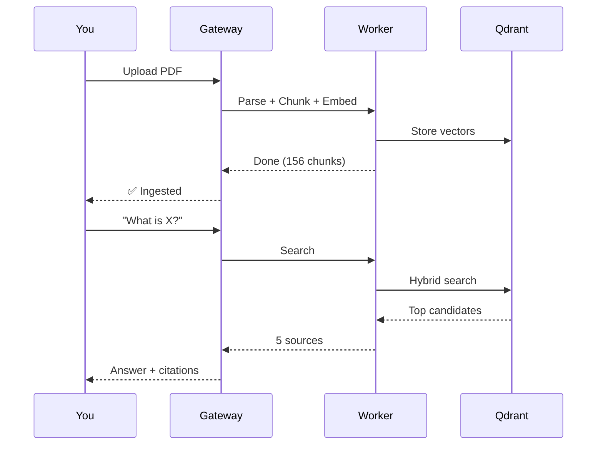

# 11 — Example: Hello RAG

The smallest working flow — from zero to your first AI-generated, document-grounded answer.

---

## What We're Building



---

## Prerequisites

| Requirement | Check Command |
|------------|---------------|
| Python 3.10+ | `python3 --version` |
| .NET SDK 10.0+ | `dotnet --version` |
| Docker | `docker --version` |
| Google API Key | [console.cloud.google.com](https://console.cloud.google.com) |

---

## Step 1 — Clone and Configure

```bash
git clone <your-repo-url> rag-system
cd rag-system

# Generate internal API key
openssl rand -hex 24
# Example output: 711f9fdf363c689d23b475b47ae826327ce351e1496901ee
```

Create `.env`:

```env
GOOGLE_API_KEY="AIzaSy..."
INTERNAL_API_KEY="711f9fdf363c689d23b475b47ae826327ce351e1496901ee"
QDRANT_HOST="localhost"
QDRANT_PORT="6333"
COLLECTION_NAME="pdf_rag"
```

Create `gateway/appsettings.Development.json`:

```json
{
  "Gateway": {
    "InternalApiKey": "711f9fdf363c689d23b475b47ae826327ce351e1496901ee"
  },
  "Gemini": {
    "ApiKey": "AIzaSy..."
  }
}
```

---

## Step 2 — Start All Services

```bash
# Terminal 1: Qdrant
docker compose up -d
curl http://localhost:6333/healthz  # → "ok"

# Terminal 2: Worker
cd worker
python3 -m venv venv && source venv/bin/activate
pip install -r requirements.txt
python3 main.py
# Wait for: "Uvicorn running on http://0.0.0.0:8000"

# Terminal 3: Gateway
cd gateway
export $(grep -v '^#' ../.env | xargs)
dotnet run
# Wait for: "Now listening on: http://localhost:8080"
```

---

## Step 3 — Upload a PDF

```bash
curl -X POST http://localhost:8080/api/ingest \
  -F "files=@/path/to/your/document.pdf"
```

**Expected response:**

```json
{
  "results": [
    {
      "filename": "document.pdf",
      "status": "success",
      "chunks": 156,
      "doc_id": "a1b2c3d4-e5f6-..."
    }
  ]
}
```

---

## Step 4 — Ask a Question

```bash
curl -X POST http://localhost:8080/api/chat \
  -H "Content-Type: application/json" \
  -d '{"message": "What does the document say about financial performance?"}'
```

**Expected response:**

```json
{
  "answer": "According to the document, net profit increased by 15% year-on-year [S1]. Revenue grew to $2.3 billion, driven primarily by the Asia-Pacific region [S2].",
  "sources": [
    {"id": "S1", "filename": "document.pdf", "text": "Net profit increased 15%..."},
    {"id": "S2", "filename": "document.pdf", "text": "Revenue reached $2.3 billion..."}
  ]
}
```

---

## Step 5 — Verify

Check that the system is working end-to-end:

| Check | Command | Expected |
|-------|---------|----------|
| Documents ingested | `curl http://localhost:8080/api/documents` | List of documents |
| Qdrant has vectors | `curl http://localhost:6333/collections/pdf_rag` | `points_count > 0` |
| Chat works | Send a question via curl | Answer with `[S1]` citations |

---

## What Happened Behind the Scenes

| Phase | Component | Action |
|-------|-----------|--------|
| **Parse** | Worker (Docling) | PDF → structured Markdown |
| **Chunk** | Worker (Schema v2) | Markdown → 156 typed chunks |
| **Embed** | Worker (BGE-M3) | Chunks → Dense + Sparse vectors |
| **Store** | Qdrant | Vectors + metadata stored |
| **Route** | Gateway (Router Agent) | Classified as `SEARCH` |
| **Search** | Worker → Qdrant | Hybrid search → 48 candidates |
| **Rerank** | Worker (Cross-Encoder) | 48 → 5 top sources |
| **Generate** | Gateway (Grounded Agent) | Sources + question → cited answer |
| **Validate** | Gateway (Citation Validator) | Verified all `[Sx]` tags are valid |

---

## Key Takeaways

| Concept | What You Learned |
|---------|-----------------|
| **Two-service architecture** | Gateway handles LLM; Worker handles ML + search |
| **Config-driven** | API keys in `.env` and `appsettings.Development.json` |
| **End-to-end flow** | Upload → Parse → Chunk → Embed → Search → Generate → Validate |
| **Citations** | Every factual claim is backed by a source `[Sx]` |

**Next:** [11 — Example: Ingestion](12-example-ingestion.md) dives deeper into the ingestion process.
