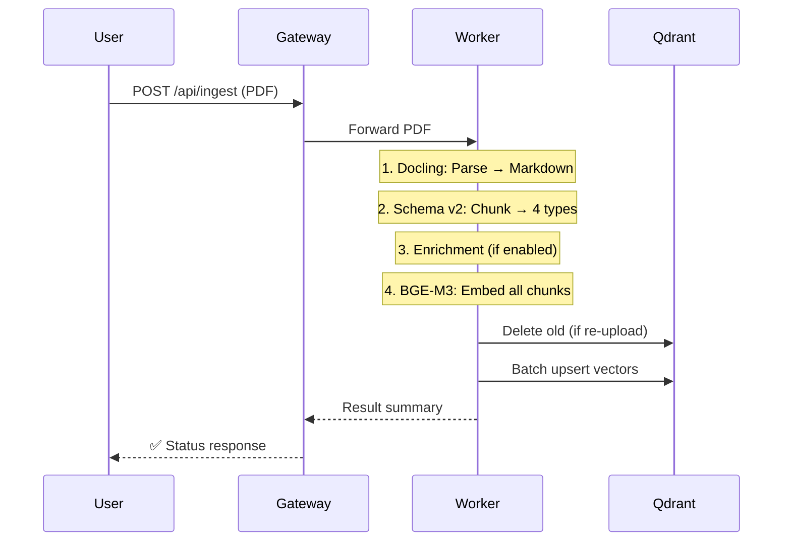

# 12 — Example: Ingestion Walkthrough

A detailed look at what happens when a PDF is uploaded and processed. This example traces the ingestion pipeline step by step.

---

## What We're Building



---

## Step 1 — Upload

Upload a PDF via curl:

```bash
curl -X POST http://localhost:8080/api/ingest \
  -F "files=@financial-report.pdf"
```

What happens internally:
1. Gateway receives the multipart form upload
2. Gateway forwards the file to Worker at `POST /api/ingest`
3. Worker takes over for all ML-intensive processing

---

## Step 2 — Parsing (Docling)

The Worker passes the PDF through Docling:

**Input:** `financial-report.pdf` (42 pages)

**Output:** Structured Markdown with document hierarchy:

```markdown
# Chapter 1: Executive Summary

Net profit increased 15% year-on-year...

## 1.1 Revenue Breakdown

| Region      | Revenue  | Growth |
|------------|----------|--------|
| Asia-Pacific| $1.2B   | +22%   |
| Europe      | $800M   | +8%    |


```

**Worker log:**

```
INFO [ingestion] Parsing PDF: financial-report.pdf (pages=42)
INFO [ingestion] Parse completed in 12.4s → 15,234 tokens
```

---

## Step 3 — Chunking (Schema v2)

The Markdown is classified and split into typed chunks:

**Output breakdown:**

| Chunk Type | Count | Example |
|-----------|-------|---------|
| `text` | 120 | Paragraphs with heading context |
| `table_parent` | 8 | Full tables (never split) |
| `table_anchor` | 24 | 3 anchors per table average |
| `figure` | 4 | Chart descriptions |
| **Total** | **156** | |

**Worker log:**

```
INFO [ingestion] Chunking: 156 chunks (text=120, table_parent=8, table_anchor=24, figure=4)
```

---

## Step 4 — Embedding (BGE-M3)

Each chunk is converted to Dense (1024d) + Sparse vectors:

**Worker log:**

```
INFO [ingestion] Embedding: 156 chunks in 8 batches
INFO [ingestion] Batch 1/8: 20 chunks → 1.2s
...
INFO [ingestion] Embedding complete: 156 vectors in 9.8s
```

---

## Step 5 — Storage (Qdrant)

Vectors are upserted in batches of 20:

**Worker log:**

```
INFO [ingestion] Upsert batch 1/8: 20 points
...
INFO [ingestion] Upserted 156 points to collection pdf_rag
```

---

## Step 6 — Verify

```bash
# Check document count
curl http://localhost:8080/api/documents
```

```json
[
  {
    "doc_id": "a1b2c3d4",
    "filename": "financial-report.pdf",
    "chunk_count": 156,
    "ingested_at": "2024-01-15T10:32:00Z"
  }
]
```

```bash
# Check Qdrant directly
curl http://localhost:6333/collections/pdf_rag | python3 -m json.tool
```

---

## Re-Upload Behavior

| Scenario | Behavior |
|----------|----------|
| Same file, same content | `status: duplicate_skipped` — no re-processing |
| Same filename, different content | Old chunks deleted → new chunks ingested |
| Different filename | Added alongside existing documents |

### Deleting a Document

```bash
# By document ID
curl -X DELETE http://localhost:8080/api/documents/a1b2c3d4

# By filename
curl -X DELETE "http://localhost:8080/api/documents/by-filename?filename=financial-report.pdf"

# Delete everything
curl -X DELETE http://localhost:8080/api/reset
```

---

## Key Takeaways

| Concept | What You Learned |
|---------|-----------------|
| **Four chunk types** | text, figure, table_parent, table_anchor |
| **Deterministic IDs** | Content hash enables duplicate detection |
| **Batch processing** | Embedding and upsert run in batches of 20 |
| **Idempotent re-upload** | Same content = skip; modified content = replace |

**Next:** [12 — Example: Query](13-example-query.md) traces a question through the retrieval pipeline.
