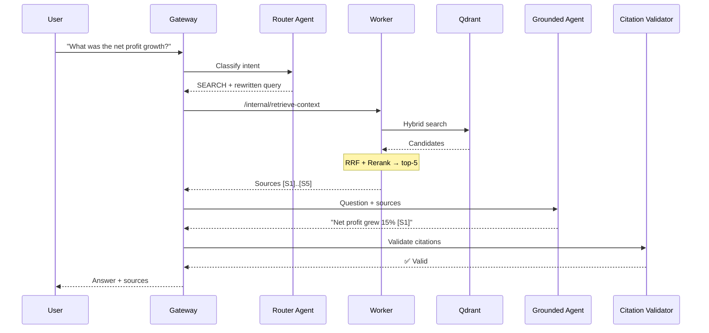

# 12 — Example: Query Walkthrough

A detailed look at what happens when a user asks a question. This example traces the retrieval and generation pipeline for different intent types.

---

## Scenario 1: Document Search (SEARCH)

**User asks:** `"What was the net profit growth?"`



### Phase 1: Routing

The Router Agent classifies the intent:

```json
{
  "intention": "SEARCH",
  "rewritten_query": "net profit growth rate year-on-year financial performance",
  "reasoning": "Factual financial question requiring document search"
}
```

### Phase 2: Retrieval

The Worker executes:
1. **Query embedding** — BGE-M3 converts the query to vectors
2. **Hybrid search** — Dense + Sparse across Qdrant
3. **RRF fusion** — Merges results from original + rewritten queries
4. **Reranking** — Cross-Encoder scores top-48 → top-5

### Phase 3: Generation

The Grounded Answer Agent receives:

```
Sources:
[S1] "Net profit increased 15% year-on-year to $340M..."
[S2] "Revenue grew to $2.3 billion, driven by Asia-Pacific..."
[S3] "Operating margin improved from 12% to 14.5%..."
[S4] "R&D spending increased 8% to support new product lines..."
[S5] "Dividend payout ratio maintained at 40%..."

Question: "What was the net profit growth?"
```

**Answer output:**

> Net profit grew 15% year-on-year, reaching $340 million [S1]. This was supported by revenue growth to $2.3 billion, primarily driven by the Asia-Pacific region [S2], and an improved operating margin of 14.5% [S3].

### Phase 4: Citation Validation

The validator checks:
- `[S1]` → "net profit...15%..." ✅ found in source S1
- `[S2]` → "revenue...$2.3 billion...Asia-Pacific" ✅ found in source S2
- `[S3]` → "operating margin...14.5%" ✅ found in source S3

All citations valid → send to user.

---

## Scenario 2: Casual Chat (CHIT_CHAT)

**User asks:** `"Hello, how are you?"`

```json
{
  "intention": "CHIT_CHAT",
  "reasoning": "Greeting — no document search needed"
}
```

**Behavior:** The Chit-Chat Agent responds directly with a friendly greeting. No retrieval pipeline is invoked.

---

## Scenario 3: Ambiguous Query (AMBIGUOUS)

**User asks:** `"How about that one?"`

```json
{
  "intention": "AMBIGUOUS",
  "reasoning": "Cannot determine what 'that one' refers to without context"
}
```

**Behavior:** The system asks for clarification:

> Could you please be more specific? For example, are you asking about a particular document, policy, or financial metric?

---

## Scenario 4: Follow-Up Question

**Turn 1:** `"What is the smoking policy?"` → SEARCH → full retrieval

**Turn 2:** `"What's the penalty for a third offense?"`

The Router uses conversation history to resolve "third offense":

```json
{
  "intention": "SEARCH",
  "rewritten_query": "penalty for third offense smoking violation company policy",
  "reasoning": "Follow-up about smoking policy from previous turn"
}
```

---

## Streaming Example

For real-time responses, use the streaming endpoint:

```bash
curl -X POST http://localhost:8080/api/chat/stream \
  -H "Content-Type: application/json" \
  -d '{"message": "What was the net profit growth?"}' \
  --no-buffer
```

**SSE output:**

```
data: {"type":"sources","sources":[{"id":"S1","text":"Net profit..."}]}

data: {"type":"delta","content":"Net "}
data: {"type":"delta","content":"profit "}
data: {"type":"delta","content":"grew "}
data: {"type":"delta","content":"15% "}
...
data: {"type":"done","tokens":{"input":1200,"output":85}}
```

---

## Key Takeaways

| Concept | What You Learned |
|---------|-----------------|
| **Four intent types** | SEARCH, SUMMARIZATION, CHIT_CHAT, AMBIGUOUS |
| **Context-aware routing** | Conversation history resolves vague references |
| **Citation validation** | Every `[Sx]` tag is verified against source text |
| **Streaming** | Sources arrive first, then answer tokens stream in real-time |

**Next:** [13 — Example: Customization](13-example-customization.md) shows how to tune the system.
