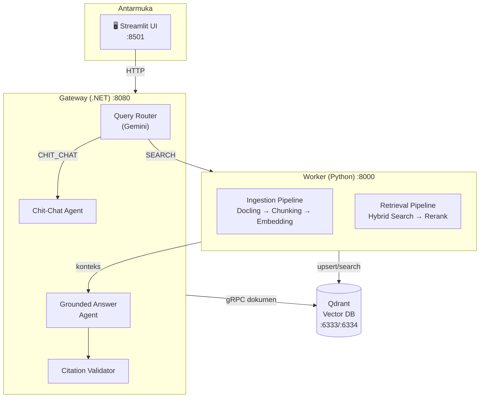

# 📚 Dokumentasi RAG System

Selamat datang di dokumentasi **RAG System** — sistem tanya-jawab cerdas berbasis dokumen yang menggabungkan kekuatan pencarian (Retrieval) dengan generasi teks AI (Generation) untuk memberikan jawaban akurat bersumber dari dokumen Anda.

---

## Apa yang Akan Anda Pelajari

Dokumentasi ini dirancang untuk pembaca yang **belum pernah** mengenal RAG, LLM, Python, atau .NET sekalipun. Setelah membaca dari awal hingga akhir, Anda akan mampu:

1. Menjelaskan **apa itu RAG** dan mengapa teknologi ini penting
2. Memahami **komponen-komponen** sistem dan peran masing-masing
3. Menelusuri **alur data** dari upload PDF → pencarian → jawaban
4. **Menjalankan** dan **mengkonfigurasi** sistem secara mandiri
5. **Mendiagnosis** masalah umum yang sering terjadi

---

## Arsitektur Sistem

---

## Peta Bacaan (Reading Path)

Ikuti urutan berikut untuk pemahaman terbaik:

### 🟢 Mulai di Sini — Konsep Dasar

| # | Dokumen | Deskripsi |
|---|---------|-----------|
| 0.1 | [Konsep Dasar LLM](00-Introduction/0.1-konsep-dasar-llm.md) | Apa itu LLM, cara kerjanya, dan kelemahannya |
| 0.2 | [Konsep Dasar RAG](00-Introduction/0.2-konsep-dasar-rag.md) | Apa itu RAG, tiga pilar utama: Ingestion → Retrieval → Generation |
| 0.3 | [Glosarium](00-Introduction/0.3-glosarium.md) | Kamus istilah teknis — rujuk kapan saja |

### 🔧 Komponen Teknis — Mendalami Alat dan Mesin

#### Alat Ingestion (Memasukkan Data)

| # | Dokumen | Deskripsi |
|---|---------|-----------|
| 1.1.1 | [Parser: Docling](01-Komponen-Teknis/1.1-Alat-Ingestion/1.1.1-parser-docling.md) | Mengubah PDF menjadi teks terstruktur |
| 1.1.2 | [Chunking: Schema v2](01-Komponen-Teknis/1.1-Alat-Ingestion/1.1.2-chunking-schema.md) | Memecah dokumen menjadi potongan cerdas |
| 1.1.3 | [Enrichment: Vision AI](01-Komponen-Teknis/1.1-Alat-Ingestion/1.1.3-enrichment-vision-ai.md) | Memperkaya chunk dengan deskripsi gambar dan konteks |
| 1.1.4 | [Embedding: BGE-M3](01-Komponen-Teknis/1.1-Alat-Ingestion/1.1.4-embedding-bge-m3.md) | Mengubah teks menjadi vektor pencarian |
| 1.1.5 | [Database: Qdrant](01-Komponen-Teknis/1.1-Alat-Ingestion/1.1.5-database-qdrant.md) | Menyimpan vektor untuk pencarian cepat |

#### Alat Retrieval (Mencari Data)

| # | Dokumen | Deskripsi |
|---|---------|-----------|
| 1.2.1 | [Query Router](01-Komponen-Teknis/1.2-Alat-Retrieval/1.2.1-intelligent-query-router.md) | Resepsionis AI yang mengklasifikasikan pertanyaan |
| 1.2.2 | [Orchestrator & RRF Fusion](01-Komponen-Teknis/1.2-Alat-Retrieval/1.2.2-orchestrator-dan-fusion.md) | Pencarian paralel dan peleburan ranking |
| 1.2.3 | [Cross-Encoder Reranker](01-Komponen-Teknis/1.2-Alat-Retrieval/1.2.3-reranker-cross-encoder.md) | Juri penilai akhir untuk kualitas hasil |

#### Alat Generation (Menjawab)

| # | Dokumen | Deskripsi |
|---|---------|-----------|
| 1.3.1 | [Multi-Agent Pipeline](01-Komponen-Teknis/1.3-Alat-Generation/1.3.1-multi-agent-pipeline.md) | 3 agen LLM bekerja sama menjawab |
| 1.3.2 | [Citation Validation](01-Komponen-Teknis/1.3-Alat-Generation/1.3.2-citation-validation.md) | Memastikan setiap klaim didukung sumber |

### 💻 Aplikasi — Menjalankan dan Memahami

| # | Dokumen | Deskripsi |
|---|---------|-----------|
| 2.1 | [Gambaran Umum Aplikasi](02-Application/2.1-gambaran-umum-aplikasi.md) | Arsitektur 2-service dan komponen utama |
| 2.2 | [Cara Menjalankan Aplikasi](02-Application/2.2-cara-menjalankan-aplikasi.md) | Setup, konfigurasi, dan menjalankan |
| 2.3 | [Alur Ingestion dan Chat](02-Application/2.3-alur-ingestion-dan-chat.md) | Detail teknis proses upload dan tanya-jawab |
| 2.4 | [Tur Kode dan Arsitektur](02-Application/2.4-tur-kode-dan-arsitektur.md) | Eksplorasi struktur kode dan modul |
| 2.5 | [Evaluasi dan Testing](02-Application/2.5-evaluasi-dan-testing.md) | Menguji dan mengukur kualitas RAG |

### 📋 Migrasi

| # | Dokumen | Deskripsi |
|---|---------|-----------|
| 3.1 | [Riwayat Migrasi](03-Migrasi/3.1-riwayat-migrasi.md) | Evolusi dari Python Monolith ke Enterprise System |

### ⚙️ Konfigurasi

| # | Dokumen | Deskripsi |
|---|---------|-----------|
| 4.1 | [Referensi Konfigurasi](04-Konfigurasi/4.1-referensi-konfigurasi.md) | Semua setting dalam satu halaman |

### 🔍 Operasional

| # | Dokumen | Deskripsi |
|---|---------|-----------|
| 5.1 | [Observability](05-Operasional/5.1-observability.md) | Logging dan cara membaca log |
| 5.2 | [Reliability](05-Operasional/5.2-reliability.md) | Retry, timeout, dan rate limiting |
| 5.3 | [Troubleshooting](05-Operasional/5.3-troubleshooting.md) | Diagnosis dan solusi masalah umum |

### 🎓 Tutorial

| # | Dokumen | Deskripsi |
|---|---------|-----------|
| 6.1 | [Hello RAG](06-Tutorial/6.1-hello-rag.md) | Alur kerja terkecil dari nol |
| 6.2 | [Contoh Ingestion](06-Tutorial/6.2-contoh-ingestion.md) | Walkthrough upload dan proses PDF |
| 6.3 | [Contoh Query](06-Tutorial/6.3-contoh-query.md) | Walkthrough tanya-jawab lengkap |
| 6.4 | [Kustomisasi](06-Tutorial/6.4-kustomisasi.md) | Tukar model, ubah chunk size, atur retrieval |

---

## Prasyarat

Untuk menjalankan sistem ini, Anda memerlukan:

| Software | Versi | Keterangan |
|----------|-------|------------|
| Python | 3.10+ | Runtime Worker |
| .NET SDK | 10.0+ | Runtime Gateway |
| Docker | Terbaru | Untuk Qdrant |
| Google API Key | - | Untuk Gemini LLM |

> **Baru pertama kali?** Mulai dari [Konsep Dasar LLM](00-Introduction/0.1-konsep-dasar-llm.md), lalu ikuti peta bacaan di atas secara berurutan.

> **Ingin langsung coba?** Lompat ke [Hello RAG](06-Tutorial/6.1-hello-rag.md) untuk panduan praktis langkah demi langkah.
